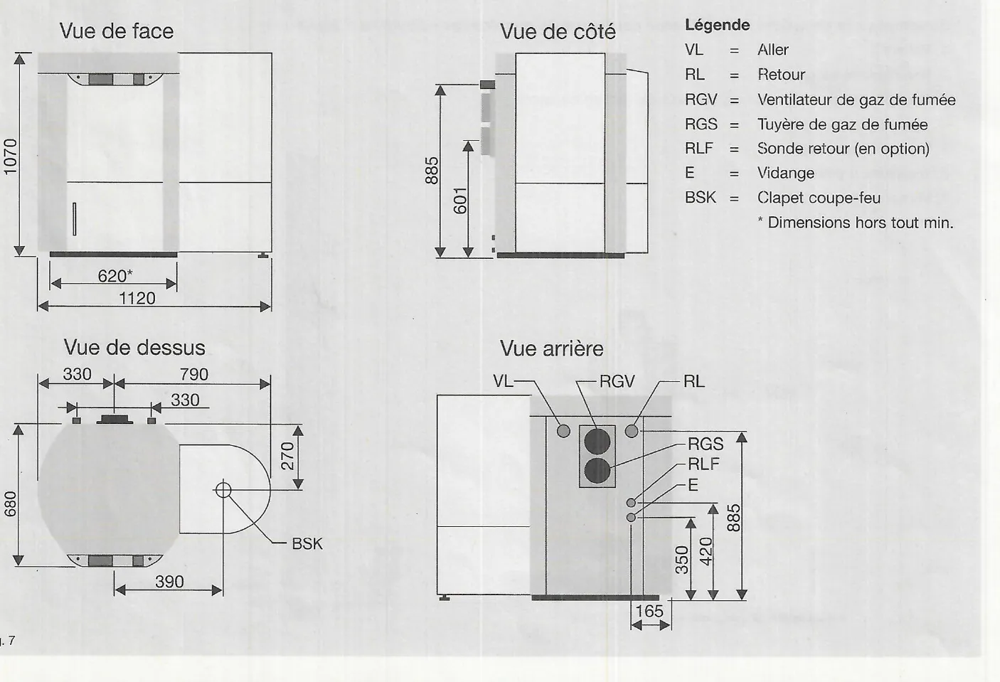
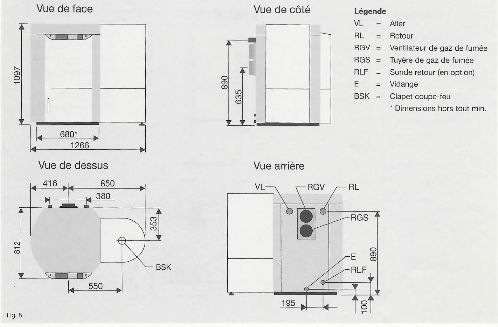
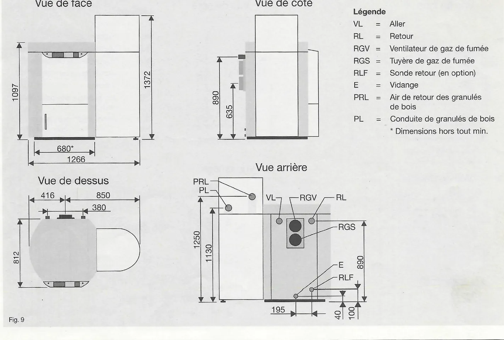
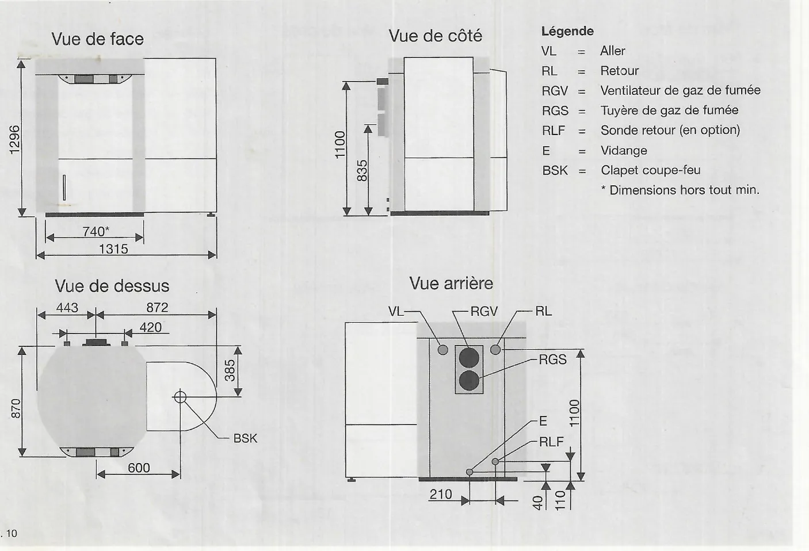
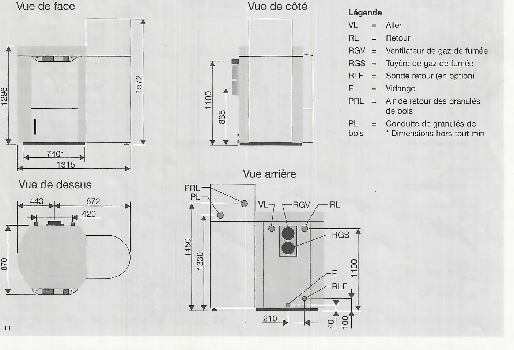

# Dimensions et données techniques

### 5.7 Fiche des dimensions Pelletti II Mini – Système de vis sans fin

Légende :

- VL = Aller
- RL = Retour
- RGV = Ventilateur de gaz de fumée
- RGS = Tuyère de gaz de fumée
- RLF = Sonde retour (en option)
- E = Vidange
- BSK = Clapet coupe-feu
- \* Dimensions hors tout min.

Cotes (mm) : vue de face hauteur 1070, largeur 620\* (chaudière) et 1120
(hors tout) ; vue de côté 885 et 601 ; vue de dessus 330, 790, 330, 680,
270, 390 ; vue arrière 885, 420, 350, 165.

<small>Source : THF1849 p. 10</small>

### 5.8 Fiche des dimensions Pelletti II 103 … 203 – Système de vis sans fin

Légende : VL = Aller ; RL = Retour ; RGV = Ventilateur de gaz de fumée ;
RGS = Tuyère de gaz de fumée ; RLF = Sonde retour (en option) ;
E = Vidange ; BSK = Clapet coupe-feu ; \* Dimensions hors tout min.

Cotes (mm) : vue de face hauteur 1097, largeur 680\* et 1266 ; vue de côté
890 et 635 ; vue de dessus 416, 850, 380, 812, 353, 550 ; vue arrière 890,
195, 100.

<small>Source : THF1849 p. 11</small>

### 5.9 Fiche des dimensions Pelletti II 103 … 203 – Système d'aspiration

Légende : VL = Aller ; RL = Retour ; RGV = Ventilateur de gaz de fumée ;
RGS = Tuyère de gaz de fumée ; RLF = Sonde retour (en option) ;
E = Vidange ; PRL = Air de retour des granulés de bois ; PL = Conduite de
granulés de bois ; \* Dimensions hors tout min.

Cotes (mm) : vue de face hauteur 1097 (chaudière) et 1372 (récipient de
stockage), largeur 680\* et 1266 ; vue de côté 890 et 635 ; vue de dessus
416, 850, 380, 812 ; vue arrière PRL 1250, PL 1130, 890, 195, 40, 100.

<small>Source : THF1849 p. 11</small>

### 5.10 Fiche des dimensions Pelletti II 253 … 323 – Système de vis sans fin

Légende : VL = Aller ; RL = Retour ; RGV = Ventilateur de gaz de fumée ;
RGS = Tuyère de gaz de fumée ; RLF = Sonde retour (en option) ;
E = Vidange ; BSK = Clapet coupe-feu ; \* Dimensions hors tout min.

Cotes (mm) : vue de face hauteur 1296, largeur 740\* et 1315 ; vue de côté
1100 et 835 ; vue de dessus 443, 872, 420, 870, 385, 600 ; vue arrière
1100, 210, 40, 110.

<small>Source : THF1849 p. 12</small>

### 5.11 Fiche des dimensions Pelletti II 253 … 323 – Système d'aspiration

Légende : VL = Aller ; RL = Retour ; RGV = Ventilateur de gaz de fumée ;
RGS = Tuyère de gaz de fumée ; RLF = Sonde retour (en option) ;
E = Vidange ; PRL = Air de retour des granulés de bois ; PL = Conduite de
granulés de bois ; \* Dimensions hors tout min.

Cotes (mm) : vue de face hauteur 1296 (chaudière) et 1572 (récipient de
stockage), largeur 740\* et 1315 ; vue de côté 1100 et 835 ; vue de dessus
443, 872, 420, 870 ; vue arrière PRL 1450, PL 1330, 1100, 210, 40, 100.

<small>Source : THF1849 p. 12</small>

### 5.12 Données techniques Pelletti II – Système de vis sans fin

| Pelletti II | Unité | Mini | 103 | 153 | 203 | 253 | 323 |
|---|---|---|---|---|---|---|---|
| Puissance nominale | kW | 8 | 10 | 15 | 20 | 25 | 31 |
| Charge partielle | kW | 2,4 | 2,6 | 5 | 6 | 8 | 10 |
| Taux de rendement de la chaudière (puissance nominale) | % | 90,5 | 91,6 | 92,6 | 93,5 | 92,9 | 92,3 |
| Taux de rendement de la chaudière (charge partielle) | % | 89,3 | 90,0 | 90,0 | 90,1 | 89,2 | 88,2 |
| Poids avec brûleur | kg | 210 | 277 | 281 | 285 | 351 | 355 |
| Contenance en eau de la chaudière | litres | 39 | 68 | 68 | 68 | 104 | 104 |
| Raccordement VL/RL de la chaudière | DN (pouces) | 25 (1") | 25 (1") | 25 (1") | 25 (1") | 32 (1 1/4") | 32 (1 1/4") |
| Résistance côté eau ΔT = 10 K | mbar | 45,7 | 5,6 | 8,8 | 12 | 5 | 8 |
| Résistance côté eau ΔT = 20 K | mbar | 11,8 | 1,5 | 2,3 | 3 | 1 | 2 |
| Plage de température de fonctionnement | °C | 60-90 | 60-90 | 60-90 | 60-90 | 60-90 | 60-90 |
| Température d'entrée min. de la chaudière | °C | 55 | 55 | 55 | 55 | 55 | 55 |
| Surpression de service admissible | bar | 3 | 3 | 3 | 3 | 3 | 3 |
| Température max. au foyer | °C | 900-1 100 | 900-1 100 | 900-1 100 | 900-1 100 | 900-1 100 | 900-1 100 |
| Pression au foyer | mbar | -0,01 | -0,01 | -0,01 | -0,01 | -0,01 | -0,01 |
| Besoin en tirage charge nominale/partielle | Pa | 8/3 | 8/3 | 8/3 | 8/3 | 8/3 | 8/3 |
| Temp. des gaz d'échappement (puiss. nominale) | °C | 140 | 160 | 160 | 160 | 160 | 160 |
| Temp. des gaz d'échappement (charge partielle) | °C | 100 | 100 | 100 | 100 | 100 | 100 |
| Débit massique des gaz d'échappement (puiss. nominale) | kg/h | 23,5 | 22 | 33 | 44 | 55 | 66 |
| Débit massique des gaz d'échappement (charge partielle) | kg/h | 9,4 | 7,5 | 11,3 | 15 | 18,3 | 22 |
| Débit volumétrique des gaz d'échappement (puiss. nominale) | m³/h | 18,1 | 17 | 25,5 | 34 | 42,5 | 51 |
| Débit volumétrique des gaz d'échappement (charge partielle) | m³/h | 7,3 | 6 | 9 | 12 | 14 | 17 |
| Raccordement tuyère de gaz de fumée | mm | 130 | 130 | 130 | 130 | 150 | 150 |
| Diamètre de cheminée recommandé | mm | conformément au calcul des cheminées de la norme DTU | | | | | |
| Cheminée résistante à l'humidité (système FU) | – | X | X | X | X | X | X |
| Volume du bac à cendres | litres | 22 | 25 | 25 | 25 | 30 | 30 |
| **Emissions selon le rapport d'essais** | | WB | WB | | WB | | WB |
| Teneur en O₂ (puiss. nominale) | Vol. % | 10,1 | 7,5 | 7,7\* | 7,8 | 7,2\* | 6,8 |
| Teneur en O₂ (charge partielle) | Vol. % | 13,2 | 11,9 | 12,4\* | 13 | 13,2\* | 13 |
| **Pour 10 % de O₂ sec (EN 303-5)** | | | | | | | |
| CO (puiss. nominale) | mg/m³ | 108 | 34 | 81\* | 128 | 74\* | 19 |
| CO (charge partielle) | mg/m³ | 570 | 542 | 437\* | 336 | 411\* | 488 |
| OGC (puiss. nominale) | mg/m³ | 10 | 2 | 2,5\* | 4 | 3\* | 3 |
| OGC (charge partielle) | mg/m³ | 27 | 3 | 3\* | 4 | 3\* | 3 |
| Poussière (puiss. nominale) | mg/m³ | 19 | 18 | 18\* | 18 | 15\* | 12 |
| **Pour 13 % de O₂ sec (Wieselburg)** | | | | | | | |
| CO (puiss. nominale) | mg/m³ | 108 | 25 | 59\* | 93 | 53\* | 14 |
| CO (charge partielle) | mg/m³ | 570 | 394 | 319\* | 245 | 300\* | 356 |
| OGC (puiss. nominale) | mg/m³ | 10 | 1 | 3\* | 3 | 2,5\* | 2 |
| OGC (charge partielle) | mg/m³ | 27 | 2 | 2,5\* | 3 | 2,5\* | 2 |
| Poussière (puiss. nominale) | mg/m³ | 19 | 12 | 15\* | 17 | 13\* | 9 |
| CO₂ (puiss. nominale) | % | 10,5 | 13,1 | 12,9\* | 12,7 | 13,3\* | 13,9 |
| CO₂ (charge partielle) | % | 7,3 | 5,9 | 6,7\* | 7,5 | 7,5\* | 7,5 |
| **Consommation de courant (raccordement au réseau 230 V/50 Hz, 7 A max.)** | | | | | | | |
| Moteur d'injection | W | 50 | 50 | 50 | 50 | 50 | 50 |
| Moteur d'extraction | W | 90-250 | 90-250 | 90-250 | 90-250 | 90-250 | 90-250 |
| Ventilateur du brûleur | W | 83 | 83 | 83 | 83 | 83 | 83 |
| Ventilateur de gaz de fumée | W | 32 | 32 | 32 | 32 | 32 | 32 |
| Allumage | W | 250 | 250 | 250 | 250 | 250 | 250 |
| Clapet coupe-feu | W | 5 | 5 | 5 | 5 | 5 | 5 |
| Moteur de nettoyage | W | 40 | 40 | 40 | 40 | 40 | 40 |
| Autres éléments de puissance | | Consommation selon le type d'élément (pompe chaudière, sortie SA, etc.) | | | | | |

\* Dimensions intermédiaires selon la norme EN 303-5 point 5.1.3.1 –
valeurs moyennes. WB = Office fédéral pour la technique agricole de
Wieselburg.

!!! note "Remarque"
    Les valeurs d'émissions indiquées reposent sur les résultats des tests
    effectués par l'Office fédéral pour la technique agricole
    (BLT-Wieselburg) selon les critères définis par la norme EN 303-5. Ces
    valeurs ont été atteintes à la date de l'homologation. Elles ne
    représentent pas obligatoirement l'état le plus actuel. Les valeurs
    d'émissions indiquées peuvent différer de celles mesurées sur site.

<small>Source : THF1849 p. 13</small>

### 5.13 Données techniques Pelletti II – Système d'aspiration

| Pelletti II | Unité | 103 | 153 | 203 | 253 | 323 |
|---|---|---|---|---|---|---|
| Puissance nominale | kW | 10 | 15 | 20 | 25 | 31 |
| Charge partielle | kW | 2,6 | 5 | 6 | 8 | 10 |
| Taux de rendement de la chaudière (puissance nominale) | % | 91,6 | 92,6 | 93,5 | 92,9 | 92,3 |
| Taux de rendement de la chaudière (charge partielle) | % | 90,0 | 90,0 | 90,1 | 89,2 | 88,2 |
| Poids avec brûleur | kg | 277 | 281 | 285 | 351 | 355 |
| Contenance en eau de la chaudière | litres | 68 | 68 | 68 | 104 | 104 |
| Raccordement VL/RL de la chaudière | DN (pouces) | 25 (1") | 25 (1") | 25 (1") | 32 (1 1/4") | 32 (1 1/4") |
| Résistance côté eau ΔT = 10 K | mbar | 5,6 | 8,8 | 12 | 5 | 8 |
| Résistance côté eau ΔT = 20 K | mbar | 1,5 | 2,3 | 3 | 1 | 2 |
| Plage de température de fonctionnement | °C | 60-90 | 60-90 | 60-90 | 60-90 | 60-90 |
| Température d'entrée min. de la chaudière | °C | 55 | 55 | 55 | 55 | 55 |
| Pression de service max. | bar | 3 | 3 | 3 | 3 | 3 |
| Température max. au foyer | °C | 900-1 100 | 900-1 100 | 900-1 100 | 900-1 100 | 900-1 100 |
| Pression au foyer | mbar | -0,01 | -0,01 | -0,01 | -0,01 | -0,01 |
| Besoin en tirage (puiss. nominale) | mbar | 8/3 | 8/3 | 8/3 | 8/3 | 8/3 |
| Temp. des gaz d'échappement (puiss. nominale) | °C | 160 | 160 | 160 | 160 | 160 |
| Temp. des gaz d'échappement (charge partielle) | °C | 100 | 100 | 100 | 100 | 100 |
| Débit massique des gaz d'échappement (puiss. nominale) | kg/h | 22 | 33 | 44 | 55 | 66 |
| Débit massique des gaz d'échappement (charge partielle) | kg/h | 7,5 | 11,3 | 15 | 18,3 | 22 |
| Débit volumétrique des gaz d'échappement (puiss. nominale) | m³/h | 17 | 25,5 | 34 | 42,5 | 51 |
| Débit volumétrique des gaz d'échappement (charge partielle) | m³/h | 6 | 9 | 12 | 14 | 17 |
| Raccordement tuyère de gaz de fumée | mm | 130 | 130 | 130 | 150 | 150 |
| Diamètre de cheminée recommandé | mm | conformément au calcul des cheminées de la norme DTU | | | | |
| Cheminée résistante à l'humidité (système FU) | – | X | X | X | X | X |
| Volume du bac à cendres | litres | 25 | 25 | 25 | 30 | 30 |
| **Emissions selon le rapport d'essais** | | WB | | WB | | WB |
| Teneur en O₂ (puiss. nominale) | Vol. % | 7,5 | 7,7\* | 7,8 | 7,2\* | 6,8 |
| Teneur en O₂ (charge partielle) | Vol. % | 11,9 | 12,4\* | 13 | 13,2\* | 13 |
| **Pour 10 % de O₂ sec (EN 303-5)** | | | | | | |
| CO (puiss. nominale) | mg/m³ | 34 | 81\* | 128 | 74\* | 19 |
| CO (charge partielle) | mg/m³ | 542 | 437\* | 336 | 411\* | 488 |
| OGC (puiss. nominale) | mg/m³ | 2 | 2,5\* | 4 | 3\* | 3 |
| OGC (charge partielle) | mg/m³ | 3 | 3\* | 4 | 3\* | 3 |
| Poussière (puiss. nominale) | mg/m³ | 18 | 18\* | 18 | 15\* | 12 |
| **Pour 13 % de O₂ sec (Wieselburg)** | | | | | | |
| CO (puiss. nominale) | mg/m³ | 25 | 59\* | 93 | 53\* | 14 |
| CO (charge partielle) | mg/m³ | 394 | 319\* | 245 | 300\* | 356 |
| OGC (puiss. nominale) | mg/m³ | 1 | 3\* | 3 | 2,5\* | 2 |
| OGC (charge partielle) | mg/m³ | 2 | 2,5\* | 3 | 2,5\* | 2 |
| Poussière (puiss. nominale) | mg/m³ | 12 | 15\* | 17 | 13\* | 9 |
| CO₂ (puiss. nominale) | % | 13,1 | 12,9\* | 12,7\* | 13,3\* | 13,9 |
| CO₂ (charge partielle) | % | 5,9 | 6,7\* | 7,5\* | 7,5\* | 7,5 |
| **Consommation de courant (raccordement au réseau 230 V/50 Hz, 15 A max.)** | | | | | | |
| Moteur d'injection | W | 50 | 50 | 50 | 50 | 50 |
| Moteur d'extraction | W | 250-370 | 250-370 | 250-370 | 250-370 | 250-370 |
| Ventilateur du brûleur | W | 83 | 83 | 83 | 83 | 83 |
| Ventilateur de gaz de fumée | W | 32 | 32 | 32 | 32 | 32 |
| Allumage | W | 250 | 250 | 250 | 250 | 250 |
| Clapet coupe-feu | W | 5 | 5 | 5 | 5 | 5 |
| Moteur de nettoyage | W | 40 | 40 | 40 | 40 | 40 |
| Turbine d'aspiration | W | 1500 | 1500 | 1500 | 1500 | 1500 |
| Autres éléments de puissance | | Consommation selon le type d'élément (pompe chaudière, sortie SA, etc.) | | | | |

\* Dimensions intermédiaires selon la norme EN 303-5 point 5.1.3.1 –
valeurs moyennes. WB = Office fédéral pour la technique agricole de
Wieselburg.

!!! note "Remarque"
    Les valeurs d'émissions indiquées reposent sur les résultats des tests
    effectués par l'Office fédéral pour la technique agricole
    (BLT-Wieselburg) selon les critères définis par la norme EN 303-5. Ces
    valeurs ont été atteintes à la date de l'homologation. Elles ne
    représentent pas obligatoirement l'état le plus actuel. Les valeurs
    d'émissions indiquées peuvent différer de celles mesurées sur site.

<small>Source : THF1849 p. 14</small>
