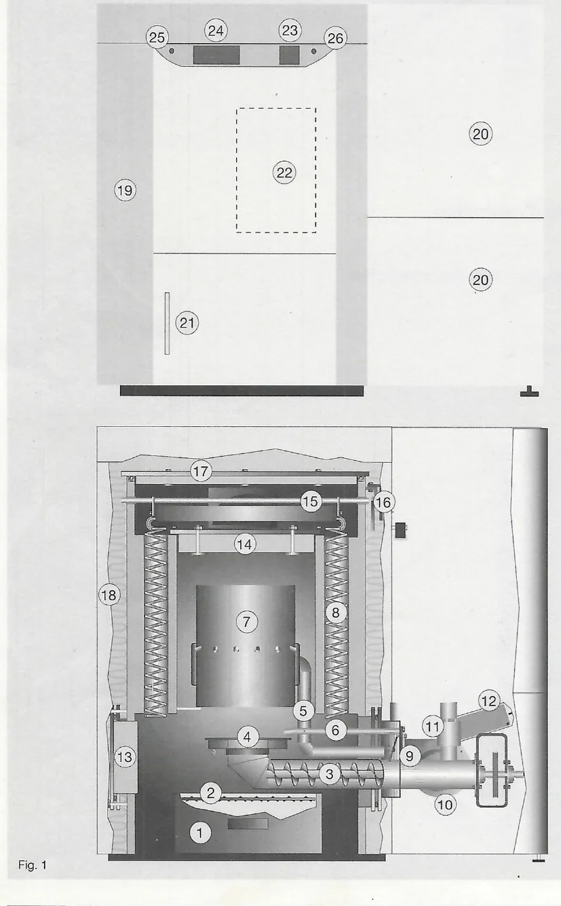
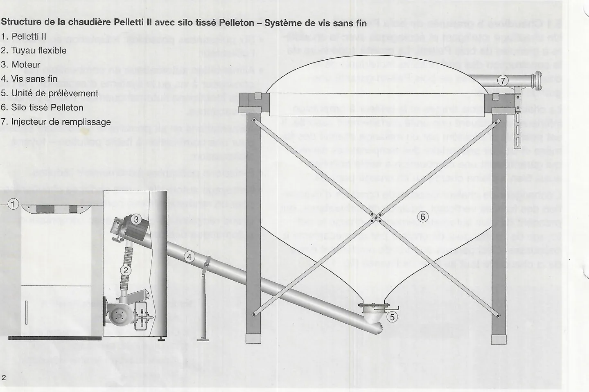
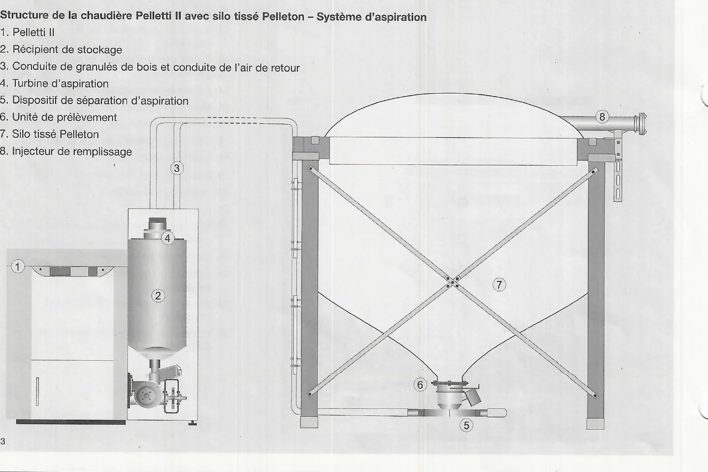
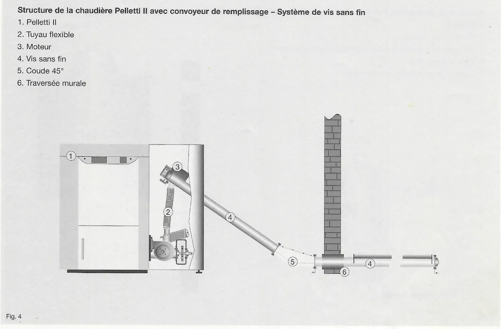
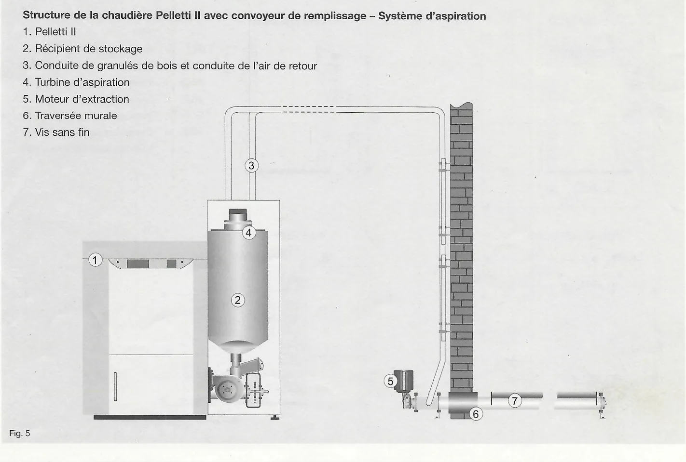
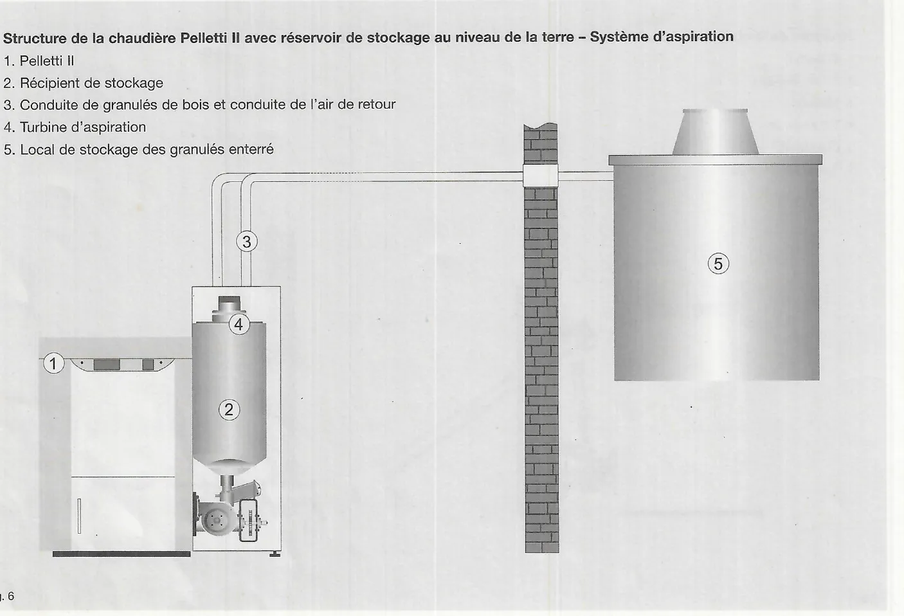

# Description de la chaudière

### 5.1 Chaudière à granulés de bois Pelletti II

Un chauffage intelligent et écologique avec la chaudière à granulés de
bois Pelletti. La qualité supérieure de la construction des composants
individuels de la chaudière à granulés de bois Pelletti garantit une
grande longévité.

La chaudière à trois tirages et le brûleur à propulsion inférieure
constituent une unité parfaitement assortie. Il est possible d'atteindre
par un mélange intensif des fumées et de l'air secondaire des
températures élevées qui garantissent une combustion à faible pollution
aussi bien à pleine charge qu'en charge partielle.

L'échangeur de chaleur dispose de conduits d'évacuation des fumées
verticaux, équipés de turbulateurs, qui prennent de plus automatiquement
en charge le nettoyage de l'échangeur de chaleur par un mécanisme à
secousses. Ceci garantit un taux de rendement élevé de la chaudière tout
au long de l'année (fig. 1).

**Avantages**

- Six puissances possibles, adaptation au besoin de l'utilisateur.
- Alimentation automatique en combustible par convoyeur à vis ou le
  système d'aspiration : la chaudière fonctionne automatiquement même
  pendant les vacances.
- Alimentations en air primaire et secondaire séparées pour une
  combustion à faible pollution – foyer à recirculation.
- Emissions polluantes extrêmement réduites.
- Nettoyage automatique des surfaces chauffantes pour un rendement élevé
  constant.
- Grand récipient de cendres avec compression automatique des cendres.

1. Récipient de cendres
2. Compression des cendres automatique
3. Convoyeur de remplissage
4. Plateau du brûleur en acier inoxydable
5. Air secondaire
6. Cartouche chauffante
7. Tube-foyer en acier inoxydable
8. Spirales de nettoyage
9. Clapet anti-retour
10. Ventilateur du brûleur
11. Clapet coupe-feu
12. Moteur de commande du clapet coupe-feu
13. Collier interchangeable brûleur gauche/droite
14. Recouvrement intérieur du tube-foyer
15. Mécanique de nettoyage
16. Moteur de nettoyage
17. Couvercle extérieur de la chaudière
18. Isolation thermique
19. Habillage de la chaudière
20. Habillage du brûleur
21. Porte du foyer
22. Allumage automatique par microprocesseur
23. Module de commande
24. Commande SystaComfort (en option)
25. Interface de service SystaComfort (en option)
26. Limiteur de température de sécurité (STB)

<small>Source : THF1849 p. 7</small>

### 5.2 Pelletti II avec silo tissé Pelleton – Système de vis sans fin

1. Pelletti II
2. Tuyau flexible
3. Moteur
4. Vis sans fin
5. Unité de prélèvement
6. Silo tissé Pelleton
7. Injecteur de remplissage

<small>Source : THF1849 p. 8</small>

### 5.3 Pelletti II avec silo tissé Pelleton – Système d'aspiration

1. Pelletti II
2. Récipient de stockage
3. Conduite de granulés de bois et conduite de l'air de retour
4. Turbine d'aspiration
5. Dispositif de séparation d'aspiration
6. Unité de prélèvement
7. Silo tissé Pelleton
8. Injecteur de remplissage

<small>Source : THF1849 p. 8</small>

### 5.4 Pelletti II avec convoyeur de remplissage – Système de vis sans fin

1. Pelletti II
2. Tuyau flexible
3. Moteur
4. Vis sans fin
5. Coude 45°
6. Traversée murale

<small>Source : THF1849 p. 9</small>

### 5.5 Pelletti II avec convoyeur de remplissage – Système d'aspiration

1. Pelletti II
2. Récipient de stockage
3. Conduite de granulés de bois et conduite de l'air de retour
4. Turbine d'aspiration
5. Moteur d'extraction
6. Traversée murale
7. Vis sans fin

<small>Source : THF1849 p. 9</small>

### 5.6 Pelletti II avec réservoir de stockage au niveau de la terre – Système d'aspiration

1. Pelletti II
2. Récipient de stockage
3. Conduite de granulés de bois et conduite de l'air de retour
4. Turbine d'aspiration
5. Local de stockage des granulés enterré

<small>Source : THF1849 p. 10</small>

### 4.7 Votre combustible — Granulés de bois

!!! note "Remarque"
    La qualité du combustible est déterminante pour le bon fonctionnement
    du chauffage par granulés de bois. Les seuls combustibles autorisés
    sont les granulés de bois de qualité de 6 mm de diamètre conformes à la
    norme DINplus ou la norme écologique M 7135.

Label DINplus : granulés de bois pour l'utilisation dans de petits foyers
de combustion.

<small>Source : THF1848 p. 10</small>
