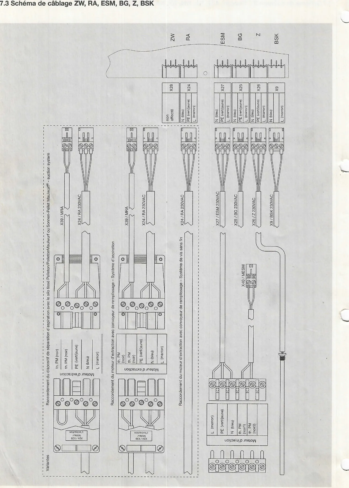

# Schémas de câblage PFA II

## 7. Schéma de câblage de la commande automatique du brûleur PFA II

Les tableaux ci-dessous reprennent, pour chaque fiche de la platine PFA
II, les bornes et couleurs de fils indiquées sur les schémas.

### 7.1 Schéma de câblage PPUI, LON, TK, TKR, TRG

| Repère platine | Fiche | Bornes (couleur) | Câble / composant |
|---|---|---|---|
| PPUI | X38 | LON-, LON+, GND, +12V | X38 LON bus PFA II - PPUI (module de commande) |
| LON | X14 | GND (vert), LON- (marron), LON+ (blanc) | X14 LON bus PFA II - régulation |
| — | — | non affecté | — |
| TK | X15 | GND (marron), TK (blanc) | X15 TK / NTC (sonde de chaudière) |
| TKR | X16 | GND (marron), TKR (blanc) | X16 TKR / NTC (sonde de retour) |
| — | — | non affecté | — |
| TRG | X17 | GND (rouge), TRG (blanc) | X17 TRG / Pt1000 (sonde de gaz de fumée) |

Le module de commande PPUI (afficheur « Pelletti auto TK 48°C ») porte
un connecteur LON et un bouton « Réinitialisation ». Côté câble LON
(X14), le connecteur est repéré LON- (marron), LON+ (blanc), GND
(vert).

<small>Source : THF1751 p. 24</small>

### 7.2 Schéma de câblage ST, Réseau, AEF, SA, RM, EX, KP, RGV, STB

| Repère platine | Fiche | Bornes (couleur) | Câble / composant |
|---|---|---|---|
| ST | X29 | L (marron), PE (vert/jaune), N (bleu) | X29 / ST 230 VAC — turbine d'aspiration (uniquement pour les systèmes d'aspiration) |
| Netz | X2 | L (marron), PE (vert/jaune), N (bleu) | X2 / Netz 230 VAC — raccordement au réseau |
| NR | X4 | L (marron), PE (vert/jaune), N (bleu) | X4 / NR 230 VAC — réseau SystaComfort (fiche PE vert/jaune, N bleu, L marron) |
| AEF | X3 | L (marron), PE (vert/jaune), N (bleu) | X3 / AEF 230 VAC |
| SA | X1 | N (bleu), L (marron) | X1 / SA 230 VAC |
| RM | X5 | L (marron), PE (vert/jaune), N (bleu) | X5 / RM 230 VAC (fils L, PE vert/jaune avec cosse, N) |
| — | — | non affecté | — |
| EX | X30 | L (marron), PE (vert/jaune), N (bleu) | X30 / EX 230 VAC |
| KP | X6 | L (marron), PE (vert/jaune), N (bleu) | X6 / KP 230 VAC — pompe chaudière |
| RGV | X7 | L (marron), PE (vert/jaune), N (bleu) | X7 / RGV 230 VAC — ventilateur de gaz de fumée |
| STB | X8 | L' (bleu), L (marron) | limiteur de température de sécurité STB : L (marron) et L' (bleu) sur les bornes 1 et 2, PE (vert/jaune) |

Les conducteurs PE (vert/jaune) sont raccordés au bornier « Conducteur
de protection PE (vert/jaune) ».

<small>Source : THF1751 p. 25</small>

### 7.3 Schéma de câblage ZW, RA, ESM, BG, Z, BSK

| Repère platine | Fiche | Bornes (couleur) | Câble / composant |
|---|---|---|---|
| ZW | X28 | non affecté | — |
| RA | X24 | N (bleu), PE (vert/jaune), L (marron) | X24 / RA 230VAC — moteur d'extraction |
| ESM | X27 | N (bleu), PE (vert/jaune), L (marron) | X27 / ESM 230VAC — moteur d'injection |
| BG | X25 | N (bleu), PE (vert/jaune), L (marron) | X25 / BG 230VAC — ventilateur du brûleur |
| Z | X26 | N (bleu), PE (vert/jaune), L (marron) | X26 / Z 230VAC — cartouche d'allumage |
| BSK | X9 | N (bleu), L (marron) | X9 / BSK 230VAC — moteur du clapet coupe-feu |

Le moteur d'injection est raccordé par un bornier : L (marron),
PE (vert/jaune), N (bleu), th. PM (noir1), th. PM (noir2) ; la
protection thermique (th. PM) est reliée à la fiche X40 / MESM.

Variantes de raccordement du moteur d'extraction (bornier : th. PM
(noir), th. PM (noir), PE (vert/jaune), N (bleu), L (marron) ; câbles
X24 / RA 230VAC et X39 / MRA) :

- Raccordement du dispositif de séparation d'aspiration avec le silo
  tissé Pelleton/PelletonMaulwurf ou Sonnen-Pellet Maulwurf® - suction
  system : X24 / RA et X39 / MRA.
- Raccordement du moteur d'extraction avec convoyeur de remplissage -
  Système d'aspiration : X24 / RA et X39 / MRA.
- Raccordement du moteur d'extraction avec convoyeur de remplissage -
  Système de vis sans fin : X24 / RA.

<small>Source : THF1751 p. 26</small>

### 7.4 Schéma de câblage SST, SRA, DZBG, BSKo/g, EXA, B1, TÜB, MRA, MESM, MZW, MST

| Repère platine | Fiche | Bornes (couleur) | Câble / composant |
|---|---|---|---|
| SST | X32 | SST (noir), +12V (marron), GND (bleu) | X32 / SST — interrupteur de niveau (sonde de capacité) |
| SRA | X33 | SRA, +12V, GND | pont (fil de liaison) sur la fiche |
| DZBG | X20 | DZBG (gris), VCC (marron), GND (noir) | X20 / DZBG — vers le capteur DZBG via connecteur (côté câble : Marron, Gris, Noir ; côté capteur : Rouge, Blanc, Noir) |
| BSKo/g | X34 | BSK/o (blanc6), BSK/g (blanc2), GND (blanc1/4) | X34 / BSKo/g — retour de position du clapet coupe-feu |
| EXA | X19 | EXA, GND | X19 / EXA |
| B1 | X21 | B1, GND | X21 / B1 |
| TÜB | X35 | TÜB (noir), GND (noir) | X35 / TÜB — interrupteur thermostatique de sécurité (surveillance de température) |
| MRA | X39 | MRA (noir), GND (noir) | X39 / MRA — protection thermique du moteur d'extraction |
| MESM | X40 | MESM (noir), GND (jaune) | X40 / MESM — protection thermique du moteur d'injection |
| MZW | X41 | MZW (jaune), GND (jaune) | pont (jonction de câbles) |
| MST | X42 | MST (jaune), GND (jaune) | pont (jonction de câbles) |

<small>Source : THF1751 p. 27</small>
