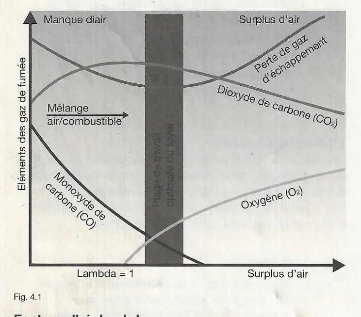
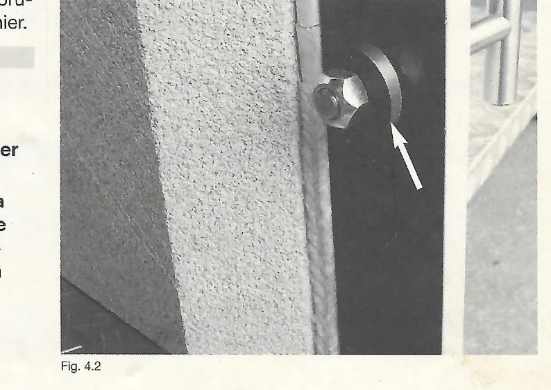

# Analyse des gaz d'échappement et réglage de la combustion

## 4. Analyse des gaz d'échappement / Mesure des émissions

### 4.1 Surveillance métrologique de la combustion

Avant de remettre la chaudière à granulés de bois ou suite à l'entretien
annuel de la chaudière, il convient de contrôler métrologiquement la
combustion pour s'assurer que l'énergie du combustible est exploitée le
mieux possible.

La qualité de la combustion peut uniquement être constatée sans
équivoque par des mesures exactes et avec des instruments de mesure
adaptés.

Pour déterminer le taux de rendement et pour constater la qualité de la
combustion, la teneur en pourcentage de CO2, de O2 et de CO est mesurée
dans la tubulure d'évacuation des gaz d'échappement du générateur de
chaleur. La valeur de CO2 max. pour les granulés de bois est de
20,0 Vol.% de CO2. Le but est de tendre vers la teneur la plus élevée
possible en CO2 sans formation de CO (fig. 4.1).

Le diagramme montre, en fonction du surplus d'air (lambda = 1 à
gauche), les courbes du monoxyde de carbone (CO), du dioxyde de carbone
(CO2), de l'oxygène (O2) et de la perte de gaz d'échappement, avec les
zones « Manque d'air », « Surplus d'air » et la plage de travail
optimale du foyer.

**Facteur d'air lambda**

L'oxygène nécessaire à la combustion est amené à la chaudière à granulés
de bois par l'air de combustion. Pour atteindre une combustion parfaite,
il est nécessaire d'amener plus que la quantité d'air théoriquement
requise pour la combustion. Le rapport de l'air de combustion en surplus
par rapport au besoin théorique en air est appelé facteur d'air lambda.

<small>Source : THF1751 p. 10</small>

### 4.2 Mesures en amont

Videz le récipient de cendres pour empêcher une influence négative
d'éventuels granulés se consumant.

La chaudière doit être en mode pleine charge au moment de l'analyse des
gaz d'échappement.

Pour cela, garantissez une prise de chaleur suffisante (pendant au moins
30 minutes) (par ex. en ouvrant les thermostats des radiateurs). Il se
peut que la combustion ait besoin d'être régulée par la suite, ce qui
peut demander encore un peu de temps.

!!! note "Remarque"
    Utilisez pour l'analyse des gaz d'échappement la fonction Entretien
    prévue à cet effet.

    Lorsque la fonction Entretien est activée, la chaudière est commandée
    à une puissance de 100 % pendant 45 minutes jusqu'à ce que la
    température de 85 °C soit atteinte. Lorsque la chaudière atteint une
    température de 85 °C, les pompes de la chaudière et du circuit de
    chauffage sont activées pour le transport de la chaleur.

!!! note "Référence"
    L'activation de la fonction Entretien est décrite en détail dans la
    documentation THF1849 Instructions de montage et d'installation,
    chapitre 12, Fonction Entretien.

<small>Source : THF1751 p. 10</small>

### 4.3 Réglage de la qualité de combustion

Pour atteindre une qualité de combustion élevée, la quantité de
combustible et celle de l'air de combustion doivent être harmonisées.
Les réglages correspondants se trouvent au niveau de service.

!!! note "Référence"
    Les fonctions des réglages individuels sont décrites en détail dans
    la documentation THF1849 Instructions de montage et d'installation,
    chapitre 17, Accès au niveau de service.

| Affichage | Description | Réglage par défaut | Plage de réglage |
|---|---|---|---|
| `Offset ventilat` | Permet d'augmenter ou de réduire la quantité d'air de combustion apporté. La valeur réglée influence la vitesse du ventilateur du brûleur. | 0 % | -50 à +50 % |
| `Offset inject°` | Permet d'augmenter ou de réduire la quantité de combustible injecté. La valeur réglée est ajoutée au temps d'injection actuellement calculé par la commande automatique du brûleur PFA II ou soustraite de ce dernier. | 0 sec. | -10 à +20 sec. |

!!! note "Remarque"
    Une porte de foyer non étanche peut causer de l'air parasite. Cela
    peut fausser les résultats de la mesure.

    A chaque entretien, assurez-vous que la poignée de la porte du foyer
    est bien fermée (elle doit être difficile à ouvrir). La tension de la
    porte peut être réglée au niveau de la poignée (fig. 4.2, flèche).

!!! note "Remarque"
    Les modifications de la quantité d'air de combustion sont
    immédiatement mesurables métrologiquement.

    Les modifications de la quantité de combustible sont mesurables
    métrologiquement après quelques minutes. Par conséquent, attendez
    quelques minutes avant de procéder à d'autres modifications.

<small>Source : THF1751 p. 11</small>

### 4.4 Réglage de la température des gaz de fumée

Pour garantir un fonctionnement stable de la cheminée, même pendant les
périodes de transition ou en été, lorsque la chaudière n'est allumée que
pour la production d'eau chaude ou un chauffage d'appoint sporadique, la
température des gaz de fumée doit être réglée sur 140 °C à 170 °C, pour
la puissance thermique nominale (pleine charge) et avec une chaudière
propre. Les écarts vers le haut ou vers le bas sont possibles selon la
puissance de la chaudière et le niveau d'encrassement.

La température des gaz de fumée peut être influencée par le soulèvement
du petit couvercle interne (vissage des vis d'ouverture 10).

<small>Source : THF1751 p. 11</small>

### 4.5 Valeurs de référence pour l'analyse des gaz d'échappement / la mesure des émissions

**Mesure des émissions**

| Valeur de mesure | Unité | Valeur de référence |
|---|---|---|
| Temp. air | °C | --- |
| Temp. gaz d'échapp. | °C | 140 - 170 |
| O2 | % | 8 - 11 |
| CO | mg/m³ (ppm) | < 250 / < 200 |
| CO2 | % | 8 - 12 |
| Lambda | --- | 1,8 - 2,5 |
| Tirage | Pa (Charge nominale/partielle) | 8 / 3 |
| Eta | % | > 90 |

(Le tableau du manuel comporte quatre colonnes vierges « Réglé » pour
noter les mesures.)

Mesure des émissions : température chaudière > 60 °C ; chaudière à
pleine charge.

Valeurs de référence valables pour des températures de chaudière entre
60 et 70 °C, pour 13 % de O2.

<small>Source : THF1751 p. 11</small>
