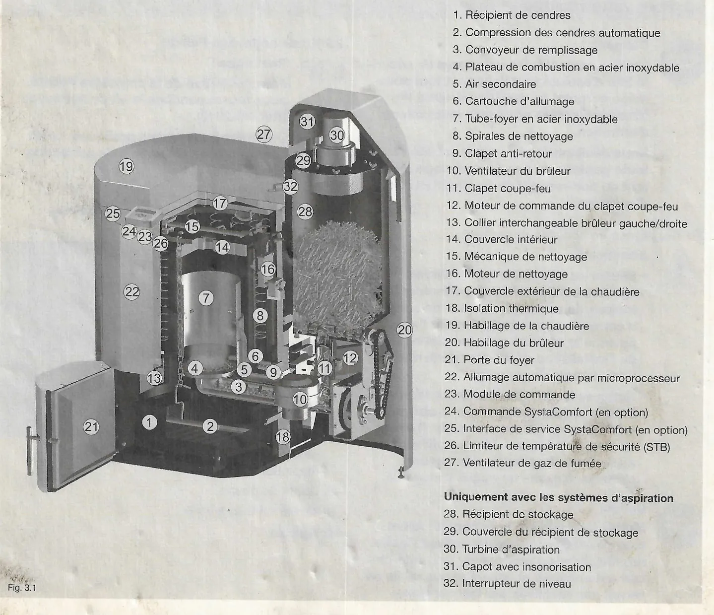
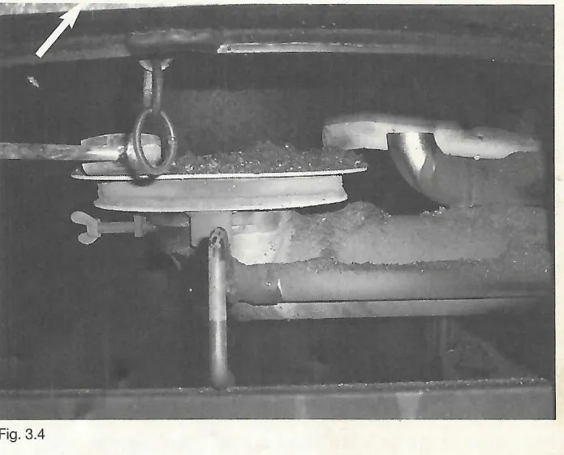
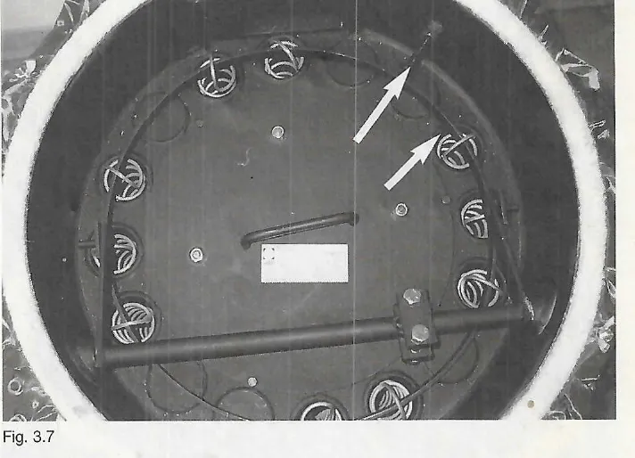
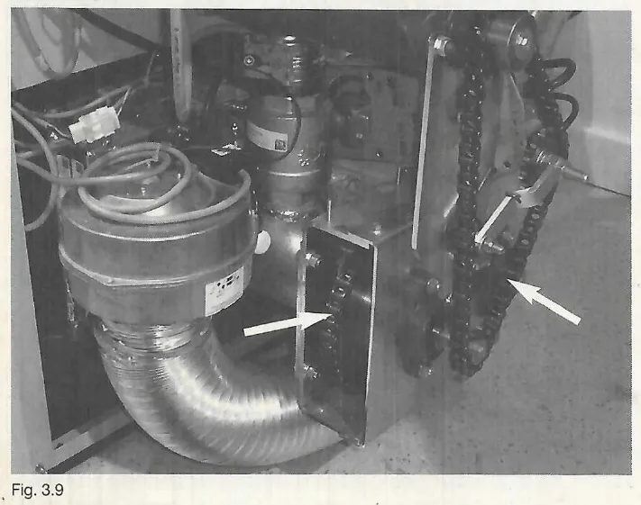
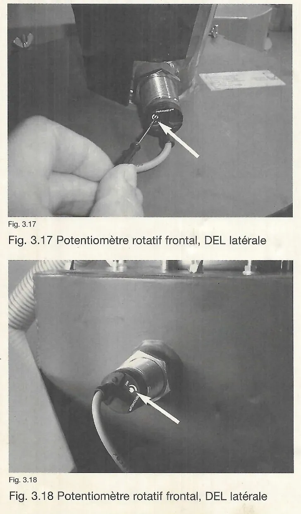
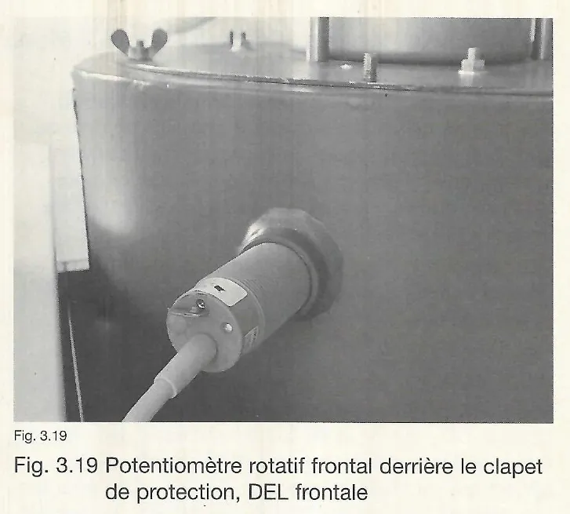

# Entretien de la chaudière

### 2.2 Kit de nettoyage Pelletti

!!! note "Remarque"
    Pour l'entretien de la chaudière Pelletti, nous recommandons le kit
    de nettoyage (Réf. 05-2940). Outre des accessoires pratiques, ce kit
    comprend des vêtements de protection adaptés (fig. 2.1).

Le kit de nettoyage comprend les éléments suivants :

1. Séparateur de cendres pour aspirateur
2. Pelle à cendres
3. Petit balai
4. Lampe torche
5. Brosse en acier inoxydable
6. 12 chiffons de nettoyage manuel
7. Masque de protection respiratoire
8. Gants de travail
9. Tablier en toile à voile
10. Spatule

<small>Source : THF1751 p. 3</small>

## 3. Travaux d'entretien

### 3.1 Pourquoi l'entretien de la chaudière est-il important ?

Un entretien régulier (annuel) garantit un fonctionnement respectueux de
l'environnement de l'installation, allonge la durée de vie, permet de
détecter rapidement des dommages possibles ou à venir et d'augmenter
ainsi la sécurité de fonctionnement de la chaudière.

En outre, l'entretien régulier de la chaudière prévient un
fonctionnement inefficace et évite ainsi le gaspillage de l'énergie.

!!! note "Remarque"
    Conformément à la législation en vigueur en matière d'installations
    de chauffage (HeizAnlV) § 9, l'utilisateur d'une installation de
    chauffage est tenu de pourvoir au nettoyage et à l'entretien de son
    installation une fois par an. Nous recommandons à l'utilisateur de
    l'installation de chauffage de conclure avec son chauffagiste
    spécialisé un contrat d'entretien.

<small>Source : THF1751 p. 4</small>

### 3.2 Quelles pièces de la chaudière sont concernées par l'entretien ?

La chambre de combustion et les voies générales des gaz de fumée doivent
être nettoyées en profondeur de leurs cendres et des dépôts qui
résultent du processus de combustion. Ainsi, la transmission optimale de
la chaleur est garantie et le rendement de la chaudière atteint de
nouveau son maximum.

En outre, l'état général des composants chauffés doit être contrôlé et
les pièces d'usure éventuellement présentes doivent être remplacées dans
les temps. Les dommages consécutifs possibles sont ainsi évités.

Le bon fonctionnement des composants tels que les moteurs et les
dispositifs de convoyage doit également être vérifié (le plus souvent
par contrôle visuel) et les pièces mobiles telles que les chaînes ou les
articulations doivent être regraissées en cas de besoin.

Les réglages du brûleur sont contrôlés et si nécessaire ajustés dans le
cadre de la mesure des émissions finale.

<small>Source : THF1751 p. 4</small>

### 3.3 Structure de la chaudière Pelletti II

1. Récipient de cendres
2. Compression des cendres automatique
3. Convoyeur de remplissage
4. Plateau de combustion en acier inoxydable
5. Air secondaire
6. Cartouche d'allumage
7. Tube-foyer en acier inoxydable
8. Spirales de nettoyage
9. Clapet anti-retour
10. Ventilateur du brûleur
11. Clapet coupe-feu
12. Moteur de commande du clapet coupe-feu
13. Collier interchangeable brûleur gauche/droite
14. Couvercle intérieur
15. Mécanique de nettoyage
16. Moteur de nettoyage
17. Couvercle extérieur de la chaudière
18. Isolation thermique
19. Habillage de la chaudière
20. Habillage du brûleur
21. Porte du foyer
22. Allumage automatique par microprocesseur
23. Module de commande
24. Commande SystaComfort (en option)
25. Interface de service SystaComfort (en option)
26. Limiteur de température de sécurité (STB)
27. Ventilateur de gaz de fumée

Uniquement avec les systèmes d'aspiration :

28. Récipient de stockage
29. Couvercle du récipient de stockage
30. Turbine d'aspiration
31. Capot avec insonorisation
32. Interrupteur de niveau

<small>Source : THF1751 p. 4</small>

### 3.4 Entretien de la chaudière

!!! danger "Danger"
    Nettoyez la chambre de combustion et le brûleur uniquement lorsque la
    chaudière à granulés de bois est refroidie. Il existe un risque de
    brûlure.

    Si vous utilisez un aspirateur, n'aspirez pas de cendres chaudes. Il
    existe un risque d'incendie.

Retirez le couvercle de revêtement et le couvercle extérieur de la
chaudière qui se trouve au-dessous.

Aspirez les cendres volantes de la partie supérieure de la chaudière
(fig. 3.2).

Retirez le plus petit couvercle intérieur et nettoyez des deux côtés
avec un aspirateur ou un balai (n'utilisez pas de brosse métallique).

Retirez le tube-foyer, nettoyez-le et contrôlez le niveau d'usure. En
cas d'usure, remplacez le tube-foyer.

Ne font pas partie des signes d'usure :

- les déformations thermiques (tube-foyer ovale),
- les décolorations.

En revanche, sont considérés comme des signes d'usure :

- lorsque env. la moitié des buses d'air secondaire manque,
- lorsque le tube-foyer est corrodé ou des éléments de la paroi sont
  absents.

Retirez les cendres volantes sur la paroi interne de la chambre de
combustion avec un racloir (ou une brosse ronde) (fig. 3.3).

!!! note "Remarque"
    Ne retirez pas les spirales de nettoyage de l'échangeur de chaleur.

    Conseil : ouvrez la porte du foyer et placez l'aspirateur dans la
    partie inférieure de la chaudière. Ainsi, il y a moins de cendres et
    de poussières qui montent par la chaudière vers le haut dans
    l'environnement.

Décrochez la chaîne de compression des cendres.

Retirez le lit de cendres du plateau de combustion avec le racloir
(fig. 3.4).

Desserrez légèrement l'écrou papillon du plateau de combustion et
retirez ce dernier (flèche).

Aspirez le bec du brûleur jusqu'à la vis du brûleur et retirez les
éventuels encrassements (fig. 3.5).

Aspirez les tubes d'air primaire et secondaire.

Retirez le récipient de cendres et procédez à un contrôle visuel des
cendres. Videz le récipient de cendres.

**Contrôle visuel du récipient de cendres :**

- **Bonne combustion :** la couleur des cendres est rougeâtre, marron,
  grise ou blanchâtre. Pas d'accumulation de granulés de bois imbrûlés
  dans le récipient de cendres.
- **Combustion incomplète :** la couleur des cendres est noire (reste de
  carbone - manque d'air) et éventuellement présence de granulés de bois
  imbrûlés dans le récipient des cendres.
    - Granulés partiellement brûlés : perforations du plateau de
      combustion en partie bouchées, ce qui entraîne un manque d'air.
    - Granulés pas brûlés du tout : trop de combustible ou manque d'air
      (voir chapitre 4.3).

Contrôlez l'ouverture du tube de protection d'allumage et dégagez-le si
nécessaire (flèche, fig. 3.5).

Nettoyez la surface du plateau de combustion avec une brosse métallique
ou un racloir, enlevez les éventuels encrassements présents de
l'intérieur et dégagez les trous d'air avec un outil pointu (fig. 3.6).

Retirez le reste de cendres de l'intérieur du plateau de combustion.

Remettez le plateau de combustion en place, serrez légèrement l'écrou
papillon.

Insérez de nouveau le récipient de cendres et rattachez la chaîne de
compression des cendres.

Remettez le tube-foyer en place. Replacez le couvercle intérieur.

Contrôlez le fonctionnement de la mécanique de nettoyage et
assurez-vous qu'elle subit une précontrainte suffisante (par ex.
commandez-la manuellement dans le programme de contrôle (mode Test))
(fig. 3.7).

La suspension des spirales de nettoyage (flèche du bas) doit se déplacer
jusqu'à la vis de limitation lors du processus de nettoyage (flèche du
haut).

Montez le couvercle extérieur de la chaudière. Remettez l'isolation et
le couvercle de revêtement en place.

!!! note "Référence"
    Le réglage de la mécanique de nettoyage (précontrainte) est décrit en
    détail dans la documentation THF1849 Instructions de montage et
    d'installation, chapitre 6.9, à la section « Modification du
    dispositif de nettoyage ».

<small>Source : THF1751 p. 5–6</small>

### 3.5 Entretien du brûleur

Démontez le ventilateur du brûleur et assurez-vous de l'absence de corps
étrangers et de dépôts de poussière dans le rouet du ventilateur. Si
nécessaire, nettoyez-la avec un pinceau (fig. 3.8).

Démontez le clapet anti-retour et contrôlez sa souplesse de
fonctionnement. Retirez les éventuels résidus de gaz de fumée et dépôts
présents.

Remontez le clapet anti-retour et le ventilateur du brûleur.

!!! warning "Attention"
    N'enlevez pas les contrepoids du rouet du ventilateur (équilibre).

Si nécessaire, graissez la chaîne d'entraînement du moteur d'injection
avec un vaporisateur à chaîne (pour vélo par ex.) (fig. 3.9, flèche de
gauche).

**Uniquement avec les systèmes d'aspiration :** si nécessaire, graissez
la chaîne d'entraînement de la vis sans fin de dosage (pour le récipient
de stockage) avec un vaporisateur à chaîne (pour vélo par ex.) (fig. 3.9,
flèche de droite).

Mesurez la résistance de la cartouche d'allumage avec un multimètre.
Pour ce faire, retirez la fiche de la cartouche d'allumage Z (X26) de la
PFA.

Valeur de référence : avec une température ambiante de 20 °C, la plage
de résistance de la cartouche d'allumage est entre 180 et 230 ohms
(fig. 3.10).

En cas de résistance supérieure à 230 ohms, remplacez la cartouche
d'allumage afin de garantir un allumage sûr.

!!! note "Remarque"
    La valeur de résistance indiquée peut fortement varier en fonction de
    la température actuelle de la cartouche d'allumage (par ex.
    lorsqu'elle est encore brûlante). Laissez refroidir la cartouche
    d'allumage et renouvelez la mesure.

<small>Source : THF1751 p. 6–7</small>

### 3.6 Nettoyage du convoyeur de remplissage

Retirez le cache du coude de 45°.

Aspirez les granulés de bois et les éléments fins.

Remplissez de nouveau le coude de 45° de granulés et montez le cache.

<small>Source : THF1751 p. 7</small>

### 3.7 Nettoyage du système d'aspiration

Retirez l'habillage du brûleur.

Desserrez les écrous papillon et retirez le couvercle du récipient de
stockage avec turbine d'aspiration (fig. 3.12).

!!! note "Remarque"
    Il n'est pas nécessaire de retirer la conduite d'aspiration des
    granulés et de l'air de retour.

**Pelletti à partir de la version 08/06 :** nettoyez la tôle perforée
avec un balai et/ou avec un pinceau (fig. 3.13).

**Pelletti jusqu'à la version 07/06 :** enlevez le cyclone du récipient
de stockage et nettoyez le filtre de l'air de retour interne avec un
pinceau (fig. 3.14, flèche).

!!! note "Remarque"
    Si le filtre est bouché par des déchets de granulés ou des éléments
    fins, la puissance d'aspiration de la turbine d'aspiration faiblit ou
    les granulés sont peu, voire pas du tout convoyés (risque de manque
    de combustible).

Videz complètement le récipient de stockage et enlevez les éléments fins
accumulés au niveau de la vis de dosage au sol du récipient de stockage
avec un aspirateur (fig. 3.15).

Remontez le couvercle avec la turbine d'aspiration et l'habillage du
brûleur.

!!! note "Remarque"
    Les granulés de bois retirés encore de bonne qualité (peu d'éléments
    fins) peuvent être rajoutés dans le réservoir à granulés ou le
    récipient de stockage.

Une fois l'entretien terminé, rebranchez la tension de réseau. Le
récipient de stockage est rempli automatiquement après env. 1 minute.

Une fois la procédure de remplissage terminée, retirez une nouvelle fois
le couvercle avec la turbine d'aspiration et contrôlez le niveau de
remplissage.

Le niveau maximum est atteint lorsque les granulés touchent
l'interrupteur de niveau (fig. 3.16, flèche).

!!! note "Remarque"
    Si la sonde de capacité est réglée de façon trop sensible, il peut
    arriver que le récipient de stockage ne soit pas entièrement rempli.
    Il en résulte une coupure inopinée (combustible insuffisant). La
    sensibilité de l'interrupteur de niveau SST doit être réduite.

!!! note "Référence"
    Le réglage de l'interrupteur de niveau SST est décrit en détail dans
    la documentation THF1849 Instructions de montage et d'installation,
    chapitre 22.3, Réglage de la sonde de capacité.

**Types d'interrupteurs de niveau utilisés**

L'interrupteur de niveau (généralement également appelé sonde de
capacité) comprend un potentiomètre rotatif pour le réglage. Pour le
contrôle optique, vous disposez d'une DEL (latérale ou frontale).

Pendant le processus de remplissage, la DEL clignote. Une fois le
récipient rempli, la DEL est allumée en continu (fig. 3.17 à 3.19,
flèche).

- Fig. 3.17 : potentiomètre rotatif frontal, DEL latérale
- Fig. 3.18 : potentiomètre rotatif frontal, DEL latérale
- Fig. 3.19 : potentiomètre rotatif frontal derrière le clapet de
  protection, DEL frontale

!!! note "Remarque"
    Quel que soit le type utilisé, les règles suivantes s'appliquent :

    - Réduire la sensibilité : rotation vers la gauche
    - Augmenter la sensibilité : rotation vers la droite

<small>Source : THF1751 p. 7–9</small>

### 3.8 Remise en service

Provoquez à titre d'essai une demande de chaleur (par ex. un passage
temporaire en mode manuel) et laissez la chaudière s'allumer. Etant donné
que le bec du brûleur a été vidé pendant l'entretien, plusieurs
tentatives d'allumages peuvent s'avérer nécessaires.

!!! note "Référence"
    Si nécessaire, il est possible d'effectuer une mise en service
    conformément à la documentation THF1849 Instructions de montage et
    d'installation, chapitre 22, Mise en service.

<small>Source : THF1751 p. 9</small>
