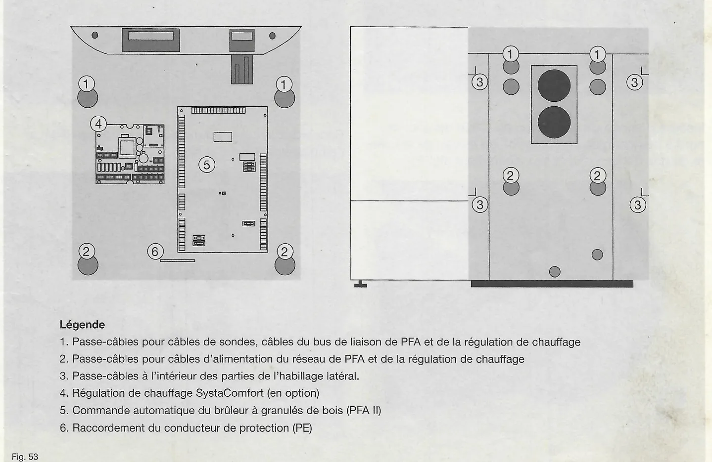
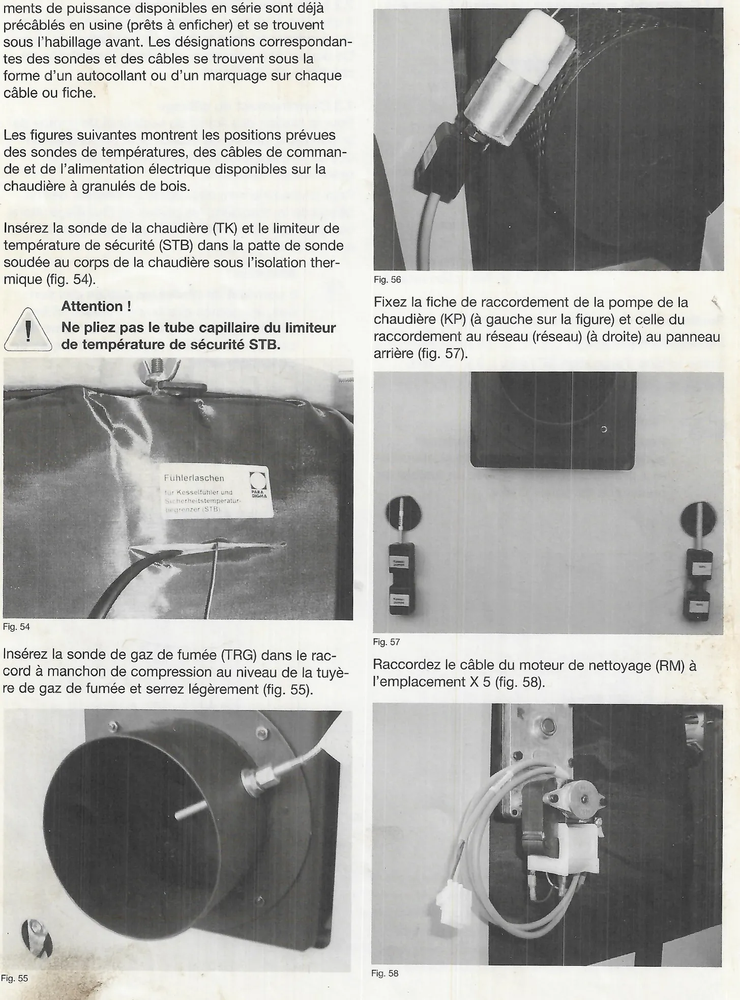
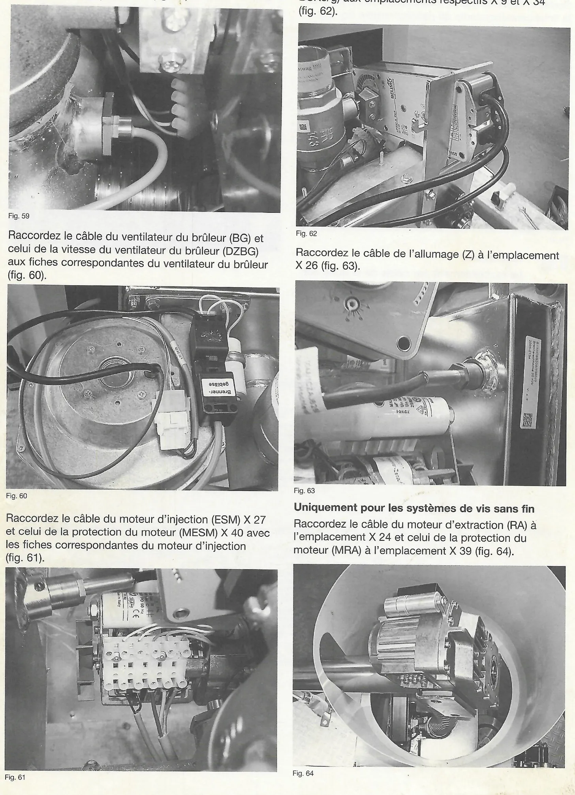
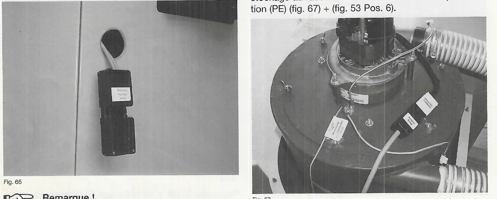
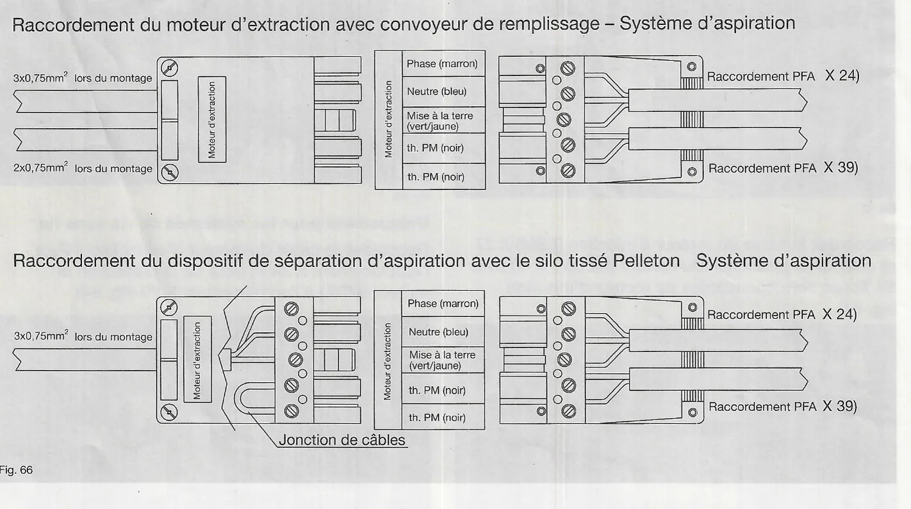
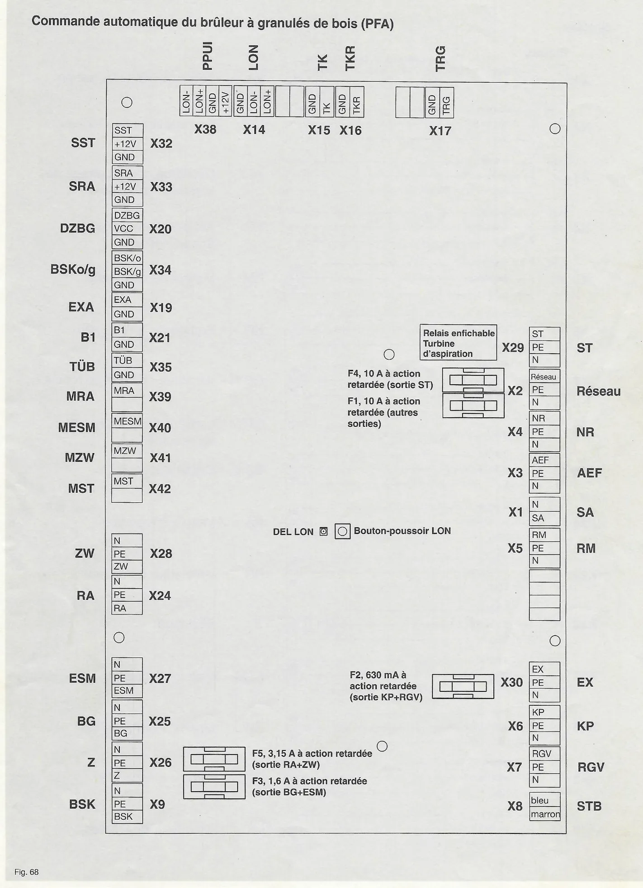
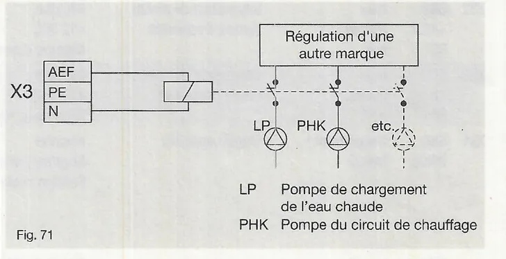
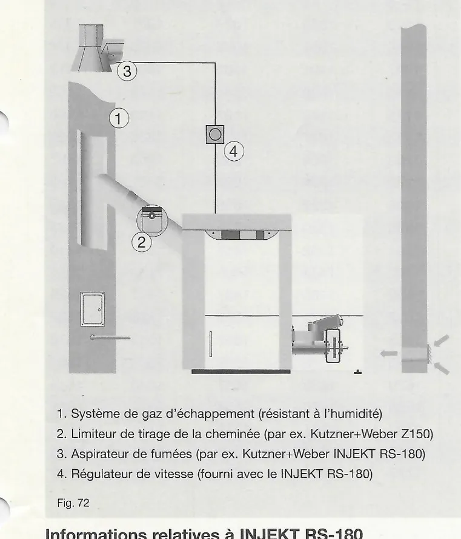

# Installation électrique (PFA II)

### 7.1 Commande automatique du brûleur à granulés de bois (PFA II)

**Données générales**

| Donnée | Valeur |
|---|---|
| Alimentation électrique | 230 V, 50 Hz |
| Système de vis sans fin | max. 7,5 A, 1,7 kW |
| Système d'aspiration | max. 15 A, 3,4 kW |
| Temp. de fonctionnement | min. 0 °C, max. 40 °C |
| Classe de protection | IP 20 |
| Fusible F1 | 10 A / à action retardée |
| Fusible F2 | 630 mA / à action retardée |
| Fusible F3 | 1,6 A / à action retardée |
| Fusible F4 | 10 A / à action retardée |
| Fusible F5 | 3,15 A / à action retardée |

**Sections des conduites de raccordement**

| Conduite | Section min. |
|---|---|
| Ligne d'alimentation | 3 x 1,5 mm² |
| Sortie turbine d'aspiration (ST) | 3 x 1,5 mm² |
| Autres sorties | 3 x 0,75 mm² |

!!! note "Remarque"
    Pour la protection dans le répartiteur général du circuit électrique
    de la chaudière à granulés de bois, utilisez un fusible de puissance
    de type « C16 ».

<small>Source : THF1849 p. 25</small>

### 7.2 Interrupteur d'arrêt d'urgence

Il convient d'installer un interrupteur d'arrêt d'urgence du chauffage en
dehors du lieu d'installation du foyer. Ce dernier doit permettre un
arrêt de l'installation de chauffage de l'extérieur.

<small>Source : THF1849 p. 25</small>

### 7.3 Cheminement du câblage

Pour la fixation des fiches du secteur et de pompe de la chaudière, des
vis de fixation sont disponibles au dos de l'habillage de la chaudière au
niveau des passe-câbles inférieurs.

Pour le cheminement des câbles à l'intérieur de l'habillage de la
chaudière, les parties de l'habillage latéral comprennent des
passe-câbles qui permettent d'insérer les câbles (fig. 53).

!!! warning "Attention"
    Il convient de placer les câbles des sondes, les câbles des bus de
    liaison et les câbles d'alimentation du réseau dans des conduits de
    câbles séparés ou équipés de cloisonnements.

1. Passe-câbles pour câbles de sondes, câbles du bus de liaison de PFA et
   de la régulation de chauffage
2. Passe-câbles pour câbles d'alimentation du réseau de PFA et de la
   régulation de chauffage
3. Passe-câbles à l'intérieur des parties de l'habillage latéral
4. Régulation de chauffage SystaComfort (en option)
5. Commande automatique du brûleur à granulés de bois (PFA II)
6. Raccordement du conducteur de protection (PE)

<small>Source : THF1849 p. 25</small>

### 7.4 Raccordement des sondes de température et des éléments de puissance

L'ensemble des sondes de températures et des éléments de puissance
disponibles en série sont déjà précâblés en usine (prêts à enficher) et
se trouvent sous l'habillage avant. Les désignations correspondantes des
sondes et des câbles se trouvent sous la forme d'un autocollant ou d'un
marquage sur chaque câble ou fiche.

Les figures suivantes montrent les positions prévues des sondes de
températures, des câbles de commande et de l'alimentation électrique
disponibles sur la chaudière à granulés de bois.

1. Insérez la sonde de la chaudière (TK) et le limiteur de température de
   sécurité (STB) dans la patte de sonde soudée au corps de la chaudière
   sous l'isolation thermique (fig. 54).
2. Insérez la sonde de gaz de fumée (TRG) dans le raccord à manchon de
   compression au niveau de la tuyère de gaz de fumée et serrez
   légèrement (fig. 55).
3. Raccordez le câble du ventilateur de gaz de fumée (RGV) à la fiche
   correspondante du ventilateur de gaz de fumée au dos de la chaudière
   (fig. 56).
4. Fixez la fiche de raccordement de la pompe de la chaudière (KP) (à
   gauche sur la figure) et celle du raccordement au réseau (réseau) (à
   droite) au panneau arrière (fig. 57).
5. Raccordez le câble du moteur de nettoyage (RM) à l'emplacement X 5
   (fig. 58).

!!! warning "Attention"
    Ne pliez pas le tube capillaire du limiteur de température de sécurité
    STB.

6. Raccordez le câble de la surveillance de température (TÜB) à
   l'emplacement X 35 (fig. 59).
7. Raccordez le câble du ventilateur du brûleur (BG) et celui de la
   vitesse du ventilateur du brûleur (DZBG) aux fiches correspondantes du
   ventilateur du brûleur (fig. 60).
8. Raccordez le câble du moteur d'injection (ESM) X 27 et celui de la
   protection du moteur (MESM) X 40 avec les fiches correspondantes du
   moteur d'injection (fig. 61).
9. Raccordez les câbles du clapet coupe-feu (BSK et BSKo/g) aux
   emplacements respectifs X 9 et X 34 (fig. 62).
10. Raccordez le câble de l'allumage (Z) à l'emplacement X 26 (fig. 63).

**Uniquement pour les systèmes de vis sans fin**

Raccordez le câble du moteur d'extraction (RA) à l'emplacement X 24 et
celui de la protection du moteur (MRA) à l'emplacement X 39 (fig. 64).

**Uniquement avec les systèmes d'aspiration**

Sortez le câble du moteur d'extraction (RA) X 24 avec la fiche
correspondante du panneau arrière (fig. 65).

!!! note "Remarque"
    Le raccordement par câble de la fiche correspondante du moteur
    d'extraction doit être mis à disposition par le maître d'œuvre. Tenez
    compte de la section du câble (fig. 66).

Raccordez le câble de la turbine d'aspiration (ST) X 29 à la fiche de la
turbine d'aspiration.

Amenez le câble de mise à la terre du récipient de stockage au
raccordement du conducteur de protection (PE) (fig. 67 + fig. 53 pos. 6).

Fig. 66 – Raccordement du moteur d'extraction, système d'aspiration :

| Borne moteur d'extraction | Fil | Raccordement PFA |
|---|---|---|
| Phase | marron | X 24 |
| Neutre | bleu | X 24 |
| Mise à la terre | vert/jaune | X 24 |
| th. PM | noir | X 39 |
| th. PM | noir | X 39 |

- Avec convoyeur de remplissage : câble 3 x 0,75 mm² (lors du montage)
  vers la fiche X 24 et câble 2 x 0,75 mm² (lors du montage) vers la
  fiche X 39.
- Dispositif de séparation d'aspiration avec le silo tissé Pelleton : un
  seul câble 3 x 0,75 mm² (lors du montage) ; les deux contacts th. PM
  sont pontés par une jonction de câbles sur la fiche du moteur.

<small>Source : THF1849 p. 26-28</small>

### 7.5 Affectation des plots de connexion PFA II

Commande automatique du brûleur à granulés de bois (PFA) – plots de
connexion.

**Bord supérieur (bus et sondes)**

| Plot | Bornes | Fonction |
|---|---|---|
| X38 | LON-, LON+, GND, +12V | PPUI |
| X14 | GND, LON-, LON+ | LON |
| X15 | GND, TK | TK |
| X16 | GND, TKR | TKR |
| X17 | GND, TRG | TRG |

**Bord gauche, très basse tension**

| Plot | Bornes | Fonction |
|---|---|---|
| X32 | SST, +12V, GND | SST |
| X33 | SRA, +12V, GND | SRA |
| X20 | DZBG, VCC, GND | DZBG |
| X34 | BSK/o, BSK/g, GND | BSKo/g |
| X19 | EXA, GND | EXA |
| X21 | B1, GND | B1 |
| X35 | TÜB, GND | TÜB |
| X39 | MRA | MRA |
| X40 | MESM | MESM |
| X41 | MZW | MZW |
| X42 | MST | MST |

**Bord gauche, 230 V**

| Plot | Bornes | Fonction |
|---|---|---|
| X28 | N, PE, ZW | ZW |
| X24 | N, PE, RA | RA |
| X27 | N, PE, ESM | ESM |
| X25 | N, PE, BG | BG |
| X26 | N, PE, Z | Z |
| X9 | N, PE, BSK | BSK |

**Bord droit, 230 V**

| Plot | Bornes | Fonction |
|---|---|---|
| X29 | ST, PE, N | ST (via relais enfichable turbine d'aspiration) |
| X2 | Réseau, PE, N | Réseau |
| X4 | NR, PE, N | NR |
| X3 | AEF, PE, N | AEF |
| X1 | N, SA | SA |
| X5 | RM, PE, N | RM |
| X30 | EX, PE, N | EX |
| X6 | KP, PE, N | KP |
| X7 | RGV, PE, N | RGV |
| X8 | bleu, marron | STB |

**Fusibles et éléments de la carte**

| Repère | Valeur | Protège |
|---|---|---|
| F4 | 10 A à action retardée | sortie ST |
| F1 | 10 A à action retardée | autres sorties |
| F2 | 630 mA à action retardée | sortie KP + RGV |
| F5 | 3,15 A à action retardée | sortie RA + ZW |
| F3 | 1,6 A à action retardée | sortie BG + ESM |

La carte comporte aussi une DEL LON et un bouton-poussoir LON.

<small>Source : THF1849 p. 29</small>

### 7.6 Schéma de câblage des sorties PFA II

Couleurs des fils : phase marron, PE jaune/vert, neutre bleu (sauf
indication contraire).

| Fiche | Bornes | Repère | Sortie |
|---|---|---|---|
| X1 | N (bleu), SA (marron) | SA | Sortie de signal/de panne (témoin lumineux ou signal sonore) |
| X2 | Netz, PE, N | Netz | Raccordement au réseau |
| X3 | AEF, PE, N | AEF | Décharge de démarrage de la régulation externe |
| X4 | NR, PE, N | NR | Alimentation de réseau SystaComfort |
| X5 | RM, PE, N | RM | Moteur de nettoyage |
| X6 | KP, PE, N | KP | Pompe de la chaudière |
| X7 | RGV, PE, N | RGV | Ventilateur de gaz de fumée |
| X8 | bleu, marron | STB | Limiteur de température de sécurité |
| X9 | BSK, PE, N | BSK | Clapet coupe-feu |
| X24 | RA, PE, N | RA | Moteur d'extraction |
| X25 | BG, PE, N | BG | Ventilateur du brûleur |
| X26 | Z, PE, N | Z | Allumage |
| X27 | ESM, PE, N | ESM | Moteur d'injection |
| X28 | ZW, PE, N | ZW | Moteur intermédiaire |
| X29 | ST, PE, N | ST | Turbine d'aspiration |
| X30 | EX, PE, N | EX | Aspirateur de fumées |

<small>Source : THF1849 p. 30</small>

### 7.7 Schéma de câblage des entrées PFA II

| Fiche | Bornes (couleur des fils) | Repère | Fonction |
|---|---|---|---|
| X14 | GND → Y11, LON- → Y9, LON+ → Y10 | LON | Bus LON (modules/interface) |
| X15 | GND (marron), TK (blanc) | TK | Sonde de la chaudière |
| X16 | GND (marron), TKR (blanc) | TKR | Sonde de retour de la chaudière (en option) |
| X17 | GND (marron), TRG (blanc) | TRG | Sonde de gaz de fumée |
| X19 | GND, EXA (contact) | EXA | Coupure externe |
| X20 | GND (marron → fiche de raccordement → noir), VCC (jaune → rouge), DZBG (blanc → blanc) | DZBG | Vitesse du ventilateur du brûleur |
| X21 | GND, B1 (contact) | B1 | Demande de chaleur externe |
| X32 | GND (bleu), +12V (marron), SST (noir) | SST | Interrupteur de niveau de la turbine d'aspiration |
| X33 | GND (bleu), +12V (marron), SRA (noir) | SRA | Interrupteur de niveau du moteur RA |
| X34 | GND (blanc4/blanc1), BSK/g (blanc2), BSK/o (blanc6) | BSKo/g | Clapet coupe-feu |
| X35 | GND (noir), TÜB (noir) | TÜB | Surveillance de température |
| X38 | LON- → Y9, LON+ → Y10, GND → Y13, +12V → Y14 | PPUI | Module de commande |
| X39 | GND (noir), MRA (noir) | MRA | Protection du moteur d'extraction |
| X40 | GND (noir), MESM (noir) | MESM | Protection du moteur d'injection |
| X41 | GND (noir), MZW (noir) | MZW | Protection du moteur intermédiaire |
| X42 | GND (noir), MST (noir) | MST | Protection du moteur de la turbine d'aspiration |

<small>Source : THF1849 p. 31 (fig. 70)</small>

### 7.8 Tableau récapitulatif des sorties PFA II

Toutes les sorties sont en 230 VAC/50 Hz.

| Fiche | Désignation | Fonction | Données techn. | Surveillance | Remarque |
|---|---|---|---|---|---|
| X1 | N bleu, SA marron | Sortie des pannes | Contact à fermeture max. 8 A | Fusible F1 = 10 A/T | Sortie de relais |
| X2 | Réseau marron, PE jaune/vert, N bleu | Raccordement au réseau | | | |
| X3 | AEF marron, PE jaune/vert, N bleu | Décharge de démarrage régulation d'une autre marque | Contact à fermeture max. 8 A | Fusible F1 = 10 A/T | Sortie de relais |
| X4 | NR marron, PE jaune/vert, N bleu | Alimentation de réseau de la régulation | | Fusible F1 = 10 A/T | |
| X5 | RM marron, PE jaune/vert, N bleu | Moteur de nettoyage | Contact à fermeture max. 8 A | Fusible F1 = 10 A/T | Sortie de relais |
| X6 | KP marron, PE jaune/vert, N bleu | Pompe chaudière | Contact à fermeture max. 1 A | Fusible F2 = 630 mA/T | Sortie triac |
| X7 | RGV marron, PE jaune/vert, N bleu | Ventilateur de gaz de fumée | Contact à fermeture max. 1 A | Fusible F2 = 630 mA/T | Sortie triac |
| X8 | bleu bleu, marron marron | Limiteur de temp. de sécurité | Contact à ouverture | | Interrupteur/contact à ouverture |
| X9 | BSK marron, PE jaune/vert, N bleu | Clapet coupe-feu | Contact à fermeture max. 8 A | Fusible F1 = 10 A/T | Sortie de relais |
| X24 | RA marron, PE jaune/vert, N bleu | Moteur d'extraction | Contact à fermeture max. 1 A | Fusible F5 = 3,15 A/T | Sortie triac |
| X25 | BG marron, PE jaune/vert, N bleu | Ventilateur du brûleur | Contact à fermeture max. 1 A | Fusible F3 = 1,6 A/T | Sortie triac |
| X26 | Z marron, PE jaune/vert, N bleu | Allumage | Contact à fermeture max. 8 A | Fusible F1 = 10 A/T | Sortie de relais |
| X27 | ESM marron, PE jaune/vert, N bleu | Moteur d'injection | Contact à fermeture max. 1 A | Fusible F3 = 1,6 A/T | Sortie triac |
| X28 | ZW marron, PE jaune/vert, N bleu | Moteur intermédiaire | Contact à fermeture max. 1 A | Fusible F5 = 3,15 A/T | Sortie triac |
| X29 | ST marron, PE jaune/vert, N bleu | Turbine d'aspiration | Contact à fermeture max. 16 A | Fusible F4 = 10 A/T | Sortie de relais |
| X30 | EX marron, PE jaune/vert, N bleu | Aspirateur de fumées | Contact à fermeture max. 8 A | Fusible F1 = 10 A/T | Sortie de relais |

<small>Source : THF1849 p. 32</small>

### 7.9 Tableau récapitulatif des entrées PFA II

| Fiche | Désignation | Fonction | Tension | Données techn. | Surveillance | Remarque |
|---|---|---|---|---|---|---|
| X14 | GND Y11, LON- Y9, LON+ Y10 | Bus LON (modules/interface) | --- | --- | --- | Communication avec la régulation de chauff. SystaComfort ou les modules MES |
| X15 | GND marron, TK blanc | Sonde chaudière | --- | Type NTC | Déconnexion, court-circuit, message à l'écran | |
| X16 | GND marron, TKR blanc | Sonde de retour chaudière (en option) | --- | Type NTC | Court-circuit, message à l'écran | |
| X17 | GND marron, TRG blanc | Sonde de gaz de fumée | --- | Type Pt 1000 | Déconnexion, court-circuit, message à l'écran | |
| X19 | GND ---, EXA --- | Coupure externe | | Contact à fermeture. **Libre de potentiel !** | --- | Par ex. thermostat externe de gaz de fumée d'une autre chaudière, etc. |
| X20 | GND marron/noir, VCC jaune/rouge, DZBG blanc/blanc | Vitesse ventilateur du brûleur | Négative / +5 volts / Signal | Sonde de Hall | Message à l'écran | |
| X21 | GND ---, B1 --- | Demande de chaleur | --- | Contact à fermeture. **Libre de potentiel !** | --- | Demande de chaleur externe par une régulation d'une autre marque. Procédez au raccordement hors tension ! |
| X32 | GND bleu, +12V marron, SST noir | Interrupteur de niveau turbine d'aspiration | Négative / +12 VDC / Négative (connectée) | Sonde de capacité | | |
| X33 | GND bleu, +12V marron, SRA noir | Interrupteur de niveau clapet coupe-feu | Négative / +12 VDC / Négative (connectée) | Sonde de capacité | | Seulement pour les applications spéciales |
| X34 | GND blanc4/blanc1, BSK/g blanc2 | Clapet coupe-feu | Négative / Négative (connectée), position finale FERMÉE | --- | Message à l'écran (Alarme) | Information en retour de la position de l'interrupteur de fin de course. Fermé hors tension (remise à l'état initial de la spirale) |
| X34 | BSK/o blanc6 | Clapet coupe-feu | Négative (connectée), position finale OUVERTE | | Message à l'écran (Alarme) | |
| X35 | GND noir, TÜB noir | Surveillance de température | Négative / +12 VDC | --- | --- | Surveillance de temp. dans le convoyeur de remplissage de granulés de bois |
| X38 | LON- Y9, LON+ Y10, GND Y13, +12V Y14 | Module de commande (PPUI) | --- | --- | --- | Communication avec la commande auto. du brûleur à granulés de bois (PFA II) |
| X39 | GND noir, MRA noir | Protection du moteur, moteur d'extraction | Négative / Négative (lorsque non déclenchée) | Contact à ouverture | Message à l'écran (Alarme) | Protection du moteur X39 à X42 (montage en série) (pas de sélection individuelle) |
| X40 | GND noir, MESM noir | Protection du moteur, moteur d'injection | Négative / Négative (lorsque non déclenchée) | Contact à ouverture | Message à l'écran (Alarme) | Montage en série |
| X41 | GND noir, MZW noir | Protection du moteur, moteur intermédiaire | Négative / Négative (lorsque non déclenchée) | Contact à ouverture | Message à l'écran (Alarme) | Montage en série |
| X42 | GND noir, MST noir | Protection du moteur, turbine d'aspiration | Négative / Négative (lorsque non déclenchée) | Contact à ouverture | Message à l'écran (Alarme) | Montage en série |

<small>Source : THF1849 p. 33</small>

### 7.10 Exemples importants d'utilisation des entrées et sorties individuelles

**Entrée X16, sonde de retour de la chaudière**

Il est possible de raccorder en option à l'entrée X16 une sonde de
température NTC supplémentaire comme sonde de retour de la chaudière.
Respectez la position de la sonde (voir chap. 5).

**Entrée X19, coupure externe**

Il est possible de raccorder à l'entrée X19 le contact à fermeture externe
d'un interrupteur thermostatique (par ex. un thermostat de repère, le
thermostat de gaz de fumée d'une chaudière à bûches, etc.).

Si cet interrupteur thermostatique externe se ferme, la chaudière à granulés
de bois est arrêtée et bloquée jusqu'à ce que l'interrupteur s'ouvre de
nouveau. En mode de fonctionnement, l'affichage « Bloqué » apparaît
(Consultation des températures : `Mode de fonction` / `Bloqué`).

En outre, la chaudière à granulés de bois peut également être bloquée par un
interrupteur externe (par ex. un boîtier de raccordement intérieur) au niveau
de cette entrée (**coupure de la chaudière lors de la livraison des granulés
de bois**).

**Entrée X21, contact du brûleur B1**

L'entrée X21 permet, **hors tension** et avec un contact à fermeture d'une
régulation d'une autre marque, d'activer la chaudière à granulés de bois.

!!! note "Remarque"
    Détermination de la valeur de consigne de la chaudière (`Temp. chaud.
    réglée`, ex. 65.0 °C) dans les paramètres de l'installation (voir
    chapitre 16).

**Entrées X39 à X42, protection du moteur**

Les entrées X39, X40, X41 et X42 sont connectées en série.

Si une de ces entrées est ouverte par un interrupteur (par ex.
thermostatique), la panne relative à la protection du moteur s'affiche et il
en résulte une coupure inopinée de la chaudière (Alarme).

Les entrées non utilisées (X41 et X42) peuvent être utilisées pour d'autres
chaînes de sécurité si nécessaire.

**Sortie X1, sortie de signal/de panne**

La sortie X1 permet de raccorder un dispositif de signalisation des pannes
(par ex. un témoin lumineux ou un signal sonore, 230 VAC).

En cas de coupure inopinée (affichage `Pelletti` / `Alarme`), la sortie X1
reste actionnée jusqu'à ce que la panne soit effacée ou éliminée (voir
chapitre 19).

**Sortie X3, décharge de démarrage régulation d'une autre marque**

Si la chaudière à granulés de bois fonctionne avec une régulation d'une
autre marque, les éléments de puissance (pompe du circuit de chauffage et
pompe de chargement de l'eau chaude) de cette régulation doivent être
alimentés en tension de réseau via cette sortie.

Cela permet de garantir que les éléments de puissance ne sont activés qu'à
partir de la température minimale requise de la chaudière de 60 °C (pour
éviter la formation de condensation).

Il est également possible de connecter à cette sortie un relais qui
déconnecte la tension de réseau des éléments de puissance d'une autre marque
(fig. 71).

- LP : pompe de chargement de l'eau chaude
- PHK : pompe du circuit de chauffage

<small>Source : THF1849 p. 34</small>

**Sortie X30, aspirateur de fumées**

Les systèmes de gaz d'échappement et les cheminées doivent être constitués de
telle façon que le vide requis pour l'évacuation sûre des gaz d'échappement
soit disponible en permanence. En pratique, des dysfonctionnements dus aux
intempéries et à la pression peuvent toutefois se produire et empêcher le
fonctionnement correct d'un foyer (terrains en pente, constructions étroites
de différentes tailles, bâtiment ancien, etc.).

Vous pouvez raccorder un aspirateur de fumées éventuellement requis pour de
telles applications directement à la sortie X30 (fig. 72).

1. Système de gaz d'échappement (résistant à l'humidité)
2. Limiteur de tirage de la cheminée (par ex. Kutzner+Weber Z150)
3. Aspirateur de fumées (par ex. Kutzner+Weber INJEKT RS-180)
4. Régulateur de vitesse (fourni avec le INJEKT RS-180)

**Informations relatives à INJEKT RS-180**

Aspirateur de fumées construit spécialement pour l'utilisation avec des
combustibles solides. INJEKT fonctionne selon le principe de l'injecteur. Le
ventilateur est placé en dehors du flux des gaz de fumée (la section de la
cheminée reste inchangée) et ne doit par conséquent pas fonctionner en
permanence. L'appareil ne nécessite aucun entretien et n'entrave pas les
travaux de ramonage car il peut être arrêté avec un interrupteur dit de
service depuis l'ouverture. Ceci est prévu lors du montage sur l'ouverture
des systèmes de gaz d'échappement classiques et métalliques.

!!! note "Remarque"
    Le mode de fonctionnement souhaité de l'aspirateur de fumées peut être
    réglé dans le niveau de service (`Fumée` / `para RGV`, voir chap. 17).

<small>Source : THF1849 p. 35</small>

### 7.11 Établissement de la liaison LON entre PFA II et PPUI

Le module de commande (PPUI) et la commande automatique du brûleur à granulés
de bois (PFA II) sont reliés par défaut. Les DEL LON du module PPUI et de la
commande PFA II sont éteintes.

1. Reliez la commande PFA II au module de commande en appuyant pendant
   env. 3 s sur la touche LON du module au moyen d'un outil (par ex. un
   tournevis). La touche LON se met à clignoter.
2. Lorsque la LED LON du module de commande a fini de clignoter, appuyez sur
   la touche LON de la commande PFA II pendant env. 3 s.
3. Une fois que cette dernière a également cessé de clignoter, le module
   PPUI et la commande PFA II sont reliés.

!!! note "Remarque"
    En cas de remplacement de la commande automatique du brûleur (PFA II),
    suivez les instructions fournies avec la pièce de rechange (THF1891
    Remplacement de la commande PFA II).

<small>Source : THF1849 p. 35</small>

### 7.12 Établissement de la liaison LON entre PFA II et SystaComfort (en option)

Le module de commande (PPUI), la commande automatique du brûleur à granulés
de bois (PFA II) et le régulateur de chauffage SystaComfort sont reliés par
défaut. Les DEL LON du module PPUI et de la commande PFA II sont éteintes.

!!! note "Remarque"
    En cas de pannes du bus de liaison entre le régulateur de chauffage
    SystaComfort et la chaudière à granulés de bois, il convient de contrôler
    le bus de liaison. Suivez pour cela les instructions du document THF1777
    Régulateur de chauffage SystaComfort, chapitre 6.5.

<small>Source : THF1849 p. 35</small>

!!! info "Voir aussi"
    Schémas de câblage détaillés par connecteur : [Câblage PFA II](../depannage/cablage-pfa.md). Tables des sondes : [Sondes de température](../depannage/sondes.md).
