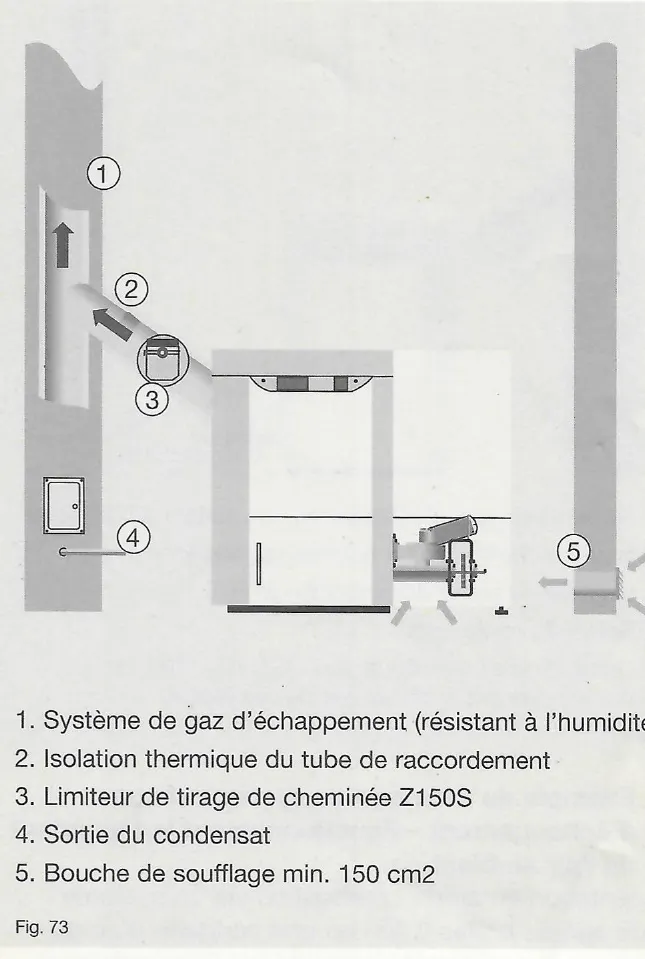
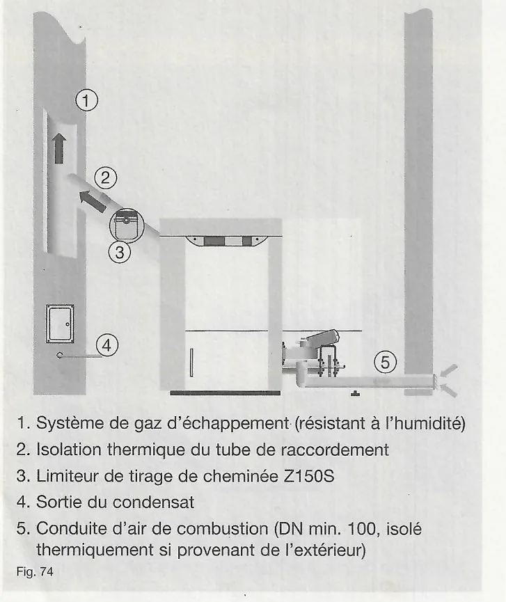
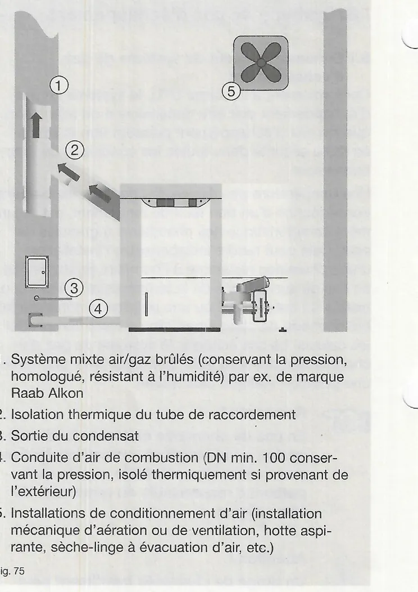
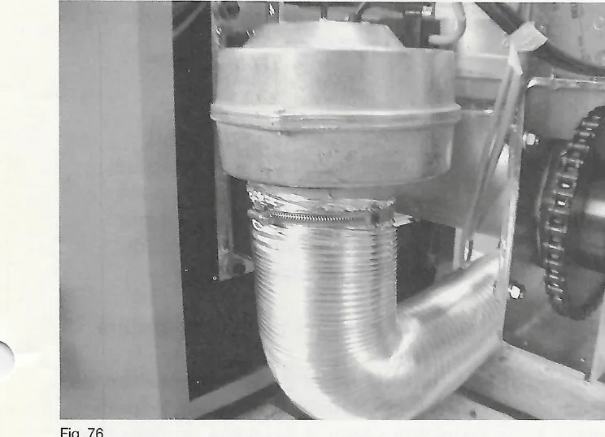
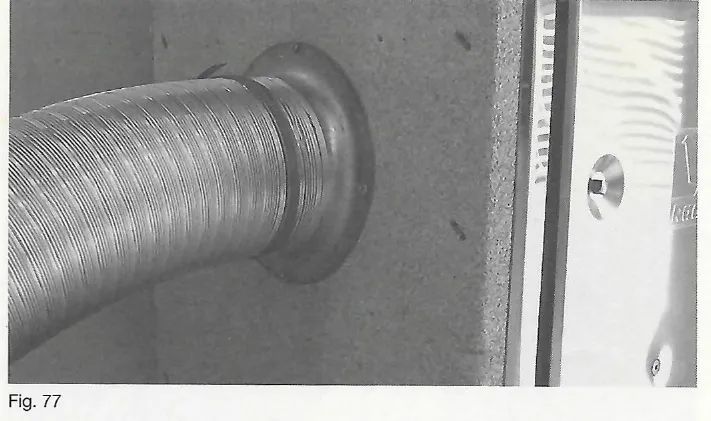
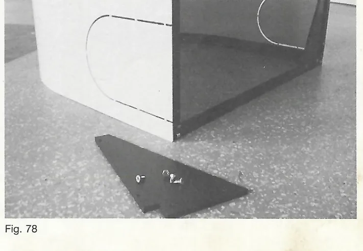
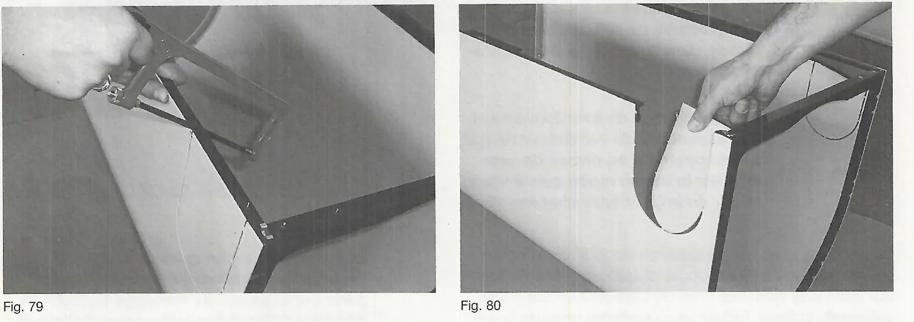

# Système de gaz d'échappement et air de combustion

## 8. Système de gaz d'échappement

### 8.1 Dimensionnement du système de gaz d'échappement

Conformément à la norme DTU, le système de gaz d'échappement doit être
dimensionné de telle façon que les gaz d'échappement puissent être évacués en
toute sécurité dans toutes les conditions de fonctionnement.

Une température peu élevée des gaz d'échappement, conséquence d'un bon taux
de rendement, est notamment caractéristique des chaudières à granulés de
bois. Cela peut rendre indispensable l'installation d'une cheminée résistante
à l'humidité (système FU) en cas de surveillance de la température. En outre,
un besoin en tirage élevé ou une puissance nominale faible en mode de charge
partielle peuvent compliquer les calculs. Le cas échéant, le système de gaz
d'échappement doit être isolé thermiquement pour créer une pression statique
plus élevée.

!!! note "Remarque"
    En cas de cheminée existante (bâtiment ancien ou rénovation), prenez
    impérativement conseil au préalable auprès de la personne responsable du
    ramonage de votre région.

!!! warning "Attention"
    Un tirage de cheminée insuffisant peut entraîner une fuite des gaz de
    fumée et des cokéfactions (risque de bouchon) au niveau du plateau du
    brûleur.

    Un tirage de cheminée trop important entraîne des pertes à l'arrêt plus
    élevées (consommation de combustible) et réduit le taux de rendement de
    l'installation.

<small>Source : THF1849 p. 37</small>

### 8.2 Exemple de montage de système de gaz d'échappement – Bouche de soufflage dans la pièce d'installation

La chaudière à granulés de bois nécessite pour la combustion suffisamment
d'air frais. Par conséquent, une bouche de soufflage d'au moins 150 cm² doit
être disponible dans la pièce d'installation (fig. 73).

1. Système de gaz d'échappement (résistant à l'humidité)
2. Isolation thermique du tube de raccordement
3. Limiteur de tirage de cheminée Z150S
4. Sortie du condensat
5. Bouche de soufflage min. 150 cm²

!!! note "Remarque"
    Les données techniques de dimensionnement de la cheminée (valeurs
    triples) pour cet exemple de montage figurent au chapitre 5 (Données
    techniques Pelletti II).

<small>Source : THF1849 p. 37</small>

### 8.3 Exemple de montage de système de gaz d'échappement – Conduite de l'air de combustion à l'extérieur

Alimentation en air de combustion via une conduite d'air de combustion
(DN 100 min.) provenant de l'extérieur. Raccordement direct au ventilateur du
brûleur (fig. 74).

Avantages :

- Pas de dommage sur l'enveloppe thermique du bâtiment
- Pas de refroidissement de la pièce d'installation
- Alimentation sûre en air de combustion même en cas d'enveloppe de bâtiment
  épaisse

!!! note "Remarque"
    Les données techniques de dimensionnement de la cheminée (valeurs
    triples) pour cet exemple de montage figurent au chapitre 5 (Données
    techniques Pelletti II).

    Le type et le modèle du canal d'alimentation en air doivent être pris en
    compte lors du dimensionnement (diamètre, longueur, nombre de coudes,
    etc.).

    Pour éviter la formation de condensation en cas de température
    extérieure froide, le canal d'alimentation de l'air doit être isolé
    thermiquement et être installé légèrement en descente vers l'extérieur.

1. Système de gaz d'échappement (résistant à l'humidité)
2. Isolation thermique du tube de raccordement
3. Limiteur de tirage de cheminée Z150S
4. Sortie du condensat
5. Conduite d'air de combustion (DN min. 100, isolé thermiquement si
   provenant de l'extérieur)

<small>Source : THF1849 p. 37-38</small>

### 8.4 Exemple de montage de système de gaz d'échappement – Fonctionnement indépendant de l'air ambiant

Alimentation en air de combustion via un système mixte air/gaz brûlés (LAS)
ou une conduite d'air de combustion provenant de l'extérieur. Raccordement
direct sur le ventilateur du brûleur.

Grâce à ce fonctionnement, la chaudière à granulés de bois peut également
être installée dans des unités d'exploitation qui sont rendues étanches et
imperméables à l'air durablement conformément à l'état de la technique ou qui
sont équipées d'installations mécaniques d'aération et de ventilation
(fig. 75).

Avantages :

- Pas de dommage sur l'enveloppe thermique du bâtiment
- Pas de refroidissement de la pièce d'installation
- Alimentation sûre en air de combustion même en cas d'enveloppe de bâtiment
  épaisse
- Fonctionnement simultané avec des installations de conditionnement d'air
  (installations mécaniques d'aération ou de ventilation, hottes aspirantes)
- Effets de récupération de chaleur grâce au système mixte air/gaz brûlés
  (LAS)

!!! danger "Danger"
    D'après la définition, le fonctionnement indépendant de l'air ambiant
    n'est possible que lorsque, outre la chaudière à granulés de bois, le
    système de gaz d'échappement et la conduite d'air de combustion sont
    homologués pour ce type de fonctionnement (homologation générale de la
    surveillance des bâtiments).

1. Système mixte air/gaz brûlés (conservant la pression, homologué,
   résistant à l'humidité), par ex. de marque Raab Alkon
2. Isolation thermique du tube de raccordement
3. Sortie du condensat
4. Conduite d'air de combustion (DN min. 100 conservant la pression, isolé
   thermiquement si provenant de l'extérieur)
5. Installations de conditionnement d'air (installation mécanique d'aération
   ou de ventilation, hotte aspirante, sèche-linge à évacuation d'air, etc.)

!!! warning "Attention"
    Pour le fonctionnement indépendant de l'air ambiant, n'installez pas de
    limiteur de tirage de cheminée. Risque de fuite des gaz de fumée en cas
    de vide dans la pièce d'installation par le système de conditionnement
    d'air.

!!! note "Remarque"
    L'absence d'un limiteur de tirage de cheminée entraîne généralement une
    pression de refoulement plus élevée dans le système de gaz
    d'échappement. Réglez le mode de fonctionnement correspondant du
    ventilateur de gaz d'échappement au niveau de service sur le même mode
    que le ventilateur du brûleur (`Ventilat RGV` = `para BG`, voir
    chapitre 17).

La conduite d'air de combustion conduit directement au ventilateur du brûleur
côté chaudière. Pour l'introduction de la conduite d'air de combustion dans
l'habillage du brûleur, retirez les ouvertures prévues à cet effet.

Le raccordement doit être le plus étanche possible. Utilisez du matériel de
conduite avec des joints ou des manchettes. Sécurisez les flexibles ondulés
avec des colliers de serrage. Il est également possible d'ajouter de la bande
adhésive alu (mise à disposition par le maître d'œuvre) pour rendre les
passages et les points de raccordement plus étanches (fig. 76).

En général l'air de combustion peut avoir deux sources : raccordement de la
conduite d'air de combustion à un système mixte air/gaz brûlés (aire
d'admission ou évent d'un système de gaz d'échappement) ou raccordement de la
conduite d'air de combustion à une paroi extérieure (un passage dans la paroi
et une grille d'aération doivent être prévus à la construction par le maître
d'œuvre) (fig. 77).

!!! note "Remarque"
    En cas de cheminée en céramique, suivez les instructions de la
    documentation technique du fabricant concerné pour le raccordement de la
    conduite d'air de combustion.

!!! note "Remarque"
    Les données techniques de dimensionnement de la cheminée (valeurs
    triples) pour cet exemple de montage figurent au chapitre 5 (Données
    techniques Pelletti II).

<small>Source : THF1849 p. 38-39</small>

### 8.5 Réglementations et calcul – Fonctionnement indépendant de l'air ambiant

En raison du fonctionnement indépendant de l'air ambiant du foyer, tenez
compte des remarques suivantes pour l'utilisation de ce dernier :

- La mise en place dans des pièces dont l'air est aspiré par des
  installations de conditionnement d'air (ventilateurs, installations
  d'aération ou de ventilation, hottes aspirantes, sèche-linge à évacuation
  d'air) est uniquement possible lorsque le dimensionnement côté alimentation
  en air est prévu de façon à ce que la pièce d'installation ne subisse pas,
  en raison du fonctionnement des installations d'extraction d'air, **un vide
  plus important que 8 Pa** par rapport à l'extérieur.
- Les conduites d'air de combustion à l'extérieur doivent être isolées,
  conformément à l'ordonnance sur les économies d'énergie.
- La section à l'air libre de la conduite d'air de combustion doit présenter
  une surface de conduite d'au moins 100 de DN.

<small>Source : THF1849 p. 39</small>

### 8.6 Habillage du brûleur pour le raccordement de l'air extérieur

Pour pouvoir relier le tuyau d'air extérieur, il convient de retirer
l'ouverture. Pour ce faire, procédez comme suit :

1. Retirez le triangle de renfort du côté souhaité (fig. 78).
2. Sciez le rail de renfort de l'ouverture prévue (fig. 79).
3. Sortez la zone prépoinçonnée en la cassant, puis retirez les éventuelles
   arêtes à l'aide d'un couteau (fig. 80).

<small>Source : THF1849 p. 39-40</small>
