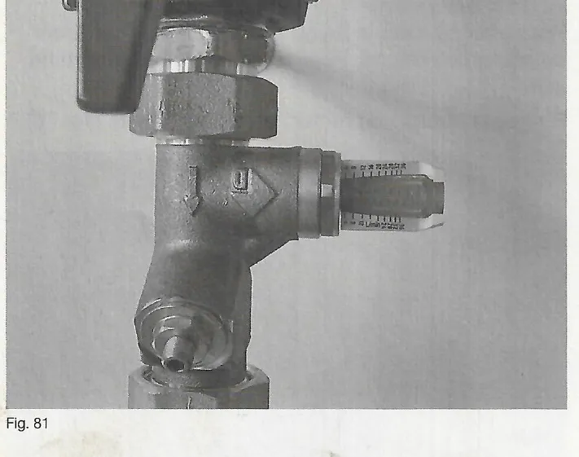

# Système hydraulique

## 9. Système hydraulique

### 9.1 Réglage du débit volumétrique

Le débit volumétrique à régler dépend de la puissance thermique nominale,
ainsi que de l'écart de température souhaité entre l'aller et le retour.

Écart recommandé :

| Pelletti | Mini | 103 | 153 | 203 | 253 | 323 |
|---|---|---|---|---|---|---|
| Puiss. thermique nominale [kW] | 8 | 10 | 15 | 20 | 25 | 31 |
| Débit volumétrique ΔT 15 K [l/min] | 8 | 10 | 14 | 19 | 24 | 31 |
| Débit volumétrique ΔT 20 K [l/min] | 6 | 7 | 11 | 14 | 18 | 23 |

Pour le réglage du débit volumétrique maximal à la puissance thermique
nominale, l'installation d'un débitmètre est recommandée (fig. 81).

!!! note "Remarque"
    Pour le réglage du débit volumétrique maximal à la puissance thermique
    nominale, réglez la vitesse de la pompe de la chaudière sur 100 % dans
    les paramètres de l'installation (`Vitesse KP minimum` = 100 %). Une fois
    le réglage du débit volumétrique maximal effectué, la pompe de la
    chaudière peut de nouveau être actionnée par régulation de vitesse en
    mode normal (voir chapitre 16).

<small>Source : THF1849 p. 40</small>

### 9.2 Dispositif de renforcement de la température de retour

Le dispositif de renforcement de la température de retour est intégré à la
chaudière en série. Il fonctionne sans entretien selon le principe de
l'injecteur et assure l'admixtion automatique de l'eau chaude de la chaudière
dans le raccordement de flux de retour entrant de la chaudière.

!!! warning "Attention"
    Pour que le dispositif de renforcement de la température de retour
    fonctionne parfaitement, l'aller et le retour ne doivent pas être
    inversés. Pour le raccordement du retour, utilisez le raccord vissé
    prémonté.

    La chaudière à granulés de bois doit toujours être raccordée
    conformément au plan hydraulique (livré avec la régulation de
    chauffage). En cas de non-respect de ce plan hydraulique, le
    fonctionnement du dispositif de renforcement de la température de retour
    et la bonne marche de la chaudière ne peuvent être garantis.

<small>Source : THF1849 p. 40</small>
