# Mise en place et montage

## 6. Mise en place et montage

### 6.1 Distances minimales

Le respect des distances minimales est indispensable pour garantir
l'accès à l'appareil lors de travaux d'entretien et de service (fig. 12).

!!! note "Remarque"
    Les systèmes de gaz d'échappement doivent rester facilement
    accessibles au ramoneur pour les travaux de mesure, de contrôle et de
    nettoyage. Tenez compte de l'encombrement latéral et supérieur.

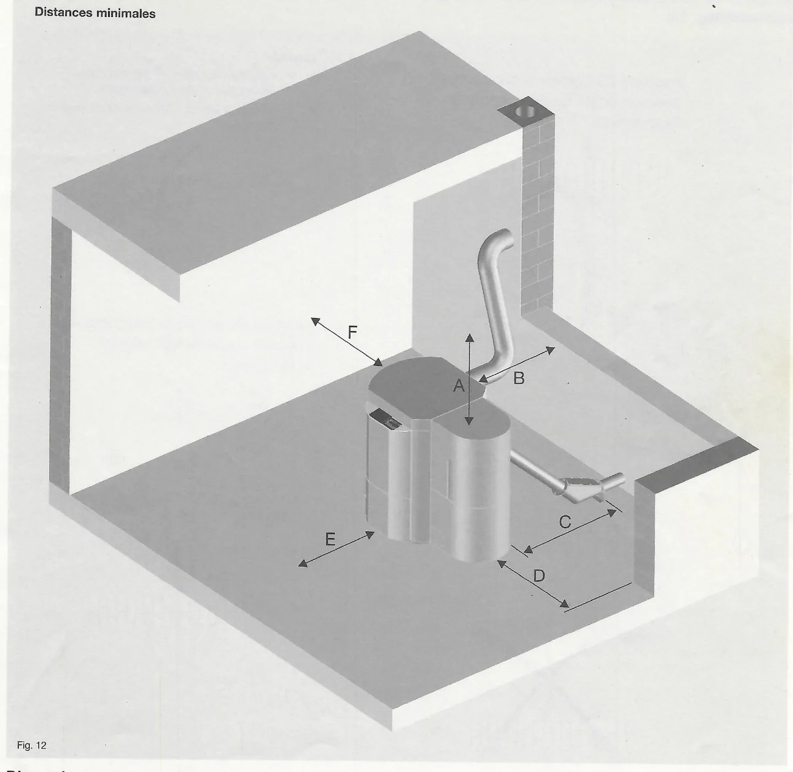

| Dimension | mm | Fonction |
|---|---|---|
| A\* | 400 | Retrait du tube-foyer, montage du système d'aspiration |
| B | 450 | Montage du système de gaz d'échappement, isolation du tube des gaz d'échappement |
| C\*\* | --- | Montage du système de vis sans fin, accessibilité du système de gaz d'échappement |
| D | 370 | (Dé-)montage du brûleur à granulés de bois |
| E | 500 | Décendrage |
| F | 200 | Montage de l'habillage de la chaudière |

\*) Avec les systèmes d'aspiration, distance au-dessus de l'habillage du
brûleur.
\*\*) Avec les systèmes de vis sans fin, respectez la distance
correspondant à la position du convoyeur ascendant (voir aussi fig. 13).

<small>Source : THF1849 p. 15</small>

### 6.2 Alimentation en granulés de bois par système de convoyeur ascendant

Le montage du convoyeur ascendant dans les systèmes de vis sans fin est
possible avec une plage d'inclinaison d'env. 180°. L'habillage du brûleur
peut être adapté en conséquence.

Les convoyeurs ascendants avec un coude de 45° peuvent en outre être
légèrement tournés une fois le montage effectué afin que le tuyau
flexible des granulés soit dirigé vers le clapet coupe-feu avec une
légère inclinaison (fig. 13).

!!! note "Remarque"
    Si le convoyeur ascendant doit être introduit dans l'habillage du
    brûleur depuis la face avant ou arrière de la chaudière avec un angle
    de 90°, respectez absolument la mesure de distance A ou B !

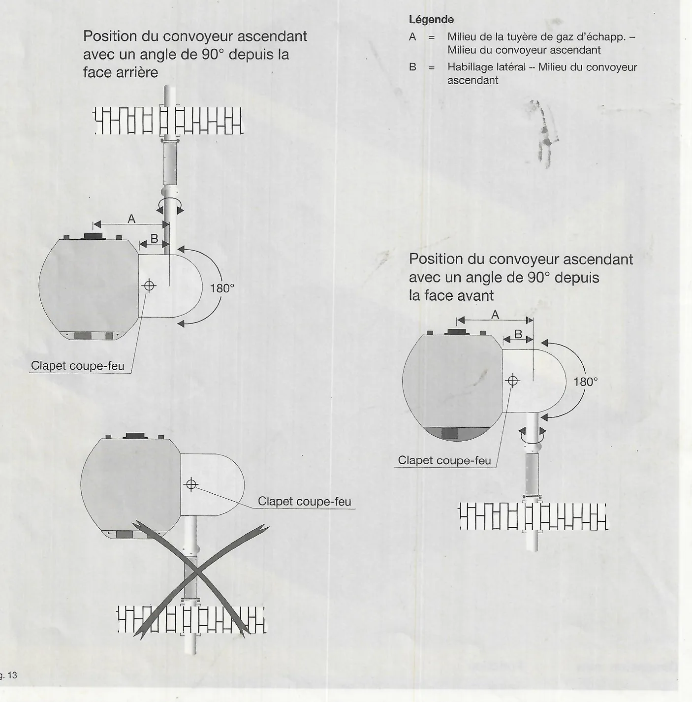

Fig. 13 : position du convoyeur ascendant avec un angle de 90° depuis la
face arrière, et depuis la face avant (plage de 180° autour du clapet
coupe-feu) ; la position barrée (convoyeur arrivant par l'avant
directement sous le clapet coupe-feu) n'est pas admise.

- A = Milieu de la tuyère de gaz d'échapp. – Milieu du convoyeur
  ascendant
- B = Habillage latéral – Milieu du convoyeur ascendant

| Modèle | A (mm) | B (mm) |
|---|---|---|
| Pelletti II Mini | 530 | 210 |
| Pelletti II 103 – 203 | 600 | 250 |
| Pelletti II 253 – 323 | 650 | 250 |

<small>Source : THF1849 p. 16</small>

### 6.3 Exemples de montage d'un système de vis sans fin

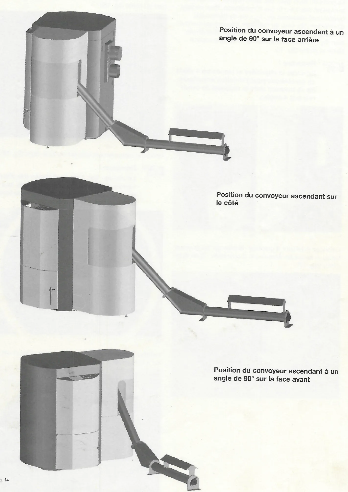

De haut en bas :

- Position du convoyeur ascendant à un angle de 90° sur la face arrière
- Position du convoyeur ascendant sur le côté
- Position du convoyeur ascendant à un angle de 90° sur la face avant

<small>Source : THF1849 p. 17</small>

### 6.4 Montage de la chaudière

La porte du foyer peut être démontée afin de faciliter la mise en place
sur le lieu d'installation. Pour ce faire, ouvrez-la et desserrez les
deux vis de fixation (clé d'ouverture 13). Lors du montage, assurez-vous
ensuite que la porte est correctement alignée et se ferme bien (fig. 15).
Installez la chaudière sur une surface plane et stable (fig. 16).

!!! note "Remarque"
    Basculez la chaudière et placez les 4 pieds en caoutchouc pour
    l'isolation acoustique (ils se trouvent dans le récipient de cendres)
    aux 4 angles.

Enfoncez le brûleur à granulés de bois sur les goujons filetés et serrez
les écrous (clé d'ouverture 17) en quinconce (fig. 17).

Insérez le tube-foyer en acier inoxydable. Assurez-vous ce faisant que la
tuyère de l'air secondaire est bien en place (fig. 18).

Insérez le recouvrement intérieur du tube-foyer (fig. 19).

!!! note "Remarque"
    Le vissage des 3 vis de distance (clé d'ouverture 10) permettra
    ultérieurement, lors de la mise en service, d'augmenter la
    température des gaz de fumée (fig. 19).

Installez le couvercle extérieur de la chaudière et serrez à la main les
4 écrous papillon (fig. 20).

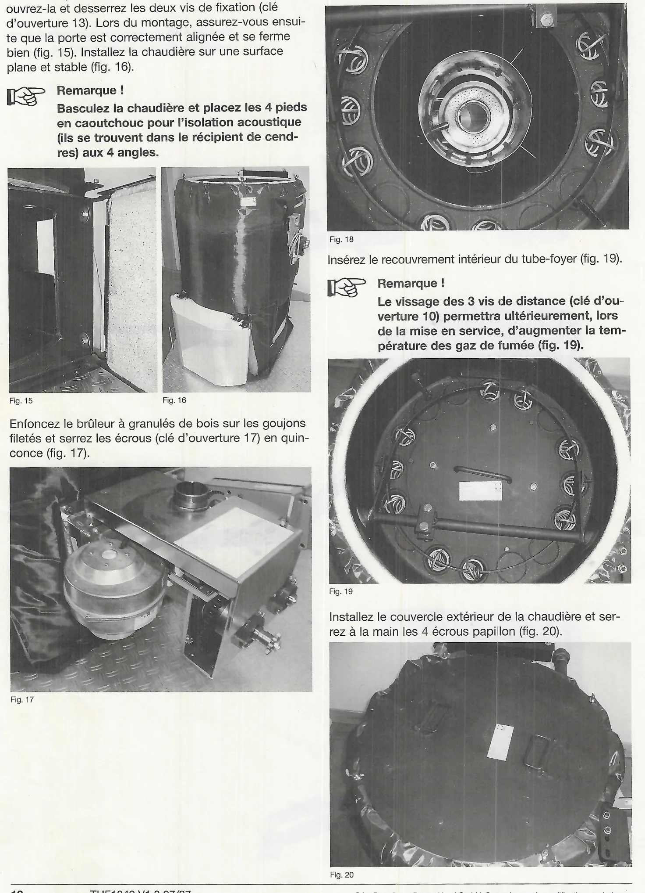

Retirez du récipient de cendres les autres accessoires de la chaudière et
enfoncez ce dernier dans la chaudière. Attachez la chaîne à la grille à
secousses (pour la compression automatique des cendres) (fig. 21).

<small>Source : THF1849 p. 18-19</small>

### 6.5 Montage de l'habillage de la chaudière

Placez le panneau arrière dans les goupilles de fixation de la plaque de
base et fixez-le en haut à l'aide des deux vis à six pans creux
(taille 5) (fig. 22).

!!! note "Remarque"
    Serrez les vis à six pans creux à la main seulement jusqu'à ce que le
    couvercle de l'habillage de la chaudière soit en place. Lorsque le
    couvercle s'enclenche dans tous les boulons d'arrêt, vous pouvez
    serrer les vis.

Enfoncez l'habillage latéral avec une ouverture pour le brûleur par
dessus ce dernier. Placez le panneau latéral dans les goupilles de
fixation de la plaque de base et reliez-le au panneau arrière (en haut et
au milieu) (fig. 23).

- Jonction supérieure – Vis sans tête avec écrou moleté en plastique.
- Jonction du milieu – Boulons d'arrêt.

Placez la plaque réglable portant la commande automatique du brûleur et
le module de commande sur les équerres de maintien au-dessus de la porte
du foyer et reliez-la à l'habillage latéral (en haut et au milieu).

- Jonction supérieure – Vis sans tête avec écrou moleté en plastique.
- Jonction du milieu – Boulons d'arrêt.

Vissez la plaque réglable avec les équerres de maintien à l'aide de deux
vis à six pans creux (taille 5) (fig. 24).

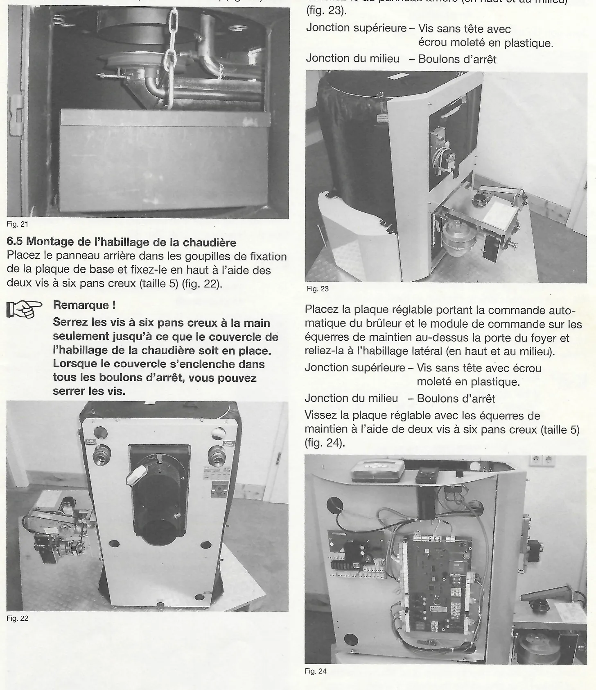

Placez le panneau latéral portant les écritures dans les goupilles de
fixation de la plaque de base et reliez-le avec le panneau arrière (en
haut et au milieu) (fig. 25).

- Jonction supérieure – Vis sans tête avec écrou moleté en plastique.
- Jonction du milieu – Boulons d'arrêt.

Placez l'habillage avant avec les deux trous en bas sur les vis à six
pans creux situées au bas de la plaque réglable. Soulevez légèrement
l'unité de commande supérieure et passez l'habillage avant dessous. Fixez
l'habillage avant avec les deux vis à six pans creux (taille 5) sur la
face supérieure (à l'intérieur) (fig. 26).

!!! note "Remarque"
    Il est également possible de monter l'habillage avant après les
    travaux électriques (voir chapitre 7).

Installez l'isolation intermédiaire et le couvercle de l'habillage de la
chaudière (boulons d'arrêt). En cas de besoin, desserrez les deux vis à
six pans creux du panneau arrière pour aligner le couvercle. Serrez les
vis à six pans creux (fig. 27).

<small>Source : THF1849 p. 19-20</small>

### 6.6 Montage de l'habillage du brûleur – Système de vis sans fin

Installez l'habillage inférieur du brûleur sur l'habillage latéral –
boulons d'arrêt (fig. 28).

!!! note "Remarque"
    Dévissez le pied de réglage au bas de l'habillage du brûleur jusqu'à
    la base de la chaudière.

Installez la partie intermédiaire de l'habillage sur l'habillage du
brûleur (fig. 29).

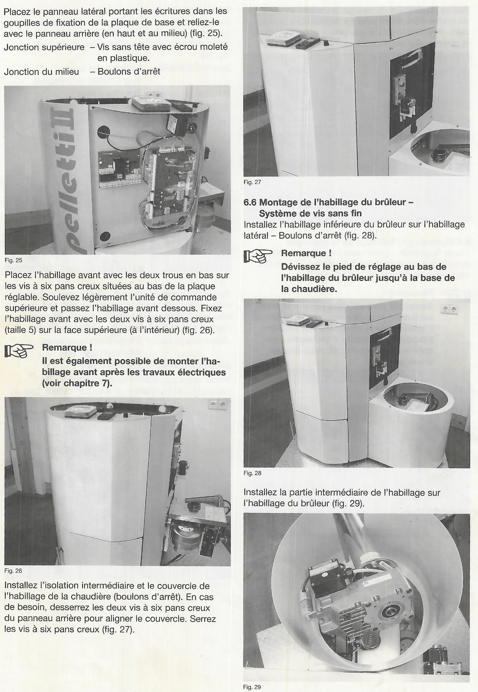

!!! warning "Attention"
    Avec les systèmes de vis sans fin, alignez la chaudière à granulés de
    bois avec la vis sans fin de telle façon que le moteur ne se heurte
    pas à l'habillage du brûleur.

    La bride du moteur est équipée de trous ovales, ce qui permet de
    modifier facilement sa position.

!!! note "Remarque"
    Il est également possible de tourner la bride du moteur avec
    l'ensemble propulsif de 90°. Pour ce faire, desserrez complètement les
    vis de fixation (clé d'ouverture 13), puis tournez la bride du moteur
    avec son support en caoutchouc de 90°.

    Etant donné que la bride du moteur sert simultanément de support du
    couple moteur, vous devez également la tourner lors de ce changement
    de position (flèche de la fig. 30).

Insérez l'habillage supérieur du brûleur dans les goupilles de guidage de
l'habillage inférieur et accrochez-le à l'habillage latéral (fig. 31).

<small>Source : THF1849 p. 20-21</small>

### 6.7 Montage de l'habillage du brûleur – Système d'aspiration, récipient de stockage

Accrochez le récipient de stockage avec turbine d'aspiration dans l'étrier
de retenue sur la chaudière à granulés de bois. Ce faisant, guidez la
sortie du récipient de stockage dans le collier de serrage de liaison au
brûleur. Placez le récipient de stockage verticalement (vis avec les trous
ovales sur l'étrier de retenue). Serrez la vis à six pans creux (taille 5)
du collier de serrage de liaison au brûleur. Rabattez le tendeur de chaîne
vers le haut et placez la chaîne de convoyage sur le pignon du brûleur
(fig. 32).

!!! note "Remarque"
    Conseil : pour faciliter l'accrochage et le décrochage de la chaîne
    de convoyage, retirez le pignon du brûleur (clé d'ouverture 10), puis
    repoussez-le avec la chaîne de convoyage.

Branchez le câble de mise à la terre sur la fixation du récipient de
stockage (fig. 33).

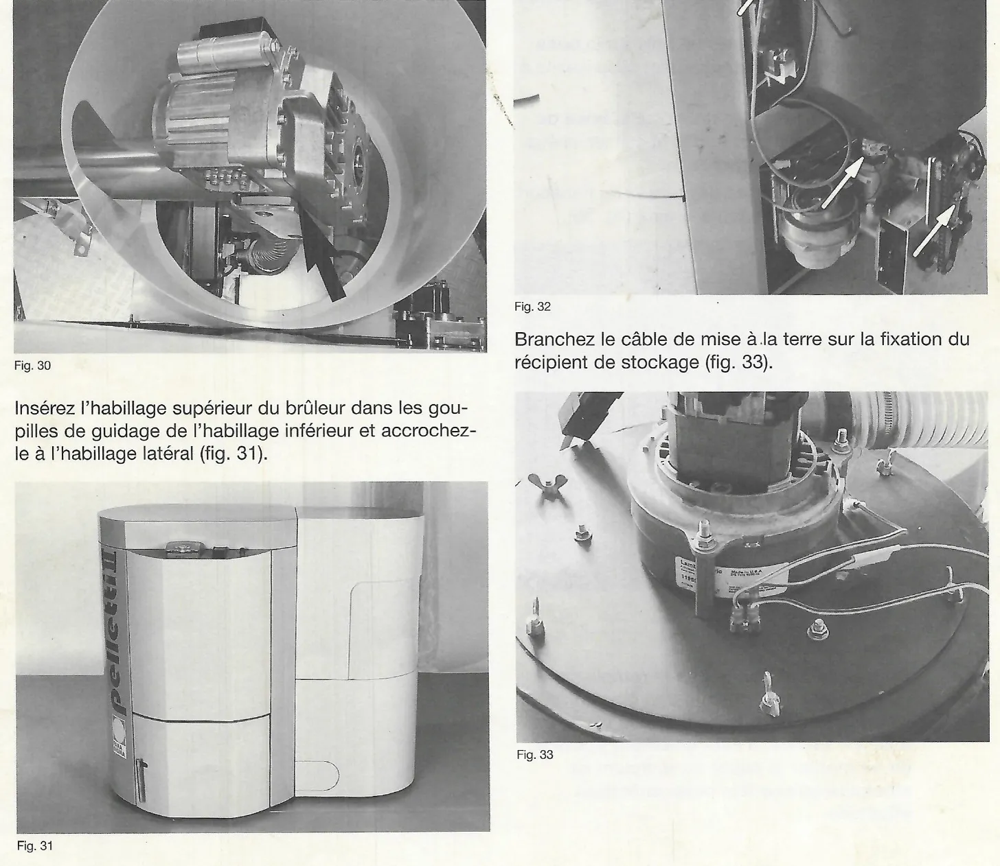

Installez l'habillage du brûleur sur l'habillage latéral – boulons
d'arrêt (fig. 34).

!!! note "Remarque"
    Dévissez le pied de réglage au bas de l'habillage du brûleur jusqu'à
    la base de la chaudière.

Poussez la conduite de granulés de bois sur la **buse de départ du
récipient de stockage** et sécurisez-la à l'aide du collier de serrage.

Poussez la conduite de l'air de retour sur la **buse de départ de la
turbine d'aspiration** et sécurisez-la également avec le collier de
serrage.

Détachez les tresses en cuivre des tuyaux de transport et reliez-les aux
câbles de mise à la terre (fig. 35).

Installez le capot du récipient de stockage – boulons d'arrêt (fig. 36).

!!! note "Remarque"
    Conseil : étant donné que le remplissage du récipient de stockage
    doit être contrôlé visuellement dans le cadre de la première mise en
    service, il est également possible de ne monter le capot du récipient
    de stockage qu'une fois cette opération effectuée.

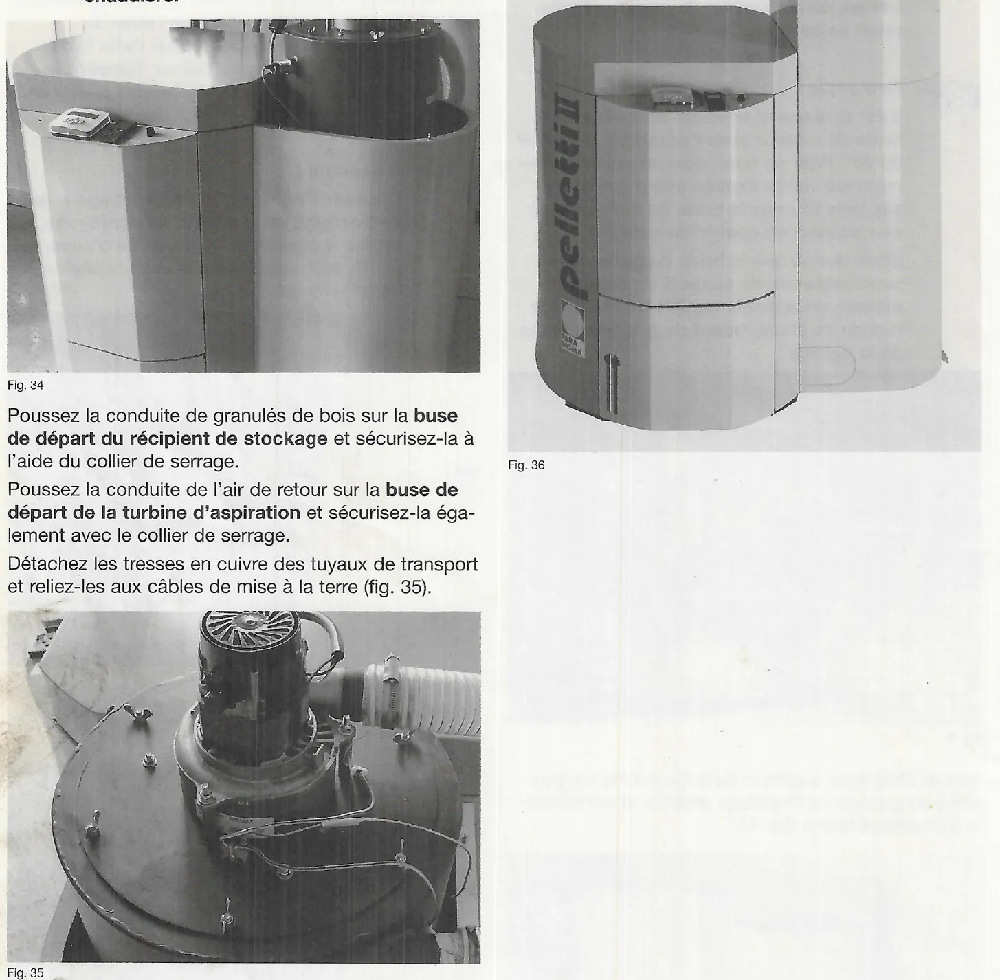

<small>Source : THF1849 p. 21-22</small>

### 6.8 Modification du brûleur (gauche/droite)

!!! note "Remarque"
    Si, en raison des conditions sur site, il est absolument nécessaire
    d'installer le brûleur de l'autre côté dans la chaudière (inversion
    gauche/droite), il convient de déplacer également le dispositif de
    nettoyage (excepté pour la Pelletti Mini).

Retirez le récipient de cendres de la chaudière. Tournez et soulevez le
couvercle extérieur de la chaudière en desserrant les quatre écrous
papillon. Retirez le recouvrement intérieur du tube-foyer ainsi que le
tube-foyer lui-même (fig. 37-40).

Pour démonter le brûleur, débranchez les raccordements par câbles (fiches
de la commande automatique du brûleur), puis tirez sur le câble avec
précaution pour le sortir. Retirez les quatre écrous (M10). Le brûleur
peut à présent être sorti de la chaudière (fig. 41-42).

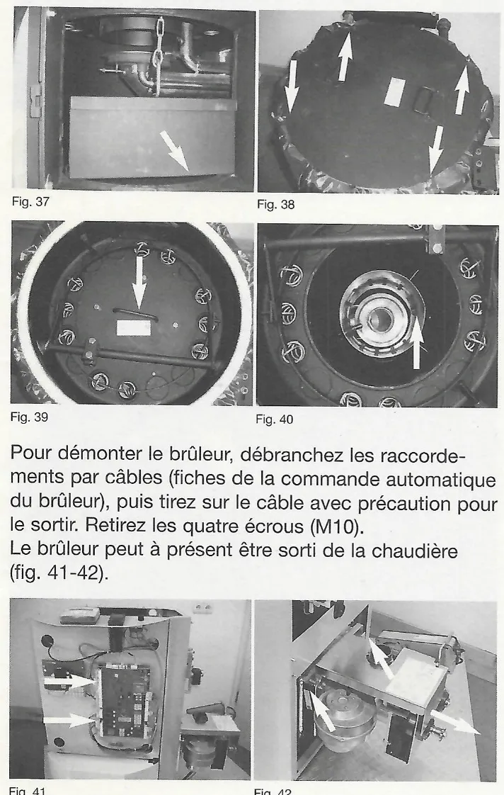

Enlevez avec soin le couvercle d'obturation de l'autre côté de la
chaudière (prenez garde à ne pas détruire le joint !) et montez-le à la
place du brûleur.

Poussez le brûleur sur les quatre goujons filetés et fixez-le avec les
quatre écrous (M10). Serrez les écrous de façon mesurée en quinconce.
Remontez le tube-foyer ainsi que son recouvrement intérieur. Rebranchez
les fiches de raccordement des câbles, insérez le récipient de cendres
(voir également les chapitres 6.4 et 7.4).

<small>Source : THF1849 p. 23</small>

### 6.9 Modification du dispositif de nettoyage

Retirez les deux écrous (M8) des équerres de fixation du moteur de
nettoyage pour enlever ce dernier. Desserrez les vis à six pans creux M5
(pos. 7) sur l'excentrique (pos. 10). Retirez l'excentrique, tournez-le
de 180° et fixez-le de nouveau sur l'arbre d'entraînement. Retirez les
deux vis Torx (pos. 6) de la plaque d'ancrage (pos. 2), puis enlevez la
plaque (fig. 43-45).

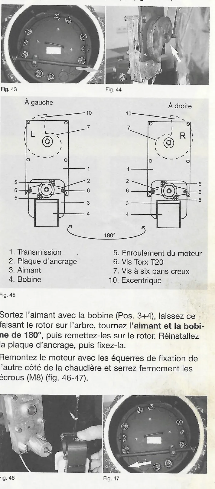

1. Transmission
2. Plaque d'ancrage
3. Aimant
4. Bobine
5. Enroulement du moteur
6. Vis Torx T20
7. Vis à six pans creux
10. Excentrique

Sortez l'aimant avec la bobine (pos. 3+4), laissez ce faisant le rotor
sur l'arbre, tournez **l'aimant et la bobine de 180°**, puis remettez-les
sur le rotor. Réinstallez la plaque d'ancrage, puis fixez-la.

Remontez le moteur avec les équerres de fixation de l'autre côté de la
chaudière et serrez fermement les écrous (M8) (fig. 46-47).

Assurez-vous que le moteur et l'excentrique sont montés correctement.
Pour savoir dans quelle direction le moteur tourne (droite ou gauche),
contrôlez l'emplacement de l'enroulement du moteur (pos. 5) (fig. 45).

Desserrez les vis et les contre-écrous (clé d'ouverture 17) au niveau du
levier de nettoyage (**attention filetage fin !**) (fig. 48-49).

Sortez l'arbre du levier de nettoyage et insérez-le de l'autre côté de la
chaudière. Ce faisant, introduisez-le de nouveau dans le levier de
nettoyage (fig. 50).

Tournez le disque d'excentrique à la main de 90° (**attention, la
rotation est difficile !**).

Placez l'étrier de l'arbre de nettoyage sur l'excentrique (**du côté
étroit !**) (fig. 51).

Serrez fermement les vis sur le levier de nettoyage et fixez-les avec les
contre-écrous (fig. 49).

Remettez le couvercle extérieur de la chaudière en place et serrez les
écrous papillon à la main (fig. 52).

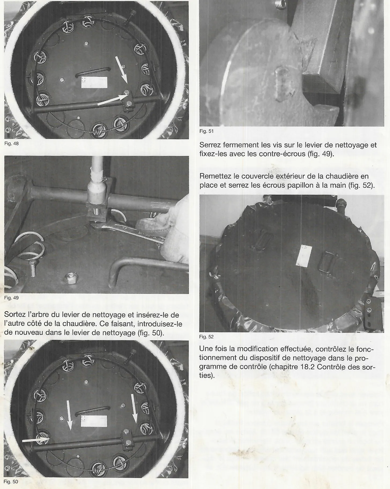

Une fois la modification effectuée, contrôlez le fonctionnement du
dispositif de nettoyage dans le programme de contrôle (chapitre 18.2
Contrôle des sorties).

<small>Source : THF1849 p. 23-24</small>
