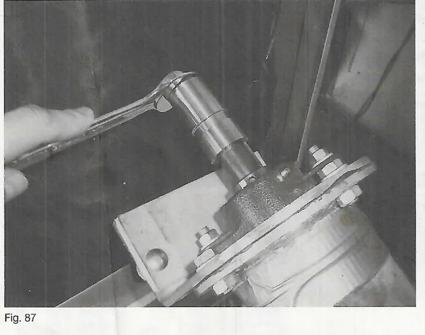
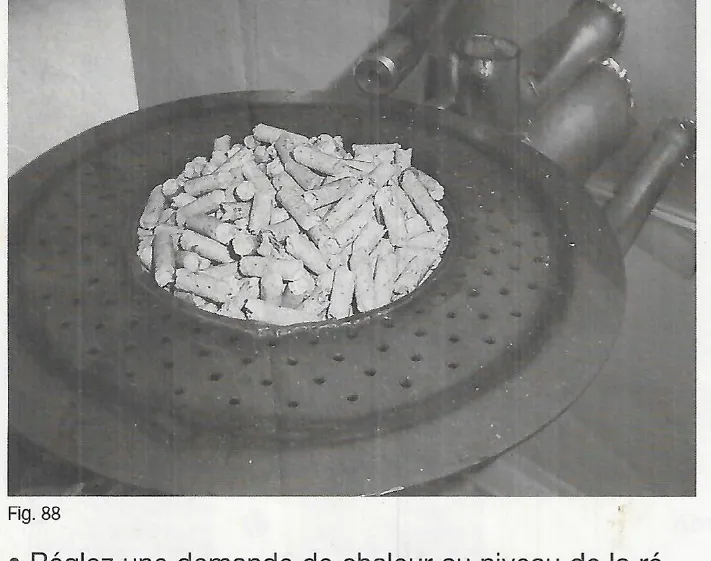
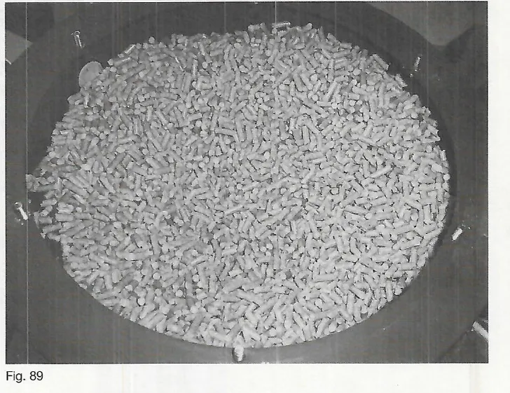
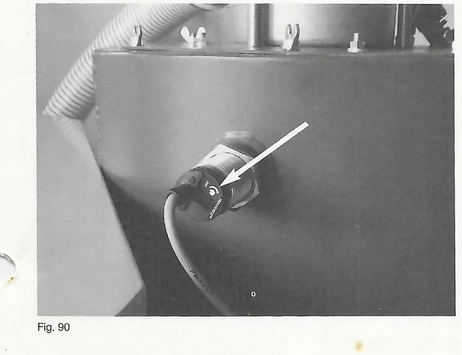
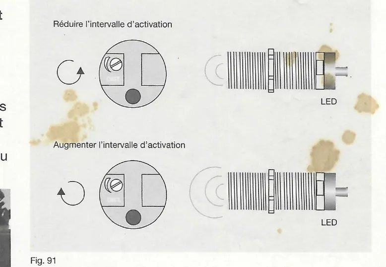
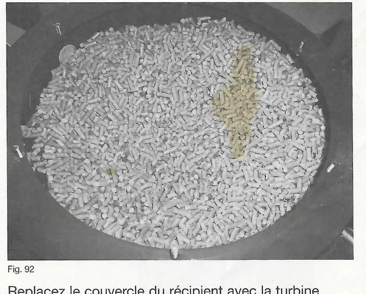

# Première mise en service

## 22. Mise en service

### 22.1 Première mise en service – Système de vis sans fin

1. Retirez l'ensemble propulsif de la bride du moteur.
2. Tournez la vis sans fin à l'aide de l'adaptateur pour le mode manuel (clé
   d'ouverture 19) (réf. 05-2018) dans le sens des aiguilles d'une montre
   jusqu'à ce que les granulés de bois commencent à tomber par le tuyau
   flexible sur le clapet coupe-feu (fig. 87).
3. Remontez l'ensemble propulsif et serrez avec une vis M8 (clé
   d'ouverture 13).
4. Activez l'interrupteur principal ou d'arrêt d'urgence de l'alimentation.
5. Passez au niveau de service et démarrez le remplissage pour la mise en
   service (`Mise en marche` = `Départ`).
6. Une fois le clapet coupe-feu ouvert, le moteur d'injection démarre et
   entraîne les granulés de bois. Arrêtez le remplissage pour la mise en
   service dès que vous voyez les granulés sur le plateau du brûleur
   (fig. 88).
7. Réglez une demande de chaleur au niveau de la régulation du chauffage ou
   réglez la chaudière sur « Manuel » pour la mise en service. La chaudière
   se met en marche.

<small>Source : THF1849 p. 58</small>

### 22.2 Première mise en service – Système d'aspiration

1. Activez l'interrupteur principal ou d'arrêt d'urgence de l'alimentation.
   Le récipient de stockage de la chaudière se remplit automatiquement après
   une « coupure de courant ».
2. Contrôlez le récipient de stockage pour vous assurer qu'il est rempli
   jusqu'à la sonde de capacité (fig. 89).
3. Passez au niveau de service et démarrez le remplissage pour la mise en
   service (`Mise en marche` = `Départ`).
4. Une fois le clapet coupe-feu ouvert, le moteur d'injection démarre et
   entraîne les granulés de bois. Arrêtez le remplissage pour la mise en
   service dès que vous voyez les granulés sur le plateau du brûleur
   (fig. 85 [sic, fig. 88]).
5. Réglez une demande de chaleur sur la régulation de chauffage
   correspondante. La chaudière se met en marche.

!!! note "Remarque"
    Si la procédure de remplissage a été interrompue de façon anticipée ou si
    le niveau de remplissage n'a pas atteint la sonde de capacité, ajustez
    cette dernière au niveau du potentiomètre (voir chapitre 22.3).

!!! note "Remarque"
    La mise en service ne peut être démarrée que lorsque la chaudière est en
    mode PAUSE ou lorsque la phase de combustion est terminée.

<small>Source : THF1849 p. 58</small>

### 22.3 Réglage de la sonde de capacité

La sonde de capacité sur le récipient de stockage est préréglée en usine. En
raison des différences liées à la qualité des granulés de bois et aux
conditions locales, il convient néanmoins de vérifier le fonctionnement de la
sonde de capacité lors de la première mise en service et, si nécessaire, de
l'ajuster.

Si l'intervalle d'activation réglé est dépassé pendant une durée d'env.
2 secondes (LED allumée en continu au niveau de la sonde de capacité), cela
signifie que le niveau maximum est atteint. La procédure de remplissage du
récipient de stockage est arrêtée.

!!! note "Remarque"
    Si la sonde de capacité est réglée de façon trop sensible, il peut
    arriver que le récipient de stockage ne soit pas entièrement rempli. Il
    en résulte une coupure inopinée (combustible insuffisant).

- La sonde de capacité comprend un potentiomètre rotatif pour le réglage.
  Pour le contrôle optique, vous disposez d'une DEL au niveau de la sonde.
  Pendant la procédure de remplissage, la DEL clignote. Une fois le récipient
  rempli, la DEL est allumée en continu (fig. 90).
- Ajustez le potentiomètre rotatif par petites étapes pendant le remplissage
  (1/4 de tour chaque fois). Observez la DEL de la sonde de capacité. La
  sonde est bien réglée lorsque la DEL clignote brièvement pendant le
  remplissage (les granulés s'écoulent devant la sonde).
- **Rotation du potentiomètre vers la gauche** = l'intervalle d'activation
  est réduit (la sonde est moins sensible).
- **Rotation du potentiomètre vers la droite** = l'intervalle d'activation
  est augmenté (la sonde est plus sensible) (fig. 91).
- Contrôlez le niveau de remplissage une fois la procédure de remplissage
  terminée. Répétez la procédure de réglage si le récipient de stockage n'est
  pas entièrement rempli (fig. 92).
- Replacez le couvercle du récipient avec la turbine d'aspiration et serrez
  fermement les écrous papillon.

!!! note "Remarque"
    Lorsque l'alimentation des granulés se fait par système d'aspiration ou
    système avec réservoir de stockage enterré (ou système Taupe ;
    `Capacité System` = `Aspirat.`), la turbine d'aspiration continue de
    fonctionner en général avec un décalage de 10 s afin de vider la conduite
    des granulés. Le moteur d'extraction correspondant (RA) est cependant
    arrêté immédiatement lorsque la fin du remplissage est signalée par la
    sonde de capacité (voir chapitre 17).

<small>Source : THF1849 p. 59</small>
