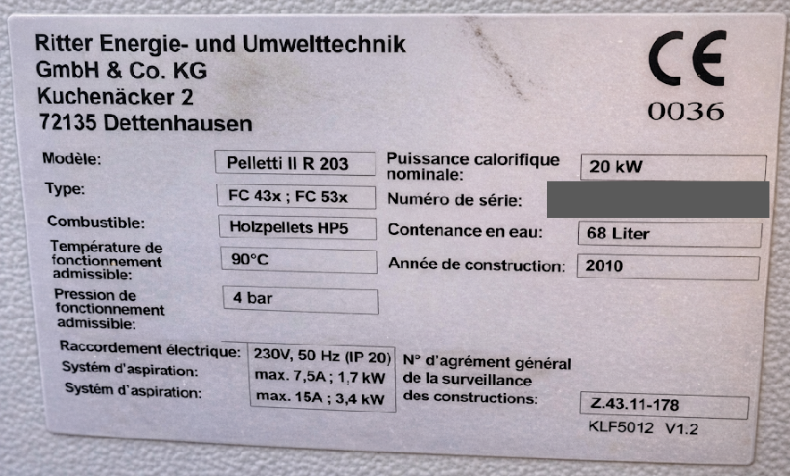

# Plaque signalétique

Fabricant : Ritter Energie- und Umwelttechnik GmbH & Co. KG,
Kuchenäcker 2, 72135 Dettenhausen. Marquage CE 0036.

| Champ | Valeur |
|---|---|
| Modèle | Pelletti II R 203 |
| Type | FC 43x ; FC 53x |
| Combustible | Holzpellets HP5 |
| Température de fonctionnement admissible | 90°C |
| Pression de fonctionnement admissible | 4 bar |
| Puissance calorifique nominale | 20 kW |
| Numéro de série | (masqué) |
| Contenance en eau | 68 Liter |
| Année de construction | 2010 |
| Raccordement électrique | 230V, 50 Hz (IP 20) |
| Systém d'aspiration | max. 7,5A ; 1,7 kW |
| Systém d'aspiration | max. 15A ; 3,4 kW |
| N° d'agrément général de la surveillance des constructions | Z.43.11-178 |
| Référence de la plaque | KLF5012 V1.2 |

!!! note "Remarque"
    La ligne « Systém d'aspiration » figure deux fois sur la plaque, telle que
    transcrite. La plaque type du manuel d'installation (THF1849 § 2.4)
    nomme ces deux lignes « Système de vis sans fin » et « Système
    d'aspiration » : voir [Sécurité, normes et garantie](../reference/securite-normes.md).
