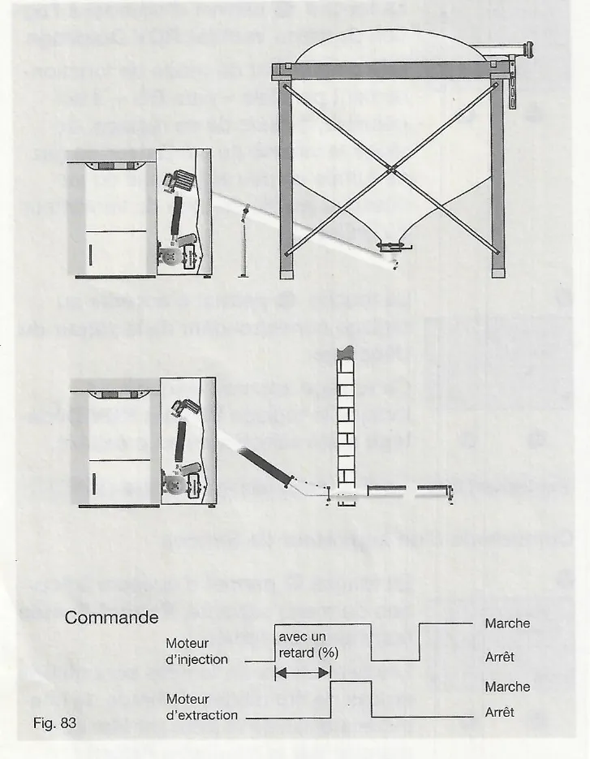
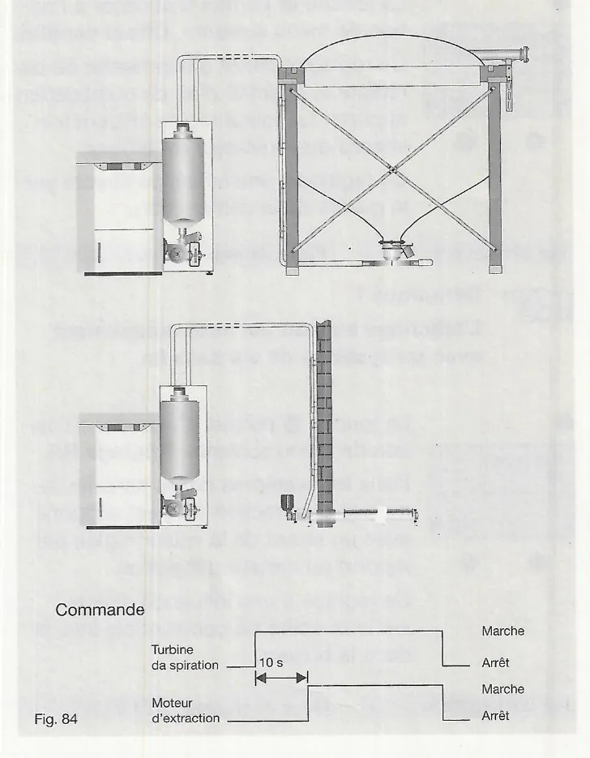
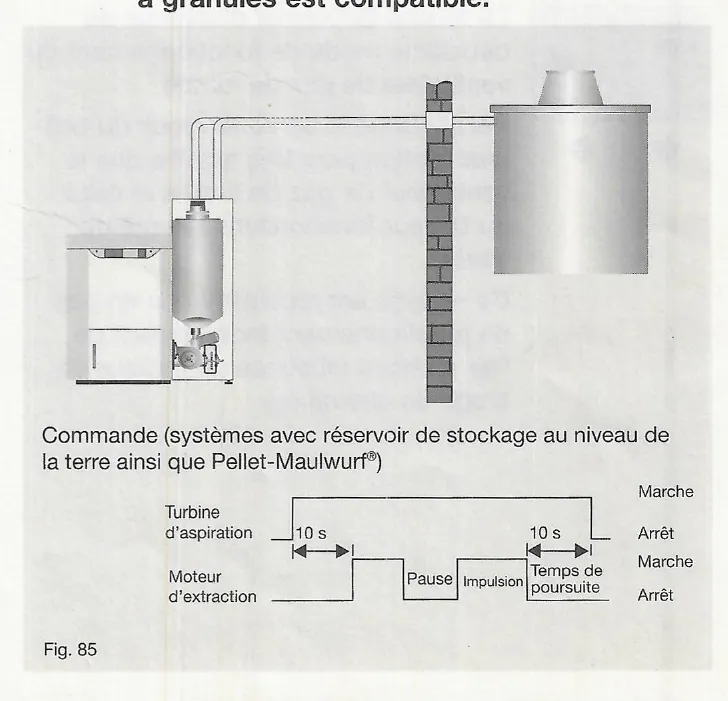
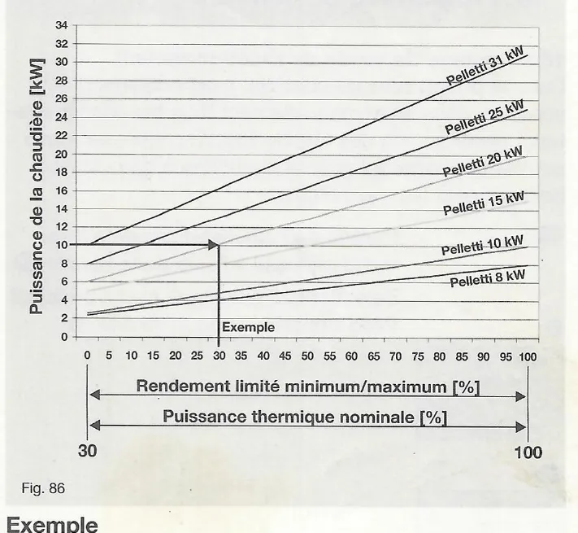

# Paramètres de la chaudière (niveaux de service)

!!! note "Notation des touches"
    Le manuel représente les touches du module de commande par des pictogrammes. Notation utilisée ici : **OK** = niveau de menu inférieur, **ESC** = niveau de menu supérieur, **▼ / ▲** = se déplacer dans un menu, **− / +** = modifier les valeurs.

## 17. Accès au niveau de service

### 17.1 Activation du niveau de service

Le niveau de service permet au chauffagiste d'accéder à des options de
configuration spécifiques à l'installation ainsi qu'à des paramètres de
réglage ayant une influence directe sur la qualité de la combustion.

!!! warning "Attention"
    Seul un technicien spécialisé est autorisé à apporter des modifications
    aux paramètres et réglages de la chaudière.

1. Passez de l'affichage par défaut au menu de sélection à l'aide de la
   touche **OK**.
2. Sélectionnez ensuite le sous-menu `Accès au service` à l'aide de la
   touche **▼**.
3. Appuyez sur la touche **OK** pour accéder au sous-menu.
4. Dans l'affichage par défaut « 0 », **augmentez la valeur avec la touche
   + jusqu'à « 12 »**. Le niveau de service est à présent activé.

<small>Source : THF1849 p. 46</small>

### 17.2 Fonctions et réglages du niveau de service

**Démarrage du remplissage pour la mise en service** : la touche **▼** permet
d'accéder à la première option, `Mise en marche` (Arrêt). Utilisez la touche
**+** pour la régler sur « Départ ». Cette fonction permet d'alimenter le
brûleur en granulés de bois automatiquement **sans** allumage.

**Fin du remplissage pour la mise en service** : appuyez sur la touche **−**
afin de stopper le remplissage pour la mise en service, dès que vous voyez
des granulés de bois sur le plateau de combustion. **Dans les systèmes
d'aspiration**, le récipient de stockage est rempli avant que les granulés
soient convoyés vers le plateau de combustion.

!!! note "Remarque"
    Cette fonction est disponible uniquement lorsqu'aucune demande de chaleur
    n'est présente au niveau de la chaudière.

Les options suivantes se succèdent avec la touche **▼** :

| Option | Par défaut | Plage de réglage | Description |
|---|---|---|---|
| Sys de ballon | Non | Non / Oui | Réglez sur « Oui » (touche +) lorsque la chaudière fonctionne avec ballon tampon ; touche − pour revenir. |
| Durée fonction minimum | 10 minutes | 0 à 30 minutes | Durée de marche minimale de la chaudière dans le mode réglé. Garantit un fonctionnement économique et peu polluant même en cas de demandes de chaleur très fréquentes ou très brèves. |
| Durée pompe | 5 minutes | 2 à 15 minutes | Temps de poursuite de la pompe de la chaudière après la coupure de la demande de chaleur : la chaleur résiduelle de la chaudière est transmise au système de chauffage. |
| Vitesse KP minimum | 100 % | 25 à 100 % | Vitesse minimale de la pompe de la chaudière. Si la température effective de la chaudière est inférieure à la température de consigne prédéfinie, le débit volumétrique de la pompe est adapté automatiquement. |
| Offset inject° | 0 secondes | -10 à +20 s | Augmente ou réduit la quantité de combustible injecté : la valeur est ajoutée au temps d'injection actuellement calculé ou soustraite de celui-ci. Influence directe sur la qualité de la combustion. |
| Offset ventilat | 0 % | -50 à +50 % | Augmente ou réduit la quantité d'air de combustion apporté ; influence la vitesse du ventilateur du brûleur. Influence directe sur la qualité de la combustion. |
| Réglage RA | 60 % | 60 à 90 % | Uniquement avec un système de vis sans fin : le moteur d'extraction (RA) est actionné avec un retard de la valeur réglée par rapport au moteur d'injection. Influence directe sur la quantité de combustible injecté dans le brûleur. |

<small>Source : THF1849 p. 46-47</small>

**Commande du ventilateur de gaz de fumée** (option `Ventilat RGV`)

Le ventilateur de gaz de fumée possède trois modes de fonctionnement :

- **100 %** : le ventilateur fonctionne à une vitesse constante. Réglage par
  défaut pour un tirage de cheminée normal.
- **para BG** (touche +) : parallèlement au ventilateur du brûleur, le
  ventilateur de gaz de fumée et celui du brûleur fonctionnent à la même
  vitesse. Recommandé en cas de fonctionnement indépendant de l'air ambiant
  (absence de limiteur de tirage de cheminée).
- **Offset** (touche +, `Ventilat RGV Décalage`) : en complément du mode
  parallèle « para BG », règle la vitesse du ventilateur de gaz de fumée un
  peu au-dessus ou au-dessous (en %) de celle du ventilateur du brûleur. La
  touche **▼** donne alors accès à la valeur `Ventilat RGV Off` (apparaît
  uniquement si `Ventilat RGV Décalage` a été sélectionné) : par défaut 0 %,
  plage -50 à +50 %.

**Commande d'un aspirateur de fumées** (option `Extract° Fumée`)

Les aspirateurs de fumées sont utilisés en cas de conditions de tirage de
cheminée difficiles et peuvent être commandés par la chaudière Pelletti.
L'aspirateur de fumées possède trois modes de fonctionnement :

- **Non** : sortie non activée.
- **para RGV** (touche +) : parallèlement au ventilateur de gaz de fumée,
  l'aspirateur de fumées fonctionne toujours pendant la combustion.
- **Démarra.** (touche +) : en plus du mode avec aspirateur de fumées, active
  une durée de marche fixe de 20 minutes, ce qui favorise la phase de
  démarrage de la chaudière.

**Choix de l'alimentation en granulés de bois** (option `Capacité System`)

Ce menu permet de déterminer quel type d'alimentation en granulés de bois a
été choisi (valeurs successives avec la touche +) :

| Valeur | Utilisation |
|---|---|
| Non | Granulés injectés directement dans le brûleur par une vis sans fin depuis le silo tissé ou le réservoir de stockage souterrain (fig. 83). |
| ZW | Réservé à des applications spéciales ; ne pas utiliser sans discussion préalable avec le service client Paradigma. |
| RA | Réservé à des applications spéciales ; ne pas utiliser sans discussion préalable avec le service client Paradigma. |
| RA+ZW | Réservé à des applications spéciales ; ne pas utiliser sans discussion préalable avec le service client Paradigma. |
| Sys.aspi | Granulés aspirés depuis un silo tissé ou un réservoir de stockage souterrain (fig. 84). |
| Aspirat. | Granulés aspirés depuis un réservoir de stockage au niveau de la terre (ou système Taupe) (fig. 85). |

!!! note "Remarque"
    Pour le réglage Aspirat., demandez avec quel réservoir de stockage
    enterré la chaudière à granulés est compatible.

Fig. 83 – Commande : le moteur d'extraction démarre avec un retard (%) par
rapport au moteur d'injection.

Fig. 84 – Commande : le moteur d'extraction démarre 10 s après la turbine
d'aspiration.

Fig. 85 – Commande (systèmes avec réservoir de stockage au niveau de la terre
ainsi que Pellet-Maulwurf®) : moteur d'extraction démarré 10 s après la
turbine d'aspiration, fonctionnement par impulsions et pauses, puis temps de
poursuite de 10 s de la turbine.

Les systèmes avec réservoir de stockage enterré (ou systèmes Taupe)
nécessitent généralement un temps de poursuite de la turbine d'aspiration
pour vider la conduite des granulés entre la chaudière et le local de
stockage enterré à la fin du processus de remplissage. Si ce temps de
poursuite est nécessaire ou recommandé pour le système disponible, il doit
être réglé dans les options avancées du niveau de service (voir
chapitre 17.3).

**Ajout de granulés dans le récipient de stockage, et options suivantes**

| Option | Par défaut | Plage de réglage | Description |
|---|---|---|---|
| Sys.aspi rempliss Durée | 10-20 kW : 150 min ; 25-32 kW : 200 min | 100 à 300 min | Durée de marche du moteur d'injection après laquelle le remplissage du récipient de stockage doit avoir lieu. Actif uniquement avec un système d'aspiration. |
| Offset ESM Dema | 5,0 s | 3,0 à 7,0 s | Modifie la durée de marche du moteur d'injection pendant la phase de démarrage (allumage) ; influence la quantité de granulés convoyés vers le plateau de combustion avant l'allumage. |
| Retour BG | 5 minutes | 2 à 30 minutes | Temps de poursuite du ventilateur du brûleur après la combustion. |
| Rend. chaud. | voir plaque signalétique | 8, 10, 15, 20, 25, 31 kW | Puissance thermique nominale requise pour la chaudière ; en fonction de celle-ci, la quantité nécessaire de granulés et d'air de combustion est apportée. |

<small>Source : THF1849 p. 47-49</small>

### 17.3 Niveau de service avancé

1. Dans le sous-menu `Accès au service` (touche **OK**), augmentez la valeur
   « 0 » avec la touche **+ jusqu'à « 42 »**. Le niveau de service avancé
   est à présent activé.
2. Faites défiler les options du niveau de service avancé à l'aide de la
   touche **▼**. Des réglages supplémentaires sont à présent disponibles.

| Option | Par défaut / Recommandation | Plage de réglage | Description |
|---|---|---|---|
| Rend. limité minimum | 0 % | 0 à 100 % | Crée une limite « basse » de la puissance thermique nominale (fig. 86). |
| Rend. limité maximum | 100 % | 0 à 100 % | Crée une limite « haute » de la puissance thermique nominale (fig. 86). |
| Retour turbine | Recommandation : 10 s (affiché 0.0 s) | 0 à 30 s | Uniquement avec un système d'aspiration : temps pendant lequel la turbine d'aspiration continue de fonctionner pour vider la conduite des granulés (le plus souvent requis pour les locaux de stockage enterrés). |
| Durée RA | Recommandation : 150 s | 5,0 à 600 s | Uniquement avec l'option Aspirat. : durée pendant laquelle la sortie RA (X24, moteur d'extraction) est actionnée avant une pause (Pause RA). |
| Pause RA | Recommandation : 5 s | 5,0 à 60 s | Uniquement avec l'option Aspirat. : durée de la pause entre deux actionnements de la sortie RA (X24, moteur d'extraction). |
| Langue | Français | Deutsch, Italiano, Français, English | Langue d'affichage à l'écran. |

!!! warning "Attention"
    Le temps de poursuite sert à vider la conduite des granulés de bois du
    local de stockage enterré. Le récipient de stockage de la chaudière ne
    doit cependant pas être trop rempli lors de l'aspiration pour vider la
    conduite des granulés (risque d'obstruction).

!!! note "Remarque"
    Pour connaître les réglages recommandés pour les paramètres Durée RA et
    Pause RA (option Aspirat.), reportez-vous aux indications du fabricant du
    système de stockage.

!!! note "Remarque"
    Le texte du manuel décrit Pause RA avec la même phrase que Durée RA
    (« combien de temps la sortie RA est actionnée avant une pause ») ; le
    libellé de l'option et sa plage indiquent qu'il s'agit de la durée de
    pause.

Fig. 86 – Puissance de la chaudière [kW] en fonction du rendement limité
minimum/maximum [%] (= puissance thermique nominale [%], échelle 30 à 100),
pour les Pelletti 8, 10, 15, 20, 25 et 31 kW.

**Exemple** : vous souhaitez imposer à une chaudière Pelletti 20 kW une
limite « basse » de 10 kW. Le réglage `Rend. limité minimum` doit alors être
réglé sur 30 %.

<small>Source : THF1849 p. 49-50</small>

## 20. Aperçu des réglages par défaut

### 20.1 Réglages de base des paramètres de l'installation

| Réglage | Valeur par défaut | Plage de réglage |
|---|---|---|
| Heure nettoyag | 12:00 | 00:00 - 23:45 |
| Durée nettoyag | 3 min | 2 - 15 minutes |
| Départ turbine | 06:00 | 00:00 - 23:45 |
| Arrêt turbine | 22:00 | 00:00 - 23:45 |
| Temp. chaud. | 65,0 °C | 65,0 - 85 °C |

<small>Source : THF1849 p. 55</small>

### 20.2 Réglages de base du niveau de service (Code 12)

| Réglage | Valeur par défaut | Plage de réglage |
|---|---|---|
| Sys de ballon | Non | Non/Oui |
| Durée fonction | 10,0 min | 0 - 30 min |
| Durée pompe | 5,0 min | 2 - 30 min |
| Vitesse KP | 100 % | 25 – 100 % |
| Offset inject° | 0,0 s | -10 à +20 s |
| Offset ventilat | 0,0 s (sic) | -50 à +50 % |
| Réglage RA | 60 % | 60 à 90 % |
| Ventilat RGV | 100 % | 100 %, para BG |
| Extract° Fumée | Non | Non/Oui |
| Capacité System | Non/Sys.aspi | Non/Sys.aspi/Aspirat. |
| Sys.aspi rempliss | 150/200 | 100 à 300 min |
| Offset ESM Dema | 5,0 s ; 6,0 s (Mini) | 3,0 à 7,0 s |
| Retour BG | 5 min | 2 à 30 min |
| Rend. chaud. | voir plaque signalétique | 8, 10, 15, 20, 25, 32 |

!!! note "Remarque"
    Écarts dans le manuel : la plage de `Durée pompe` est 2 à 15 minutes au
    chapitre 17.2 mais 2 - 30 min ici ; la plage de `Rend. chaud.` se
    termine par 31 kW au chapitre 17.2 et par 32 ici.

<small>Source : THF1849 p. 55</small>

### 20.3 Réglages en niveau de service avancé (Code 42)

| Réglage | Valeur par défaut | Plage de réglage |
|---|---|---|
| Rend. limité minimum | 0 % | 0 - 100 % |
| Rend. limité maximum | 100 % | 0 - 100 % |
| Retour turbine | 0,0 s | 0,0 - 30,0 s |
| Durée RA | 150,0 s | 5,0 - 600,0 s |
| Pause RA | 5,0 s | 5,0 - 60,0 s |
| Langue | prédéfini | Deutsch, Italiano, Français, English |

Le tableau d'origine comporte en plus des colonnes vides « Réglé » et
« Modifié », ainsi que des champs « Date » et « Nom » à remplir par
l'installateur.

<small>Source : THF1849 p. 55</small>

## Aperçu des paramètres (instructions utilisateur)

| Réglage | Valeur par défaut | Plage de réglage |
|---|---|---|
| Heure nettoyag | 12:00 | 00:00 - 23:45 |
| Durée nettoyag | 3 min | 2 - 15 minutes |
| Départ turbine | 06:00 | 00:00 - 23:45 |
| Arrêt turbine | 22:00 | 00:00 - 23:45 |
| Temp. chaud. | 65,0 °C | 65,0 - 85 °C |
| Durée fonction | 10,0 min | 0 - 30 minutes |
| Durée pompe | 5,0 min | 2 - 30 minutes |
| Vitesse KP | 33 % | 33 - 100 % |

(Le tableau original comporte des colonnes vides « Réglé » et « Modifié »
et des champs « Réglé le / Signature / Modifié le / Signature », non
remplis.)

<small>Source : THF1848 p. 19</small>

!!! note "Remarque"
    Écart entre manuels : les instructions utilisateur (THF1848) donnent `Vitesse KP` 33 % (plage 33 - 100 %), les manuels technicien THF1849 et THF1751 donnent 100 % (plage 25 - 100 %).
