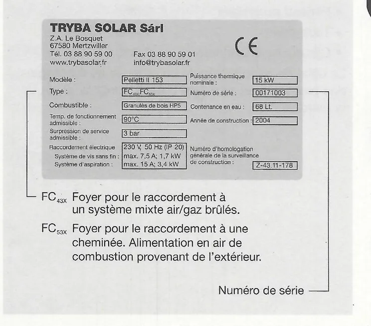

# Sécurité, normes et garantie

## 1. A propos de ce document

### 1.1 Fonction de ce document

Ce document fournit des informations sur la chaudière à granulés de bois
Pelletti, notamment sur :

- la sécurité,
- les systèmes à granulés de bois,
- les instructions de montage et d'installation,
- la mise en service,
- la garantie légale.

<small>Source : THF1849 p. 4</small>

### 1.2 Groupe cible de ce document

Ces instructions de montage et d'installation s'adressent au technicien
spécialisé.

<small>Source : THF1849 p. 4</small>

### 1.3 Symboles utilisés dans ce document

| Symbole | Signification |
|---|---|
| Danger ! | Signale un danger pour l'utilisateur. |
| Attention ! | Signale un risque de dommage matériel. |
| Remarque ! | Ce symbole donne des informations sur les instructions qui demandent une attention particulière. |

<small>Source : THF1849 p. 4</small>

### 1.4 Remarque relative à la validité

Les présentes instructions de montage et d'installation sont valables
pour les chaudières à granulés de bois Pelletti II de Paradigma à partir
de la version 06/06.

<small>Source : THF1849 p. 4</small>

## 2. Pour votre sécurité

!!! danger "Danger"
    Veuillez respecter les consignes de sécurité afin d'exclure tout
    danger et tout dommage corporel ou matériel. Veuillez lire
    attentivement les présentes instructions de service.

### 2.1 Utilisation conforme de l'appareil

La chaudière à granulés de bois Pelletti doit être utilisée exclusivement
pour la combustion de granulés de bois et dans des installations de
production d'eau chaude.

La chaudière à granulés de bois et ses composants sont prévus uniquement
pour être associés aux systèmes de prélèvement des granulés de bois de la
société Paradigma. L'utilisation de composants d'un autre fabricant avec
la chaudière à granulés de bois n'est possible qu'après consultation de la
société Paradigma.

Il est interdit d'utiliser la chaudière de quelque autre manière que ce
soit. Toute autre utilisation, ainsi que toute modification apportée à
l'appareil, même dans le cadre du montage et de l'installation, entraînent
l'annulation du droit à la garantie.

En tant que fabricant, nous déclarons que le produit désigné correspond,
dans sa conception et sa structure ainsi que dans sa version
commercialisée par nos soins, aux exigences de sécurité fondamentales et
aux normes nationales actuellement en vigueur.

<small>Source : THF1849 p. 4</small>

### 2.2 Consignes de sécurité générales

!!! warning "Attention"
    - La première mise en service de la chaudière à granulés de bois et
      l'adaptation de la commande de la chaudière au système de
      prélèvement des granulés de bois (réglage des paramètres de
      l'installation) ne doivent être réalisées que par un technicien
      spécialisé. Après la première mise en service, le technicien
      spécialisé doit expliquer à l'utilisateur le fonctionnement de la
      chaudière à granulés de bois (voir les instructions de service
      THF1848, chapitre 5.2).
    - Sauf en cas de danger, la chaudière à granulés de bois ne peut être
      mise hors service que par le technicien spécialisé. Sauf en cas de
      danger, la chaudière à granulés de bois ne doit être séparée du
      réseau que pour les travaux de réparation, de livraison de granulés
      de bois et d'entretien.
    - Veillez à ce que la température ambiante soit comprise entre 0 °C
      et 40 °C. Des conditions ambiantes non autorisées peuvent entraîner
      des dommages sur la chaudière à granulés de bois.

<small>Source : THF1849 p. 4</small>

### 2.3 Déclaration de conformité selon les directives européennes

Paradigma déclare par la présente que ce produit répond aux directives
fondamentales pour la commercialisation dans l'UE.

- La déclaration de conformité correspondant à l'appareil (CE) peut être
  obtenue sur simple demande auprès de Paradigma.

<small>Source : THF1849 p. 5</small>

### 2.4 Identification de l'appareil

L'appareil est clairement identifiable par la plaque signalétique apposée
à l'avant de la chaudière. Cette plaque signalétique comprend les
principales données techniques et un numéro de série unique.

Exemple de plaque signalétique (distributeur Tryba Solar) :

| Champ | Exemple |
|---|---|
| Modèle | Pelletti II 153 |
| Type | FC43x, FC53x |
| Combustible | Granulés de bois HP5 |
| Temp. de fonctionnement admissible | 90 °C |
| Surpression de service admissible | 3 bar |
| Raccordement électrique | 230 V, 50 Hz (IP 20) ; système de vis sans fin : max. 7,5 A ; 1,7 kW ; système d'aspiration : max. 15 A ; 3,4 kW |
| Puissance thermique nominale | 15 kW |
| Numéro de série | 00171003 |
| Contenance en eau | 68 L |
| Année de construction | 2004 |
| Numéro d'homologation générale de la surveillance de construction | Z-43.11-178 |

- FC43x : foyer pour le raccordement à un système mixte air/gaz brûlés.
- FC53x : foyer pour le raccordement à une cheminée. Alimentation en air
  de combustion provenant de l'extérieur.

<small>Source : THF1849 p. 5</small>

### 2.5 Marques de contrôle

- **BLT-Wieselburg**, Office fédéral pour la technique agricole (marque
  « Geprüft ») : EN 303-5. Chaudière pour combustibles solides, foyers
  alimentés manuellement ou automatiquement, puissance thermique nominale
  jusqu'à 300 kW.
- **Deutsches Institut für Bautechnik** : homologation générale de la
  surveillance des bâtiments. Numéro d'homologation : Z-43.11-178. Objet
  de l'homologation : foyer à granulés de bois indépendant de l'air
  ambiant de la série « Pelletti ».
- **Surveillance de la production** : TÜV Industrie Service GmbH, Groupe
  TÜV SÜD.

<small>Source : THF1849 p. 5</small>

## 3. Normes et prescriptions

Les normes et directives suivantes doivent être respectées lors de la
mise en œuvre et du fonctionnement d'installations de chauffage :

- les prescriptions légales de prévention des accidents,
- les prescriptions légales de protection de l'environnement,
- les prescriptions de votre association professionnelle,
- les conditions de sécurité applicables des normes NF, EN.

!!! note "Remarque"
    En règle générale : les normes et ordonnances spécifiques de
    l'assemblage et de fonctionnement des installations de chauffage en
    vigueur dans le pays concerné doivent être respectées.

<small>Source : THF1849 p. 5</small>

## 4. Conditions de garantie légale

Dans la mesure où le montage a été effectué conformément par une
entreprise spécialisée agréée et que l'appareil est utilisé de façon
appropriée, ainsi que sur la base de nos conditions générales de vente,
nous prenons en charge les périodes de garanties prévues par la loi pour
le produit décrit dans la présente brochure, à l'exception des pièces
d'usure qu'il contient. Pour obtenir une période de garantie plus longue
que celle prévue par la loi, reportez-vous à la liste des prix en vigueur
à la date d'achat.

Aucune garantie n'est prévue pour les dommages dus à :

- une utilisation non appropriée ou non conforme ;
- un montage ou une mise en service incorrects par l'acheteur ou un
  tiers ;
- le non-respect des normes et prescriptions en vigueur pour l'assemblage
  et le fonctionnement d'installations de chauffage ;
- la détérioration naturelle ;
- une manipulation incorrecte ou négligente ;
- des moyens d'exploitation inappropriés (qualité des granulés de bois) ;
- des influences chimiques, électrochimiques ou électriques, dans la
  mesure où ces dernières ne sont pas de notre fait ;
- le non-respect des instructions de service ;
- des modifications ou des opérations de réparation non conformes par
  l'acheteur ou un tiers ;
- l'influence de pièces d'origine inconnue ;
- les dommages ou pannes par des composants de l'installation qui ne
  figurent pas dans le contenu de la livraison par Paradigma (composants
  d'autres fabricants) ;
- la présence de vapeurs ou d'halogènes agressifs dans l'air ambiant ou
  de combustion ;
- la corrosion par l'oxygène ;
- la poursuite de l'utilisation après l'apparition d'un vice.

**Période de détérioration des pièces d'usure**

La détérioration des pièces dites d'usure ne représente en aucun cas un
vice matériel, dans la mesure où il ne s'agit pas d'une détérioration
excessive due à un vice de constitution de la pièce concernée. Les droits
du client relatifs aux vices de matériel de ces pièces d'usure prennent
fin dès lors que ces pièces ont fonctionné plus longtemps que leurs
périodes de détérioration prévues, et au plus tard après deux ans.

| Pièce d'usure | Période de détérioration |
|---|---|
| Plateau du brûleur | 2 ans |
| Tube-foyer | 2 ans |
| Cartouche chauffante | 2 ans |

Le délai de garantie légale commence au montage des pièces ou au plus
tard 3 mois après livraison de la marchandise.

<small>Source : THF1849 p. 6</small>

## Régulateur SystaComfort : sécurité

!!! note "Validité"
    Le manuel d'installation THF1777 (V 1.4 07/08) est valable pour le régulateur de chauffage SystaComfort de Paradigma à partir de la version de logiciel 1.32 07/08.

<small>Source : THF1777 p. 4</small>

!!! danger "Danger !"
    Veuillez respecter les consignes de sécurité afin d'exclure tout danger et tout dommage corporel ou matériel. Lisez attentivement ce manuel d'installation et de mise en service.

!!! danger "Danger !"
    Seul un électricien spécialisé est autorisé à procéder à l'ouverture de l'appareil, à son installation ou à sa mise en service ! Veuillez respecter les prescriptions en vigueur ! Les travaux non conformes sur des appareils alimentés par du courant peuvent entraîner un risque de blessure mortelle par électrocution.

<small>Source : THF1777 p. 4</small>

**Conformité CE** — cet appareil correspond aux directives européennes suivantes :

- Directive basse tension 73/23/CEE ;
- Directive sur la compatibilité électromagnétique (CEM) 89/336/CEE, y compris les directives d'amendement jusqu'à la directive 93/66/CEE.

<small>Source : THF1777 p. 4</small>

### 2.1 Utilisation conforme de l'appareil

Le régulateur de chauffage SystaComfort doit être utilisé uniquement pour la régulation d'installations de chauffage équipée d'une chaudière gaz à condensation Paradigma Modula II ou ModuVario, une chaudière à granulés de bois Pelletti ou une chaudière gaz ou fioul à un niveau de Paradigma. Il peut fonctionner seul ou associé au régulateur solaire Paradigma SystaSolar ou SystaSolar Aqua.

Il est interdit d'utiliser l'appareil de quelque autre manière que ce soit. Toute autre utilisation, ainsi que toute modification apportée à l'appareil, même dans le cadre du montage et de l'installation, entraînent l'annulation du droit à la garantie.

<small>Source : THF1777 p. 4</small>

### 2.2 Consignes de sécurité générales

!!! warning "Attention"
    - La première mise en service de l'installation de chauffage et l'adaptation du régulateur de chauffage à cette installation (réglage des données de l'installation) doivent être effectuées par le fabricant ou par un spécialiste compétent (technicien spécialisé) nommé par lui. Après la première mise en service, le technicien spécialisé doit expliquer à l'utilisateur le fonctionnement du régulateur de chauffage et de l'installation de chauffage (voir chapitre 6.16 « Présentation explicative à l'utilisateur »).
    - Veillez à ce que la température ambiante soit toujours comprise entre 0 °C et 40 °C. Protégez l'appareil des liquides et d'une humidité élevée durable. Des conditions ambiantes non autorisées peuvent entraîner des dommages sur le régulateur de chauffage.
    - Seul le fabricant est autorisé à procéder à des réparations sur l'appareil. Il est interdit d'utiliser d'autres pièces de rechange que les pièces Paradigma d'origine.

<small>Source : THF1777 p. 4</small>
