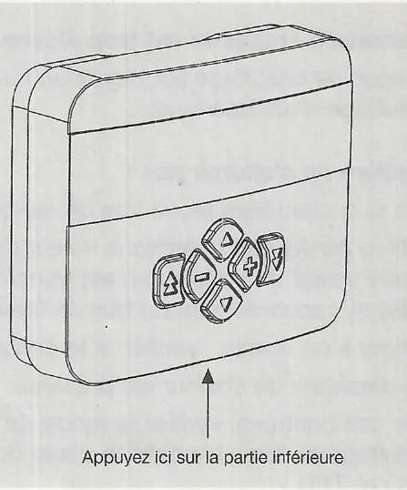
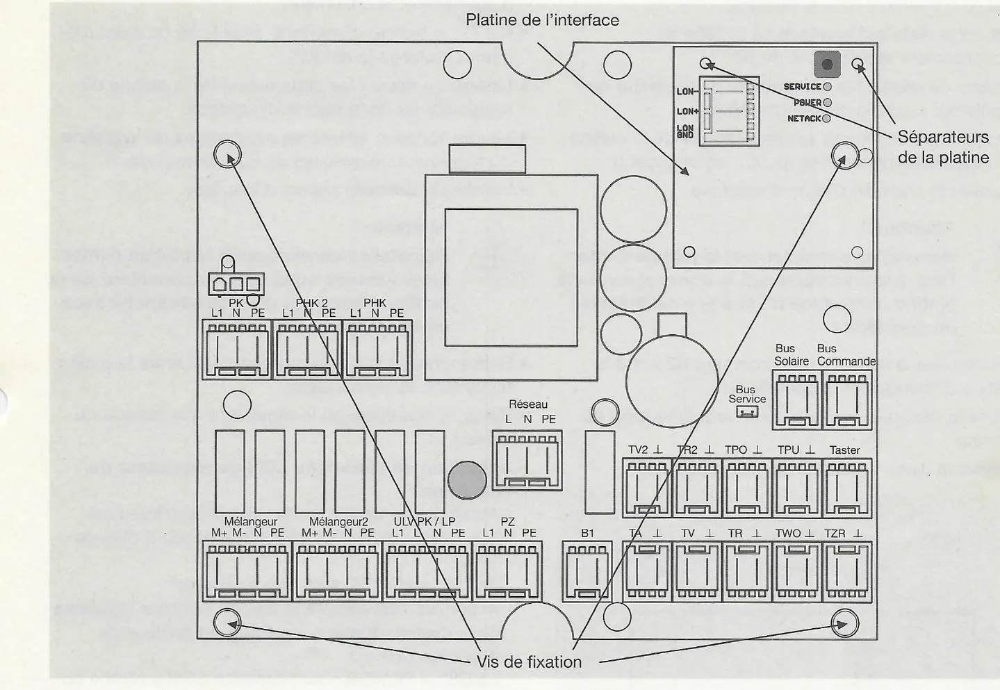
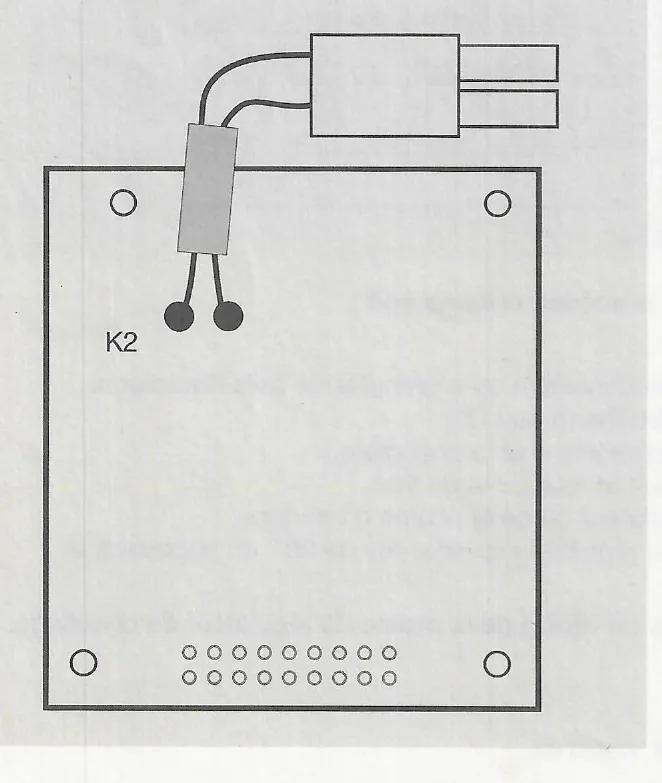
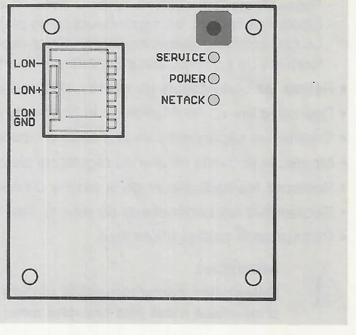

# Fonctionnement, pannes et remplacement (SystaComfort)

!!! note "Notation des touches"
    ⊕ / ⊖ (plus / moins), △ / ▽ (haut / bas), ⇩ (double flèche vers le bas : niveau de menu inférieur / 2e niveau de commande), ⇧ (double flèche vers le haut : niveau supérieur / affichage par défaut).

## 7. Fonctionnement du régulateur de chauffage SystaComfort

### 7.1 Fonctionnement normal

Une fois l'installation mise en service de façon conforme par le technicien, aucune manipulation spéciale n'est nécessaire ; l'installation fonctionne automatiquement. Des réglages ne sont nécessaires que pour adapter l'installation aux besoins de l'utilisateur :

- réglage du mode de fonctionnement (par exemple Confort +, Abaissement continu) ;
- modification des températures ambiantes souhaitées et du programme horaire de chauffage ;
- modification des températures d'eau chaude souhaitées et du programme horaire de production d'eau chaude ;
- modification du programme horaire de circulation.

<small>Source : THF1777 p. 33</small>

### 7.2 Fonctionnement en cas d'absence prolongée

L'utilisateur peut sélectionner le mode **Abaissement continu** ou entrer une période de vacances. Le circuit de chauffage passe alors en abaissement ; la production d'eau chaude et la circulation sont verrouillées.

!!! note "Remarque"
    Dans les installations à deux circuits de chauffage, pour mettre à l'arrêt toute l'installation, il faut régler le mode Abaissement continu ou saisir la période de vacances pour les deux circuits.

<small>Source : THF1777 p. 33</small>

### 7.3 Mise hors service de l'installation de chauffage

Lorsque l'installation n'est pas utilisée pendant une longue durée, l'utilisateur ne doit pas la débrancher du réseau, mais régler le mode de fonctionnement du ou des circuits de chauffage sur **Arrêt**. L'installation et le bâtiment restent ainsi protégés contre le gel, et on évite le blocage des pompes et mélangeurs dû à de longues périodes d'arrêt.

<small>Source : THF1777 p. 33</small>

## 8. Panne

Le régulateur signale une défaillance de la sonde extérieure (si au moins un circuit est régulé en fonction de la température extérieure) et, dans les installations avec chaudière gaz ou fioul à un niveau ou avec ballon OPTIMA ou TITAN, une défaillance de la sonde TPO.

Il affiche en outre les messages de panne de la chaudière gaz à condensation ou à granulés de bois Paradigma et du régulateur solaire SystaSolar (s'il est correctement raccordé par le bus de liaison).

### 8.1 Consultation du code de panne

Passez de l'affichage par défaut au menu principal avec ⇩. Faites défiler avec ▽ jusqu'à **Consulter le code de panne** (`Pannes Consulter`). Appelez le sous-menu avec ⇩, puis naviguez avec △ et ▽.

**Panne sonde** (affichage `Panne sonde --` sans défaut) : une **défaillance** de la **sonde extérieure** s'affiche (si au moins un circuit est régulé en fonction de la température extérieure) et, dans les installations avec chaudière gaz ou fioul à un niveau ou ballon d'eau douce, mixte ou tampon, une défaillance de la **sonde TPO**.

| Code | Panne | Cause possible | Remède |
|---|---|---|---|
| 10 | Sonde TA défectueuse | Sonde non raccordée ; sonde défectueuse | Raccorder la sonde ; remplacer la sonde |
| 11 | Sonde TPO défectueuse | Sonde non raccordée ; sonde défectueuse | Raccorder la sonde ; remplacer la sonde |

**Panne chaudière** (ex. `Panne chaudière 02`) : le régulateur affiche le code de panne de la chaudière. Avec les chaudières à granulés de bois Pelletti de Paradigma équipées d'un système d'évacuation des cendres Confort, le code **201** apparaît lorsque le récipient à cendres est pratiquement plein et le code **199** lorsqu'il est complètement rempli. Videz alors le récipient à cendres (voir les instructions de service de la chaudière). La communication entre chaudière et régulateur est également surveillée ; en cas de problème, un message s'affiche (« Pas de bus OT » ou « Pas de bus LON »).

**Panne solaire** (ex. `Panne solaire 20`) : si un régulateur solaire SystaSolar ou SystaSolar Aqua est raccordé par bus de liaison, son **message de panne** est également affiché (voir la documentation du régulateur solaire).

<small>Source : THF1777 p. 34</small>

### 8.2 Dépannage

**La pompe du circuit de chauffage ne se met pas en marche ou à l'arrêt :**

- Vérifiez la température extérieure, le mode de fonctionnement et les limites de chauffage (Normal, Abaissement, température extérieure de protection antigel).
- Tenez compte du temps de poursuite de 5 min des pompes des circuits de chauffage.
- **Si une pompe électronique (par exemple Grundfos Alpha) est utilisée comme pompe de circuit de chauffage, la vitesse minimale (vitesse PHK MIN) doit absolument être réglée sur 100 % !**

**La température ambiante diffère de sa consigne :**

- Circuit régulé en fonction de la température extérieure : corrigez la courbe de chauffe.
- Circuit régulé en fonction de la température ambiante : réduisez la bande proportionnelle.

**La température ambiante est trop élevée ou trop faible en période de transition :**

- Circuit régulé en fonction de la température extérieure : réduisez ou augmentez la limite de chauffage d'abaissement.

**La chaudière ne s'allume pas :**

- Vérifiez si la chaudière reçoit une demande de chaleur :
    - Chaudière modulante : vérifiez la consigne transmise (voir instructions de la chaudière) ; si aucune consigne n'est transmise, contrôlez la communication avec la chaudière (voir chapitre 6.5 Contrôle du raccordement du bus de liaison à la chaudière).
    - Chaudière à un niveau : vérifiez si le contact brûleur B1 est fermé.
- Si une demande de chaleur est présente, vérifiez le fonctionnement de la chaudière.
- Sinon, vérifiez le mode de fonctionnement, les consignes et les réglages des circuits et, avec ballon d'eau douce, mixte ou tampon, contrôlez aussi les températures TPO et TPU.
- Avec les ballons TITAN, EXPRESSO ou OPTIMA, vérifiez que la sonde TPO est montée à hauteur du raccordement de l'aller du circuit de chauffage ou légèrement **en dessous**.

**La chaudière ne s'arrête pas ou s'arrête trop tard :**

- Avec ballon d'eau douce, mixte ou tampon, vérifiez la sonde TPU : la chaudière ne s'éteint que lorsque la consigne du tampon est atteinte à la sonde TPU.
- Avec les ballons OPTIMA, EXPRESSO ou TITAN, vérifiez que la sonde TPU est montée à hauteur du raccordement du retour du circuit de chauffage ou légèrement **au-dessus**.
- Vérifiez le réglage « Température maximale du tampon » et la température TPO. Si TPO dépasse la température maximale du tampon, la chaudière s'éteint ; seule la pompe chaudière continue de fonctionner.

**La chaudière se synchronise :**

- Installations sans ballon tampon : augmentez la différence de commutation et la durée de marche minimale de la chaudière.
- Installations avec ballon OPTIMA, EXPRESSO ou TITAN et chaudière modulante : vérifiez la différence de commutation interne de la chaudière (voir ses instructions de service) ; elle doit être réglée sur 5 K.

**La pompe de circulation ne se met pas en marche :**

- Vérifiez le mode de fonctionnement et le programme horaire de la circulation.
- Vérifiez si la température de retour (sonde TZR) est inférieure à la température d'interruption.
- Vérifiez si le temps de verrouillage depuis la dernière interruption est écoulé.

**La pompe de circulation ne s'arrête pas :**

- En fonctionnement par bouton-poussoir, vérifiez le temps de poursuite réglé.

<small>Source : THF1777 p. 35</small>

## 9. Inspections, entretien et nettoyage du régulateur de chauffage

Le régulateur ne nécessite aucun entretien spécifique. Lors de l'entretien annuel de la chaudière, contrôlez les sondes et le fonctionnement des appareils raccordés (pompes, vanne de dérivation, mélangeurs).

Nettoyez la commande et le coffret mural avec des nettoyants ménagers classiques (pas de produit abrasif). Essuyez avec un chiffon légèrement humide.

<small>Source : THF1777 p. 36</small>

## 10. Remplacement du régulateur de chauffage

!!! danger "Danger"
    - Respectez les consignes du chapitre 2 « Pour votre sécurité ».
    - Mettez le régulateur hors tension et assurez-vous qu'il ne sera pas remis sous tension par inadvertance.

### 10.1 Remplacement de la commande

Toutes les valeurs réglées sont enregistrées dans le régulateur ; elles restent donc en mémoire lors du remplacement de la commande.

- Appuyez ici sur la partie inférieure.

Pour remplacer une commande :

- Débranchez le régulateur ou la chaudière du réseau.
- Retirez la partie supérieure de la commande : appuyez légèrement sur la partie inférieure (en bas) et soulevez la partie supérieure vers l'avant.
- Installez la partie supérieure de la nouvelle commande.
- En cas de défaut de la partie inférieure, remplacez-la également.
- Pour une commande du deuxième circuit de chauffage, rebranchez les ponts sur les bornes de raccordement.

<small>Source : THF1777 p. 36</small>

### 10.2 Remplacement de la platine du régulateur de chauffage

Avant de remplacer la platine (si cela est encore possible), consultez et notez toutes les valeurs réglées.

- Platine de l'interface (en haut à droite, bornes LON−, LON+, LON GND, DEL SERVICE, POWER, NETACK)
- Séparateurs de la platine
- Vis de fixation (4)
- Borniers : PK, PHK 2, PHK (L1 N PE) ; Réseau (L N PE) ; Mélangeur, Mélangeur2 (M+ M− N PE) ; ULV/PK/LP (L1 L N PE) ; PZ (L1 N PE) ; B1 ; sondes TV2, TR2, TPO, TPU, Taster, TA, TV, TR, TWO, TZR ; Bus Solaire, Bus Commande, Bus Service

Pour remplacer la platine :

- Débranchez le régulateur ou la chaudière du réseau.
- Si la régulation est montée dans une chaudière gaz à condensation ou à granulés de bois Paradigma, retirez d'abord la platine d'interface OpenTherm ou LON :
    - débranchez la fiche de raccordement entre la platine d'interface et la chaudière ;
    - retirez la platine d'interface de la fiche de raccordement et relevez-la de 90° ;
    - libérez ce faisant les séparateurs de la platine du régulateur ou de la platine d'interface ;
    - le cas échéant, libérez les séparateurs de la platine du régulateur (relevez-les de 90° en appuyant) et fixez-les de nouveau dans la platine d'interface.
- Retirez les connecteurs du réseau, des sorties et du bus de liaison.
- Desserrez les vis de fixation de la platine du régulateur.
- Enlevez les séparateurs de la platine d'interface.
- Montez la nouvelle platine et vissez-la.
- Replacez les séparateurs de la platine d'interface.
- Rebranchez les connecteurs du réseau, des sorties et du bus de liaison.
- Réinstallez la platine d'interface.

!!! warning "Attention"
    Réinstallez correctement la platine d'interface. Assurez-vous que son connecteur n'est pas branché avec un décalage !

- Rebranchez la fiche de raccordement entre la platine d'interface et la chaudière.
- Remettez la chaudière ou le régulateur sous tension.
- Réglez de nouveau toutes les valeurs.
- Testez les sondes et les sorties.
- Vérifiez la communication avec la chaudière et le régulateur solaire.

<small>Source : THF1777 p. 37</small>

### 10.3 Remplacement de l'interface OpenTherm

- K2 : fiche de raccordement vers la chaudière

- Débranchez le régulateur ou la chaudière du réseau.
- Débranchez la fiche de raccordement K2 entre la platine d'interface et la chaudière.
- Retirez la platine d'interface de la fiche de raccordement et relevez-la de 90°.
- Libérez ce faisant les séparateurs de la platine du régulateur ou de la platine d'interface.
- Le cas échéant, libérez les séparateurs de la platine du régulateur (relevez-les de 90° en appuyant).
- Installez la nouvelle platine d'interface.

!!! warning "Attention"
    Réinstallez correctement la platine d'interface. Assurez-vous que son connecteur n'est pas branché avec un décalage !

- Rebranchez la fiche K2 entre la platine d'interface et la chaudière.
- Remettez la chaudière ou le régulateur sous tension.
- Vérifiez la communication avec la chaudière.

<small>Source : THF1777 p. 38</small>

### 10.4 Remplacement de l'interface LON

- Bornes LON−, LON+, LON GND ; touche (carré en haut) ; DEL SERVICE, POWER, NETACK

- Débranchez le régulateur ou la chaudière du réseau.
- Débranchez la fiche de raccordement entre la platine d'interface et la chaudière.
- Retirez la platine d'interface de la fiche de raccordement et relevez-la de 90°.
- Libérez ce faisant les séparateurs de la platine du régulateur ou de la platine d'interface.
- Le cas échéant, libérez les séparateurs de la platine du régulateur (relevez-les de 90° en appuyant).
- Installez la nouvelle platine d'interface.

!!! warning "Attention"
    Réinstallez correctement la platine d'interface. Assurez-vous que son connecteur n'est pas branché avec un décalage !

- Rebranchez la fiche de raccordement entre la platine d'interface et la chaudière.
- Remettez la chaudière ou le régulateur sous tension.
- **Activation de l'interface LON du régulateur :**
    - Maintenez la touche de l'interface LON du régulateur enfoncée plus de 10 s.
    - La DEL « POWER » se met à clignoter.
    - Appuyez **brièvement** sur la touche LON de la **platine de la commande automatique du brûleur à granulés**.
    - La DEL « POWER » de l'interface LON s'allume en continu, la DEL « NETACK » clignote.
    - Sinon, débranchez brièvement la chaudière et le régulateur du réseau.
- Vérifiez la communication avec la chaudière.

<small>Source : THF1777 p. 38</small>
