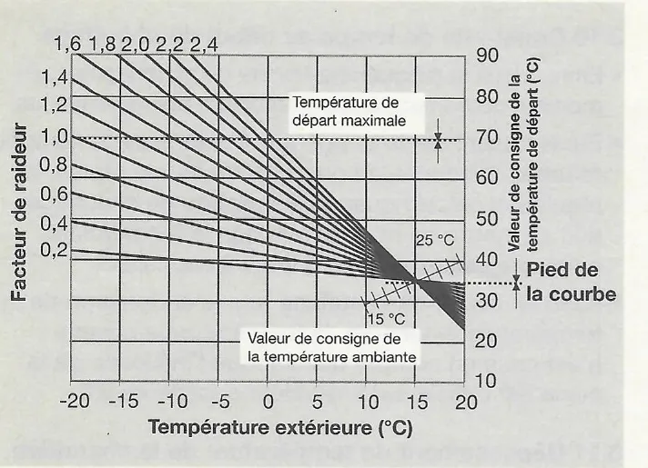
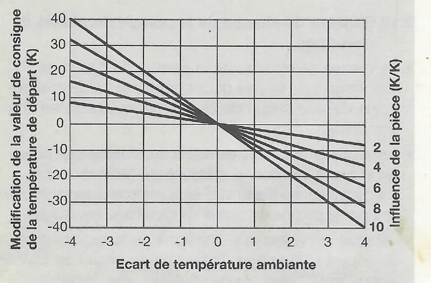
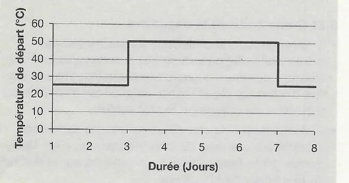
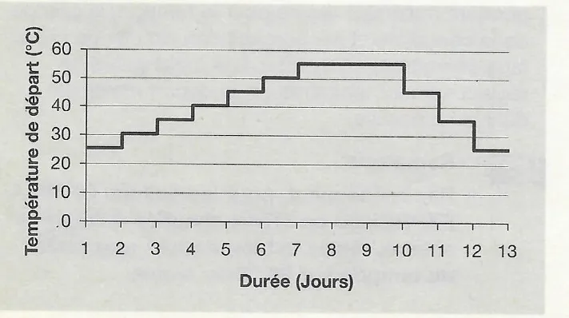

# Fonctions du régulateur SystaComfort

## 3. Fonctions du régulateur de chauffage

- Le régulateur de chauffage SystaComfort permet de réguler un ou deux circuits de chauffage mixtes en fonction de la température extérieure ou ambiante.
- En outre, il commande la production d'eau chaude sanitaire par la chaudière.
- Dans les installations avec un ballon d'eau douce, un ballon mixte ou un ballon tampon de Paradigma, le chargement par stratification de ces ballons est régulé par la chaudière.
- Il est possible de commander en option une pompe de circulation pour l'eau chaude sanitaire.
- La lecture et la modification des valeurs se font au moyen de la commande.
- Il est possible de raccorder en option une commande propre au deuxième circuit de chauffage.
- Le régulateur de chauffage SystaComfort est livré installé dans un coffret mural (pour les chaudières gaz ou fioul à un niveau) ou intégré dans la chaudière (chaudière gaz à condensation ou chaudière à granulés de bois Paradigma).

Pour la régulation, il requiert les valeurs de températures suivantes :

- Température extérieure TA
- Température de départ du circuit de chauffage TV
- Température de retour du circuit de chauffage TR
- Température de départ du 2ème circuit de chauffage TV2
- Température de retour du 2ème circuit de chauffage TR2
- Température TWO du ballon d'eau chaude sanitaire ou de la partie supérieure du ballon OPTIMA ou TITAN
- Température TPO dans la zone de l'aller du circuit de chauffage du ballon d'eau douce, du ballon mixte ou du ballon tampon (zone tampon de chauffage haut)
- Température TPU dans la zone de retour du circuit de chauffage du ballon d'eau douce, du ballon mixte ou du ballon tampon (zone tampon de chauffage bas)
- Température de retour de la circulation TZR

<small>Source : THF1777 p. 5</small>

### 3.1 Modes de fonctionnement

| Mode | Description |
|---|---|
| Automatique PR 1, 2 ou 3 | Chauffage ou Abaissement selon le programme horaire de chauffage 1, 2 ou 3 |
| Forcée | Valeur de consigne de la température ambiante = Chauffage, production d'eau chaude sanitaire et pompe de circulation selon les horaires programmés |
| Confort | Valeur de consigne de la température ambiante = Confort, production d'eau chaude potable et pompe de circulation selon les horaires programmés |
| Réduit / Réduit externe | Valeur de consigne de la température ambiante = Abaissement, pompe de circulation verrouillée |
| confort + | Jusqu'au prochain point de commutation, valeur de consigne de la température ambiante = Chauffage, valeur de consigne de l'eau chaude = Normal et pompe de circulation activée |
| Eté | Chauffage éteint, production d'eau chaude sanitaire et pompe de circulation selon les horaires programmés |
| Reglages finis | Chauffage, production d'eau chaude sanitaire et circulation verrouillés (protection antigel seulement) |
| Vacances | Valeur de consigne de la température ambiante = Abaissement, production d'eau chaude sanitaire et pompe de circulation verrouillées |
| Manuel | Sortie chaudière, pompe de la chaudière et pompes des circuits de chauffage activées, pompe de chargement activée selon la configuration, valeur de consigne de la chaudière pour le chauffage = Température de départ maximale |
| Test | Sorties activables et désactivables individuellement 30 min après la dernière pression de touche, retour en mode de fonctionnement automatique |
| Ramoneur | Fonction Ramoneur, voir chapitre 3.6 |

- Dans les installations avec une commande unique pour le ou les circuits de chauffage, la production d'eau chaude et la circulation sont verrouillées par le mode de fonctionnement lorsque ce dernier est réglé pour le premier circuit de chauffage sur Abaissement continu, Arrêt ou Vacances.
- Dans les installations avec une commande propre au deuxième circuit de chauffage, la production d'eau chaude et la circulation sont verrouillées par le mode de fonctionnement uniquement lorsque ce dernier est réglé pour les deux circuits de chauffage sur Abaissement continu, Arrêt ou Vacances.

<small>Source : THF1777 p. 5</small>

### 3.2 Programmes horaires

**Programme horaire de chauffage**

- Il existe pour chaque circuit de chauffage trois programmes hebdomadaires avec jusqu'à 8 points de commutation par jours ou blocs de jours.
- Trois niveaux correspondant à la température ambiante souhaitée sont disponibles pour chaque point de commutation : Chauffage, Confort ou Abaissement.
- Il est possible de réinitialiser chacun des trois programmes horaires de chauffage sur les valeurs par défaut.
- Sélectionnez le mode de fonctionnement Programme auto 1, 2 ou 3 pour définir lequel des trois programmes hebdomadaires doit être utilisé pour la régulation du circuit de chauffage.

**Programme horaire de production d'eau chaude**

- Il existe pour la production d'eau chaude sanitaire un programme hebdomadaire avec jusqu'à 8 points de commutation par jours ou blocs de jours.
- Trois niveaux correspondant à la température souhaitée de l'eau chaude sanitaire sont disponibles pour chaque point de commutation : Normal, Elevé ou Verrouillé.
- Chaque programme horaire de production d'eau chaude peut être réinitialisé sur les valeurs par défaut.
- Plutôt que d'utiliser le programme horaire de production d'eau chaude, vous pouvez associer la production d'eau chaude sanitaire au programme horaire de chauffage actuellement actif.

**Programme horaire de circulation**

- Il existe pour la commande de la pompe de circulation un programme hebdomadaire avec jusqu'à 8 points de commutation par jours ou blocs de jours.
- Vous pouvez définir pour chaque point de commutation si la pompe de circulation est activée ou verrouillée. Lorsque la pompe de circulation est activée, sa mise en marche et l'arrêt dépendent de la température de retour du conduit de circulation (voir chapitre 3.25).
- Le programme horaire de circulation peut être réinitialisé sur les valeurs par défaut.
- Plutôt que de régler le programme horaire de circulation, vous pouvez activer la pompe de circulation parallèlement au programme horaire de production d'eau chaude.

<small>Source : THF1777 p. 6</small>

### 3.3 Programme de vacances

- Cette fonction permet de régler le début et la fin de la période de vacances.
- Entre le début des vacances à 0 h 00 et la fin des vacances à 23 h 59, le circuit de chauffage passe en mode Abaissement et la production d'eau chaude sanitaire ainsi que la circulation sont verrouillées.

<small>Source : THF1777 p. 6</small>

### 3.4 Mode de fonctionnement Abaissement externe

- Si la sonde de retour d'un circuit de chauffage est court-circuitée par un contact de commutation, ce circuit de chauffage passe en mode Abaissement externe. Ce mode de fonctionnement correspond au mode réglable Abaissement continu.
- Il est ainsi possible d'influencer le ou les circuits de chauffage via un dispositif de commutation.

<small>Source : THF1777 p. 6</small>

### 3.5 Deuxième circuit de chauffage

- Il est possible de commander le deuxième circuit de chauffage à l'aide de la commande du premier.
- Dans le sous-menu Verrouillage des touches et affichage, vous pouvez définir si l'affichage par défaut se rapporte au 1er ou au 2ème circuit de chauffage.
- Dans l'affichage par défaut, la deuxième ligne de l'affichage indique le circuit de chauffage auquel se rapporte l'affichage par défaut (« cir. chauffage 1 » ou « cir. chauffage 2 ») en alternance avec le mode de fonctionnement actuel.
- **Si l'affichage par défaut se rapporte au 2ème circuit de chauffage,**
    - les fonctions indépendantes de la structure des menus (Modifier la température ambiante souhaitée, Modifier le mode de fonctionnement et Fonction Party) se rapportent alors également au 2ème circuit de chauffage.
    - Lors du chauffage de la chape pour le 2ème circuit de chauffage, la température de départ et le jour actuel du programme de chauffage pour le 2ème circuit de chauffage sont affichés.
- Il est possible de raccorder en option une commande pour le deuxième circuit de chauffage.
- À l'aide de cette commande pour le deuxième circuit de chauffage, vous pouvez régler pour ce dernier des programmes horaires pour la production d'eau chaude sanitaire et la circulation, ainsi que des propres valeurs de consignes pour l'eau chaude sanitaire.
- Lorsque la production d'eau chaude sanitaire est en marche, les valeurs de consigne maximales prédéfinies par les programmes horaires sont respectées et la pompe de circulation est activée (dans la mesure où l'un des deux programmes horaires déclenche l'activation de la pompe).
- La production d'eau chaude sanitaire et la circulation ne sont verrouillées par le mode de fonctionnement que lorsque les deux circuits de chauffage sont réglés sur Abaissement continu, Arrêt ou Vacances.

<small>Source : THF1777 p. 6</small>

### 3.6 Fonction Ramoneur

- Si vous appuyez simultanément sur les touches △ et ▽ dans l'affichage par défaut, la fonction Ramoneur est alors activée.
- La chaudière se met en marche.
- Dès que la température mesurée par la sonde TPO dépasse 60 °C, les pompes des circuits de chauffage sont activées et les mélangeurs sont réglés de façon à ce que la température TPO reste à 60 °C.
- Dans les installations sans sonde TPO, les pompes des circuits de chauffage sont activées immédiatement et les mélangeurs se règlent sur la température de départ maximale définie.
- Après 30 min, la fonction Ramoneur est terminée, le mode de fonctionnement actif avant cette opération reprend.

<small>Source : THF1777 p. 6</small>

### 3.7 Régulation du circuit de chauffage en fonction de la température extérieure

#### 3.7.1 Calcul de la valeur de consigne de la température de départ

- Axe horizontal : température extérieure (°C), de -20 à 20.
- Axe vertical droit : valeur de consigne de la température de départ (°C), de 10 à 90.
- Courbes : facteur de raideur 0,2 à 2,4 ; ligne pointillée « Température de départ maximale » ; décalage « Pied de la courbe » ; faisceau « Valeur de consigne de la température ambiante » entre 15 °C et 25 °C.

- La valeur de consigne de la température de départ du circuit de chauffage est déterminée en fonction de la température extérieure au moyen d'une courbe caractéristique de chauffage définie.
- La courbe caractéristique de chauffage est fixée par le pied de la courbe et le facteur de raideur réglés.
- La valeur de consigne de la température de départ est limitée à la température de départ maximale réglée.
- La courbe caractéristique de chauffage définie donne la valeur de consigne de la température de départ pour une température ambiante souhaitée de 20 °C. Une température ambiante souhaitée plus élevée ou plus faible décale la courbe caractéristique de chauffage vers le haut ou vers le bas.

<small>Source : THF1777 p. 7</small>

#### 3.7.2 Influence de la pièce

- Axe horizontal : écart de température ambiante, de -4 à 4.
- Axe vertical : modification de la valeur de consigne de la température de départ (K), de -40 à 40.
- Droites : influence de la pièce 2, 4, 6, 8, 10 K/K.

- En cas d'écart entre la température ambiante et la valeur de consigne (en raison, par exemple, d'une source de chaleur externe), la régulation peut corriger la température de départ selon l'influence de la pièce définie.
- Le réglage Influence de la pièce indique de combien de degrés la température de départ doit être augmentée ou abaissée par degré d'écart de la température ambiante avec sa valeur de consigne.
- Une influence de la pièce de 0 signifie que la température ambiante mesurée n'a pas d'influence sur la valeur de consigne de la température du départ.
- Si la commande est montée dans la chaudière ou à un emplacement inapproprié comme pièce de référence (par exemple, un couloir ou une cuisine), réglez l'influence de la pièce sur 0.

!!! note "Remarque"
    Si la température ambiante doit influencer la valeur de consigne de la température de départ, montez la commande dans la pièce d'habitation. Dans ce cas, respectez les instructions relatives au montage de la commande dans la pièce d'habitation (voir chapitre 4.3.2).

<small>Source : THF1777 p. 7</small>

#### 3.7.3 Optimisation de la courbe caractéristique de chauffage

- La régulation peut adapter automatiquement la courbe caractéristique de chauffage réglée au bâtiment.
- Pour cela, elle modifie les valeurs définies des options « Pied de la courbe » et « Facteur de raideur » en fonction de l'écart de la température ambiante mesurée avec sa valeur de consigne.

!!! note "Remarque"
    Si la courbe caractéristique de chauffage doit être optimisée, vous devez monter la commande dans la pièce d'habitation. Dans ce cas, respectez les instructions relatives au montage de la commande dans la pièce d'habitation (voir chapitre 4.3.2).

<small>Source : THF1777 p. 7</small>

#### 3.7.4 Mise en marche et arrêt du circuit de chauffage

- La pompe du circuit de chauffage se met en marche lorsque la température extérieure descend de plus de 3 K en dessous de la limite de chauffage actuelle. Elle s'éteint avec un temps de poursuite de 5 min, lorsque la température extérieure dépasse la limite de chauffage actuelle.
- La limite de chauffage actuelle correspond à la valeur « Limite chauffage Mode Chauffage » définie en mode de fonctionnement Confort automatique, Chauffage automatique, Confort continu, Chauffage continu ou Confort +.
- Pour les modes de fonctionnement Abaissement automatique, Abaissement continu, Abaissement externe et Vacances, la limite de chauffage actuelle correspond à la valeur « Limite chauffage Abaissement » définie.
- En mode Arrêt ou Eté, si la température extérieure baisse en dessous de la température extérieure de protection antigel réglée, la pompe du circuit de chauffage se met en marche. Le circuit de chauffage régule la valeur de consigne de la température ambiante à 5 °C. Si la température extérieure dépasse la température extérieure de protection antigel de plus de 3 K, la pompe du circuit de chauffage s'éteint de nouveau après un temps de poursuite de 5 min.

<small>Source : THF1777 p. 8</small>

### 3.8 Régulation du circuit de chauffage en fonction de la température ambiante

- Si le circuit de chauffage est régulé en fonction de la température ambiante, la valeur de consigne de la température de départ du circuit de chauffage est calculée par un régulateur proportionnel et intégral à partir de l'écart entre la valeur de consigne et la valeur réelle de la température ambiante.
- La bande proportionnelle et le temps de compensation du régulateur PI sont modifiables.
- Si la température ambiante dépasse sa valeur de consigne de plus de 0,5 K, la pompe du circuit de chauffage s'éteint après un temps de poursuite de 5 min.
- Si la température ambiante passe sous sa valeur de consigne, la pompe du circuit de chauffage se remet en marche.

!!! note "Remarque"
    Si le circuit de chauffage est régulé en fonction de la température ambiante, la commande doit être montée dans la pièce d'habitation. Dans ce cas, respectez les instructions relatives au montage de la commande dans la pièce d'habitation (voir chapitre 4.3.2).

<small>Source : THF1777 p. 8</small>

### 3.9 Fonctionnement mixte du circuit de chauffage

- Avec ce mode de fonctionnement, le circuit de chauffage est régulé en fonction de la température extérieure dans la journée et en fonction de la température ambiante la nuit.
- Le début du fonctionnement de jour est défini par la première heure de chauffage (Chauffage ou Confort) du programme horaire actuel située après 4 h du matin.
- Le début du fonctionnement de nuit est défini par la première heure d'abaissement du programme horaire actuel située avant 4 h du matin.

<small>Source : THF1777 p. 8</small>

### 3.10 Constante de temps au début du chauffage

- Entrez dans le programme horaire de chauffage à quel moment quelle température ambiante doit être atteinte.
- En se basant sur la température extérieure, la température ambiante et la constante de temps réglée, la régulation calcule quand l'installation de chauffage doit se mettre en marche afin que la température ambiante soit atteinte au moment souhaité.
- Avec un circuit de chauffage régulé en fonction de la température extérieure, la température ambiante n'est prise en compte que lorsque l'influence de la pièce est définie sur une valeur supérieure à 0.

<small>Source : THF1777 p. 8</small>

### 3.11 Dépassement de température de la chaudière

- Il est possible d'ajouter à la valeur de consigne calculée pour la température de départ du circuit de chauffage un décalage appelé dépassement de température de la chaudière. Cette valeur a pour résultat la valeur de consigne de la chaudière pour le chauffage.

<small>Source : THF1777 p. 8</small>

### 3.12 Réglage de vitesse de la pompe du circuit de chauffage

- La vitesse de rotation de la pompe du circuit de chauffage est régulée pour adapter le débit volumétrique dans le circuit de chauffage au besoin en chaleur actuel.
- Ainsi, une température de retour aussi faible que possible et par là une bonne utilisation de l'effet de gaz à condensation sont atteintes et la consommation de courant par la pompe du circuit de chauffage est réduite.
- Lorsque les valeurs de consigne de la température de départ sont faibles, la pompe du circuit de chauffage ralentit. Dans le cas contraire, elle accélère.
- De plus, l'écart de température du circuit de chauffage (différence entre la température de départ et de retour du circuit de chauffage) est pris en compte dans la valeur de consigne de l'écart réglé.
- Si l'écart du circuit de chauffage passe sous sa valeur de consigne, la pompe du circuit de chauffage ralentit, dans le cas contraire, elle accélère.

<small>Source : THF1777 p. 8</small>

### 3.13 Régulation du mélangeur

- **Dans le cas d'un circuit de chauffage mixte, le départ du circuit de chauffage est régulé sur la température de consigne du circuit de chauffage par admission du retour du circuit de chauffage.**
- La durée de marche du mélangeur est réglable, elle influence la caractéristique de la régulation du mélangeur.
- La régulation du mélangeur possède un interrupteur de fin de course virtuel. Si le régulateur de chauffage détecte que le mélangeur fonctionne depuis plus de 10 minutes dans un sens, le mélangeur n'est plus commandé dans ce sens de fonctionnement (par exemple, chaud) tant qu'il n'a pas fonctionné dans l'autre sens (par exemple, froid).

<small>Source : THF1777 p. 8</small>

### 3.14 Priorité eau chaude

- Lorsque la priorité eau chaude est activée, le circuit de chauffage s'arrête pendant le fonctionnement de la production d'eau chaude, le mélangeur et la pompe du circuit de chauffage s'éteignent.
- Si la température extérieure est en dessous de la température extérieure antigel définie, la pompe du circuit de chauffage reste en fonctionnement en même temps que la production d'eau chaude.

<small>Source : THF1777 p. 9</small>

### 3.15 Chauffage de la chape

Affichage (exemple) : `TV 35°C 1. Jour` / `sol chauffant`

- Deux programmes réglables sont à votre disposition pour le séchage de la chape d'un chauffage par le sol.
- Pendant le programme de chauffage, la température de l'aller et le jour actuel du programme de chauffage apparaissent dans l'affichage par défaut, au cas où l'affichage par défaut se rapporte à ce circuit de chauffage).
- À l'issue du chauffage du plancher, la régulation passe en mode de fonctionnement Programme auto 1.

<small>Source : THF1777 p. 9</small>

#### 3.15.1 En une fois

- La chape est chauffée pendant une période réglable avec une valeur de consigne de la température de départ de 25 °C.
- Ensuite, la chape est chauffée avec une température de départ définie pendant une période réglée.

<small>Source : THF1777 p. 9</small>

#### 3.15.2 Par paliers

- En partant d'une température de départ de 25 °C, la température de départ est augmentée chaque jour d'une valeur réglable (montée), jusqu'à ce que la température réglable (température de départ maximale) soit atteinte.
- Ensuite, la chape est chauffée avec cette température de départ pendant une période réglée.
- Après cela, la température de départ baisse chaque jour d'une valeur réglable (descente), jusqu'à atteindre 25 °C.

<small>Source : THF1777 p. 9</small>

### 3.16 Affichage d'entretien

Affichage (exemple) : `Intervention` / `01234 56789`

- Vous avez la possibilité de définir dans la régulation le mois et l'année du prochain entretien de l'installation de chauffage ainsi qu'un numéro de téléphone.
- Le moment venu, un message de rappel de l'entretien apparaît toutes les 10 min pendant 30 sec dans l'affichage par défaut.

<small>Source : THF1777 p. 9</small>

### 3.17 Ajustement de la température ambiante

- Il est possible de vérifier la température ambiante mesurée par la commande à l'aide d'un deuxième thermomètre et, le cas échéant, de la corriger.

<small>Source : THF1777 p. 9</small>

### 3.18 Chargement d'un ballon d'eau douce, d'un ballon mixte ou d'un ballon tampon

- Dans les installations avec un ballon d'eau douce, un ballon mixte ou un ballon tampon Paradigma, la zone tampon du ballon se remplit par stratification.
- La chaudière s'allume lorsque la température de la sonde TPO descend de plus de la différence de commutation réglée en dessous la valeur de consigne de la chaudière pour le mode de chauffage.
- Cette valeur est calculée à partir des valeurs de consigne de départ maximales du circuit de chauffage ajoutées aux dépassements de température de la chaudière réglés pour les deux circuits de chauffage.
- La chaudière s'éteint lorsque la valeur de consigne de la chaudière pour le mode de chauffage est atteinte au niveau de la sonde TPO et que la température de la sonde TPU est plus élevée que la valeur de consigne de la chaudière moins la différence de commutation divisée par deux.
- En outre, la durée de marche minimale de la chaudière doit être écoulée.
- La pompe de la chaudière s'éteint une fois le temps de poursuite réglé écoulé.
- La valeur de consigne de la chaudière est limitée en haut comme en bas par les températures de tampon minimale et maximale réglées.

<small>Source : THF1777 p. 9</small>

### 3.19 Production d'eau chaude sanitaire

#### 3.19.1 Ballon d'eau chaude sanitaire ou ballon mixte TITAN

- Si la température de la sonde TWO passe sous la valeur de consigne de l'eau chaude de plus de la différence de commutation réglée, la chaudière se met en marche.
- La pompe de chargement ou la vanne de dérivation est activée.
- La chaudière se met en marche, la valeur de consigne de la chaudière est de 20 K au-dessus de celle de l'eau chaude.
- Lorsque la température de la sonde TWO atteint la valeur de consigne de l'eau chaude, la chaudière s'éteint. La pompe de chargement ou la vanne de dérivation et la pompe de la chaudière s'éteignent également une fois le temps de poursuite réglé écoulé.
- Dans les installations équipées d'un ballon tampon et d'un ballon d'eau sanitaire séparé dans lesquelles le ballon d'eau sanitaire est chargé à partir du ballon tampon, la chaudière pour la production d'eau sanitaire ne se met en marche que lorsque la température du tampon (de la sonde TPO) dépasse la valeur de consigne de la température d'eau chaude réglée de plus de 10 K.
  La pompe de chargement se met uniquement en marche lorsque la température de la sonde TPO dépasse la température réelle d'eau chaude (au niveau de la sonde TWO) de plus de 5 K.
  La pompe de chargement se met également en marche lorsque la température de la sonde TPO dépasse 80 °C. Le ballon d'eau sanitaire est alors chauffé à une température maximale réglable.
  La chaleur excessive par ex. de l'installation solaire est alors transportée du tampon dans le ballon d'eau sanitaire.

<small>Source : THF1777 p. 10</small>

#### 3.19.2 Ballon d'eau douce OPTIMA ou EXPRESSO

- Avec les ballons d'eau douce OPTIMA, la valeur de consigne de la partie supérieure du ballon est de 10 K au-dessus de la valeur de consigne de l'eau chaude prédéfinie dans le programme horaire de production d'eau chaude.
- Avec les ballons d'eau douce EXPRESSO, la température de ballon nécessaire est calculée par le régulateur SystaExpresso en fonction de la température de puisage souhaitée et du débit vl prise maximal, puis est transmise au régulateur de chauffage SystaComfort.
- Si la température de la sonde TWO passe sous cette valeur de consigne de plus de la différence de commutation réglée, la chaudière se met en marche avec cette valeur de consigne.
- Si la température de la sonde TWO atteint cette valeur de consigne et si la température de la sonde TPO dépasse cette valeur de consigne moins la différence de commutation réglée, la chaudière s'éteint et la pompe de la chaudière s'arrête une fois le temps de poursuite réglé écoulé.

<small>Source : THF1777 p. 10</small>

### 3.20 Réglage de vitesse de la pompe de la chaudière

- Avec les chaudières gaz ou fioul à un niveau, la vitesse de la pompe de la chaudière dans les installations équipées d'un ballon d'eau douce, d'un ballon mixte ou d'un ballon tampon est réglée en fonction de la sonde TPO pendant le chargement du tampon de chauffage afin que le ballon se remplisse par stratification autant que possible selon la température de consigne. Pendant que la production d'eau chaude sanitaire est en marche, la pompe de la chaudière fonctionne à 100 % dans les installations équipées d'un ballon TITAN et selon la sonde TPO dans les installations équipées d'un ballon d'eau douce ou d'un ballon tampon.
- Dans les installations équipées d'un ballon d'eau douce, d'un ballon mixte ou d'un ballon tampon et des chaudières gaz à condensation Paradigma, la vitesse de la pompe et la puissance de la chaudière sont régulées en fonction de la température de l'aller de cette dernière.
- Dans les installations équipées d'une chaudière à granulés de bois Paradigma, la pompe de la chaudière est commandée par la commande automatique du brûleur de la chaudière.
- La vitesse de rotation minimale de la pompe de la chaudière peut être réglée.

<small>Source : THF1777 p. 10</small>

### 3.21 Commande de la chaudière

- Si le régulateur de chauffage SystaComfort est monté dans une chaudière gaz à condensation Paradigma, il communique avec la chaudière via une platine d'interface OpenTherm installée sur la platine du régulateur de chauffage SystaComfort.
- Si le régulateur de chauffage est monté dans une chaudière à granulés de bois Paradigma, c'est une platine d'interface LON qui est installée sur la platine du régulateur de chauffage.
- Les chaudières gaz ou fioul à un niveau sont commandées par le contact du brûleur libre de potentiel du régulateur de chauffage dans le coffret mural.

<small>Source : THF1777 p. 10</small>

### 3.22 Protection antisurchauffe pour les ballons d'eau douce, mixte ou tampon

- Si la température de la sonde TPO dépasse la température maximale réglée pour le tampon, la pompe de la chaudière et les pompes des circuits de chauffage se mettent en marche. Les mélangeurs se règlent sur leur température de départ maximale définie respective.

!!! note "Remarque"
    Par conséquent, pour les ballons OPTIMA, EXPRESSO ou TITAN chauffés à l'énergie solaire, réglez la température maximale du tampon sur 90 °C au moins.

<small>Source : THF1777 p. 10</small>

### 3.23 Verrouillage de la chaudière pour le chauffage

- Dans les installations équipées d'un ballon d'eau douce, d'un ballon mixte ou d'un ballon tampon, vous pouvez faire fonctionner les circuits de chauffage uniquement à l'énergie solaire pendant la période de transition ou en été.
- Dans ce cas, lorsque la température extérieure définie est dépassée, la chaudière est verrouillée pour le chauffage.
- Lorsque la chaudière est verrouillée pour le mode de chauffage, les pompes des circuits de chauffage s'éteignent dès que la température de la sonde TPO passe en dessous de la valeur de consigne du circuit de chauffage respectif.

<small>Source : THF1777 p. 11</small>

### 3.24 Compteurs des heures de service et de la fréquence d'allumage

- Le nombre d'allumages de la chaudière et ses heures de service sont comptés.
- Vous pouvez remettre à zéro les deux compteurs.

<small>Source : THF1777 p. 11</small>

### 3.25 Commande de la pompe de circulation

- Lorsqu'une sonde est raccordée pour la température de retour de la circulation (sonde TZR), la pompe de circulation est commandée en fonction du temps et de la température.
- Lorsque la pompe de circulation est activée par le programme horaire de circulation et le mode de fonctionnement réglé, elle se met en marche.
- Si la température de la sonde TZR dépasse la température la moins élevée entre la température de l'eau chaude TWO et la température d'eau chaude souhaitée réglée sur le régulateur moins une différence de commutation modifiable, la pompe de circulation s'arrête. (Arrêt de la pompe PZI, lorsque TZR > MIN [TWO, température eau chaude souhaitée] – différence de commutation).
- Si la température de la sonde TZR baisse de plus de 1 K sous cette température d'interruption, la pompe de circulation (dans la mesure où elle est toujours activée par le programme horaire) se remet en marche.
- En outre, il est possible de faire fonctionner la pompe de circulation depuis un bouton-poussoir. Indépendamment du programme horaire de circulation, la pompe de circulation s'allume pendant un temps de poursuite réglable en cas de court-circuit de l'entrée du bouton-poussoir de la circulation.
- Pendant un temps de verrouillage réglable, une nouvelle pression sur le bouton-poussoir sera ignorée.
- L'interruption de la pompe de circulation par la température de retour TZR du conduit de circulation reste active pendant le fonctionnement par le bouton-poussoir.

<small>Source : THF1777 p. 11</small>

### 3.26 Dispositif antiblocage

- Pour empêcher le blocage des pompes et des mélangeurs, toutes les pompes s'allument brièvement vers 12 heures.
- Vers 12 heures, lorsque le circuit de chauffage est à l'arrêt, les mélangeurs fonctionnent pendant une courte période, puis s'arrêtent.

<small>Source : THF1777 p. 11</small>

### 3.27 Protection antigel

- Le bâtiment, le circuit de chauffage et le ballon d'eau chaude sanitaire ou le ballon d'eau douce, ballon mixte ou ballon tampon sont protégés du gel, quel que soit le mode de fonctionnement réglé.

<small>Source : THF1777 p. 11</small>

### 3.28 Messages de panne

- Les messages de panne d'une chaudière gaz à condensation ou à granulés de bois Paradigma et de l'installation solaire (dans la mesure où elle est raccordée par bus de liaison au régulateur de chauffage) s'affichent sur la commande du régulateur de chauffage.
- Étant donné que la configuration de la régulation est déterminée par les sondes raccordées, seules les pannes de la sonde extérieure (à condition que les deux circuits de chauffage ne soient pas régulés selon la température ambiante) et de la sonde TPO dans les installations équipées d'une chaudière gaz ou fioul à un niveau ou d'un ballon d'eau douce, ballon mixte ou ballon tampon sont reconnues et affichées.

<small>Source : THF1777 p. 11</small>

### 3.29 Interface de service

- L'interface de service de la chaudière ou du coffret mural peut être raccordée à un PC ou un ordinateur portable via l'interface de service SystaService.
- Vous avez également la possibilité de raccorder une autre commande à cette interface. Cette commande permet de lire les valeurs parallèlement aux commandes disponibles, ainsi que d'effectuer des réglages.
- Vous devez dans ce cas adresser correctement cette commande (voir chapitre 5.2 Adressage des commandes).

<small>Source : THF1777 p. 11</small>

### 3.30 Raccordement au régulateur solaire SystaSolar

Le régulateur de chauffage SystaComfort peut être raccordé au régulateur solaire SystaSolar par l'intermédiaire d'une liaison bifilaire (bus de liaison).

**Si tel est le cas :**

- la valeur de consigne de l'eau chaude réglée sur le régulateur de chauffage est transmise au régulateur solaire, dans le cas d'un ballon OPTIMA avec un dépassement de 10 K et dans le cas d'un ballon EXPRESSO avec le dépassement calculé,
- la température des capteurs et le rendement solaire sont affichés sur la commande du chauffage et
- toute panne de l'installation solaire s'affiche sur la commande du chauffage.

<small>Source : THF1777 p. 11</small>
