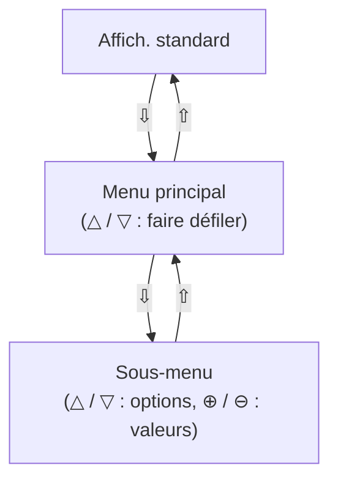
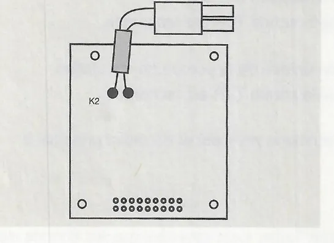
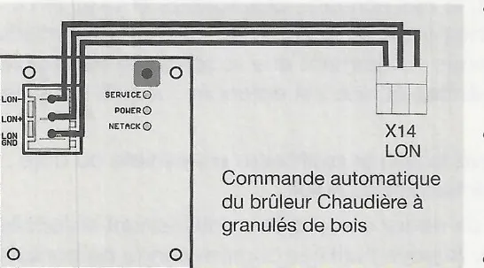

# Mise en service du SystaComfort

!!! note "Notation des touches"
    ⊕ / ⊖ (plus / moins), △ / ▽ (haut / bas), ⇩ (double flèche vers le bas : niveau de menu inférieur / 2e niveau de commande), ⇧ (double flèche vers le haut : niveau supérieur / affichage par défaut).

## 6. Mise en service et utilisation du régulateur de chauffage

!!! warning "Attention"
    Respectez les consignes du chapitre 2 « Pour votre sécurité ».

### 6.1 Première mise en service par le technicien spécialisé

La première mise en service de l'installation de chauffage et l'adaptation du régulateur de chauffage à cette installation (réglage des données de l'installation) doivent être effectuées par le fabricant ou par un spécialiste compétent nommé par lui. Afin d'assurer une réalisation sans accrocs des prestations fournies à raison de garantie pour vices, répertoriez avec l'utilisateur la mise en service et les travaux d'entretien dans les procès-verbaux respectifs. Notez les données d'installation réglées sur le régulateur de chauffage dans le tableau du chapitre Valeurs par défaut (voir chapitre 11 « Valeurs par défaut »).

<small>Source : THF1777 p. 16</small>

### 6.2 Commande et affichage du régulateur de chauffage

#### 6.2.1 Commandes et commande de service

- Dans le cas d'installations avec deux circuits de chauffage, les données de ces deux circuits peuvent être réglés via une commande unique.
- Si le deuxième circuit de chauffage dispose d'une commande propre, ses données sont réglées depuis cette commande uniquement.
- En outre, vous pouvez accéder aux deux circuits de chauffage par l'intermédiaire d'une commande dite de service. Cette commande de service peut être raccordée à la prise femelle de service de la chaudière ou du coffret mural au moyen d'une fiche jack.
- Lorsqu'une commande de service est raccordée, les touches des autres commandes sont verrouillées.
- Avec une commande pour le deuxième circuit de chauffage et d'une commande de service, une adresse doit être attribuée via des ponts au niveau des bornes de raccordement (voir chapitre 5.2 Adressage des commandes).

<small>Source : THF1777 p. 16</small>

#### 6.2.2 Structure de commande

La commande comprend 6 touches. Notation utilisée ci-dessous : ⊕ / ⊖ (plus / moins), △ / ▽ (haut / bas), ⇩ (double flèche vers le bas, touche de droite) et ⇧ (double flèche vers le haut, touche de gauche).

##### 6.2.2.1 1er niveau de commande

Lorsque l'affichage par défaut est actif sur le régulateur de chauffage, les touches ont les fonctions suivantes :

| Touche(s) | Fonction |
|---|---|
| ⊕ ⊖ | Augmenter ou abaisser la température ambiante souhaitée |
| △ ▽ | Changer de mode de fonctionnement (impossible lorsque le programme actif est celui qui permet de chauffer la chape d'un chauffage par le plancher) |
| △ et ▽ simultanément | Activer ou désactiver la fonction Ramoneur |
| ⇩ | Appeler le 2ème niveau de commande |
| ⇧ | Passer à l'affichage par défaut |
| ⇩ et ⇧ simultanément | Activer ou désactiver la fonction Confort + |

!!! note "Remarque"
    Dans le cas d'installations avec 2 circuits de chauffage et une commande unique, vous pouvez définir si l'affichage par défaut se rapporte au 1er ou au 2ème circuit de chauffage (voir chapitre Verrouillage des touches et affichage). Si l'affichage par défaut se rapporte au 2ème circuit de chauffage, ces réglages concernent alors également le 2ème circuit de chauffage.
    Si chaque circuit de chauffage dispose d'une commande propre, ces réglages se rapportent toujours au circuit de chauffage respectif.

<small>Source : THF1777 p. 17</small>

#### 6.2.3 2ème niveau de commande

Au deuxième niveau de la commande se trouvent les menus. Les touches disposent des fonctions suivantes :

| Touche(s) | Fonction |
|---|---|
| ⇩ | permet de passer au niveau de menu inférieur |
| ⇧ | permet de passer au niveau de menu supérieur |
| △ ▽ | permet de se déplacer dans un menu |
| ⊕ ⊖ | permet de modifier les valeurs |

<small>Source : THF1777 p. 17</small>

#### 6.2.4 Structure des menus

- Passez de l'affichage par défaut au menu principal à l'aide de la touche ⇩.
- Faites défiler les sous-menus du menu principal jusqu'à l'option souhaitée à l'aide des touches △ ou ▽. Pour sélectionner un sous-menu, appuyez sur la touche ⇩. Pour revenir à l'affichage par défaut, appuyez sur la touche ⇧.
- Sélectionnez les options de sous-menu (réglages) à l'aide des touches △ ou ▽. Changez les valeurs avec les touches ⊕ ou ⊖. Revenez au menu principal à l'aide de la touche ⇧.

!!! note "Remarque"
    Les valeurs réglables clignotent.

<small>Source : THF1777 p. 17</small>

#### 6.2.5 Aperçu du menu principal

Cette section décrit brièvement le menu principal. Pour obtenir un aperçu de tous les menus et réglages, reportez-vous au chapitre 13 « Aperçu des commandes ».

| Affichage | Fonction | Description |
|---|---|---|
| Températures consulter | Consulter les températures | Affichage des températures mesurées par les sondes de température raccordées aux circuits de chauffage, au ballon d'eau chaude sanitaire ou au ballon d'eau douce, ballon mixte ou ballon tampon et à la circulation. Affichage des valeurs de consigne pour les circuits de chauffage et le ballon. |
| Valeurs solaires consulter | Consulter les données solaires | Affichage de la température des capteurs, de la puissance solaire, ainsi que du rendement journalier et cumulé de l'installation solaire. Cette option de menu est disponible uniquement si un régulateur solaire SystaSolar est raccordé au régulateur de chauffage par un bus de liaison. |
| Cir. chauffage 1 programmer | Régler le 1er circuit de chauffage | Réglage du mode de fonctionnement, de la température ambiante souhaitée, du programme horaire de chauffage et du programme de vacances du premier circuit de chauffage. |
| Cir. chauffage 2 programmer | Régler le 2ème circuit de chauffage | Réglage du mode de fonctionnement, de la température ambiante souhaitée, du programme horaire de chauffage et du programme de vacances du 2ème circuit de chauffage. Cette option de menu apparaît uniquement lorsque la sonde de départ TV2 du 2ème circuit de chauffage est raccordée et que ce dernier ne possède pas de commande propre. |
| Eau chaude programmer | Régler la production d'eau chaude | Chauffage unique de l'eau chaude sanitaire, réglage des températures souhaitées et du programme horaire de la production d'eau chaude sanitaire. Cette option de menu apparaît uniquement lorsque la sonde TWO de la production d'eau chaude sanitaire est raccordée. |
| Circulation programmer | Régler la circulation | Réglage du programme horaire pour l'activation de la pompe de circulation. Cette option de menu apparaît uniquement lorsque la sonde de retour TZR de la circulation est raccordée. |
| Compteur Consulter | Consulter les compteurs | Affichage des heures de service et du nombre de démarrages de la chaudière. |
| Heure et date programmer | Régler heure date | Réglage de la date et de l'heure. Ces valeurs restent en mémoire même lorsque vous débranchez l'appareil de la tension d'alimentation. Le passage à l'heure d'été ou à l'heure d'hiver a lieu automatiquement. |
| Touches et affichage | Verrouillage des touches et affichage | Blocage des touches de la commande (verrouillage enfants). Choix de l'affichage par défaut. |
| Données unité cir. 1 chauffage | Paramètres de l'installation pour le premier circuit de chauffage | Réglage des données de l'installation du (premier) circuit de chauffage. |
| Données unité cir. 2 chauffage | Régler les données de l'installation pour le 2ème circuit de chauffage | Réglage des données de l'installation du deuxième circuit de chauffage. Cette option de menu apparaît uniquement si la sonde de départ TV2 du deuxième circuit de chauffage est raccordée et que ce dernier ne possède pas de commande propre. |
| Données unité chaud./tampon | Régler les données de l'installation pour le tampon / la chaudière | Réglage des paramètres de l'installation pour le chargement du ballon d'eau douce, ballon mixte ou ballon tampon et la commande de la chaudière. |
| Données unité circulation | Régler les données de l'installation pour la circulation | Réglage des données de l'installation pour la commande de la pompe de circulation. Cette option de menu apparaît uniquement lorsque la sonde de retour TZR de la circulation est raccordée. |
| Prog. de contrôl | Programme de contrôle | Réglage du mode de fonctionnement du régulateur de chauffage (Automatique, Manuel, Test), affichage de l'état de commutation des sorties (pompes, mélangeurs, vanne de dérivation), consultation de la version de logiciel du régulateur de chauffage. |
| Pannes Consulter | Consulter le code de panne | Consultation du code de panne d'une panne qui s'est produit. |

<small>Source : THF1777 p. 18-19</small>

### 6.3 Mise en marche de l'appareil

Avant de pouvoir procéder au réglage des données de l'installation, vous devez alimenter le régulateur de chauffage ou la chaudière, dans le cas d'un régulateur intégré à la chaudière, en tension de réseau.

| Affichage (exemple) | Signification |
|---|---|
| `Lu 16:31 20.8°C` / `Prog. 1 Chauffe` | L'affichage par défaut apparaît sur l'écran de la commande. L'affichage par défaut comprend le jour de la semaine et l'heure, la température ambiante mesurée par la commande ou la température extérieure et le mode de fonctionnement (par exemple, Automatique puisque le programme horaire de chauffage est 1, Chauffage). La deuxième ligne de l'affichage indique le circuit de chauffage auquel se rapporte l'affichage par défaut (« cir. chauffage 1 » ou « cir. chauffage 2 ») en alternance avec le mode de fonctionnement actuel. |
| `Panne solaire` / `Prog. 1 chauffe` | En cas de panne, la source du panne apparaît sur la première ligne (**Panne Sonde**, **Panne Chaudière** ou **Panne Solaire**). Le menu **Consulter le code de panne** permet de connaître la cause du panne (voir chapitre 8 Panne). |
| `TV 35°C 1. Jour` / `sol chauffant` | Si le **programme de chauffage** de la **chape** est actif, la première ligne indique la température de départ mesurée et le jour actuel du programme de chauffage réglé. La deuxième ligne comprend le **mode de fonctionnement Sécher chape** (voir chapitre 6.9.1 Chauffage de la chape). |
| `Cendres vider` / `Prog. 1 Chauffe` | Si le récipient à cendres de la chaudière à granulés de bois Paradigma Pelletti avec **système d'évacuation des cendres Confort** est presque rempli, le message « Cendres vider » apparaît sur la première ligne de l'affichage et s'il est rempli « Cendres remplie ». |

Avant de procéder au réglage des données de l'installation, contrôlez les sondes raccordées et, le cas échéant, le raccordement du bus de liaison à la chaudière gaz à condensation ou à granulés de bois Paradigma et au régulateur solaire à l'aide des chapitres suivants.

<small>Source : THF1777 p. 19</small>

### 6.4 Contrôle des sondes raccordées

Contrôlez les sondes raccordées dans le menu Consulter les températures.

!!! note "Remarque"
    La configuration de l'installation est déterminée par les sondes raccordées. Seules les sondes raccordées s'affichent.
    Exception : Même sans sonde raccordée, les options de menu du retour du premier circuit de chauffage et de la température extérieure (à condition que tous les circuits de chauffage ne soient pas régulés selon la température ambiante), ainsi que les options de menu pour la sonde TPO (dans les installations équipées d'une chaudière gaz ou fioul à un niveau) s'affichent.

Passez de l'affichage par défaut au menu principal à l'aide de la touche ⇩. L'option de menu **Consulter les températures** s'affiche. Appelez le sous-menu **Consulter les températures** à l'aide de la touche ⇩. Les touches △ et ▽ vous permettent de consulter les températures mesurées par les sondes. Ces options de sous-menu sont décrites ci-dessous :

| Affichage (exemple) | Description |
|---|---|
| `Température ext. TA -2.0°C` | Température extérieure (sonde TA). Si aucune sonde extérieure n'est raccordée, « --- » apparaît à la place de la température mesurée. Affichage disponible uniquement lorsque les deux circuits de chauffage ne sont pas régulés en fonction de la température ambiante. |
| `Température int. 20.3°C` | Température ambiante mesurée au niveau de la commande. |
| `Température int. Rég. cir2 20.5°C` | Valeur de consigne actuelle de la température ambiante. |
| `Temp. int. HK2 réglée 20.0°C` | Valeur de consigne actuelle du 2ème circuit de chauffage. Disponible uniquement pour les installations équipées de deux circuits de chauffage. |
| `Temp. eau chaude TWO 48.6°C` | Température du ballon d'eau chaude sanitaire ou de la partie supérieure du ballon OPTIMA, EXPRESSO ou TITAN (sonde TWO). Affichage disponible uniquement lorsque la sonde TWO est raccordée. |
| `Temp. eau chaude réglée 50.0°C` | Température de consigne actuelle du ballon d'eau chaude sanitaire ou de la partie supérieure du ballon OPTIMA, EXPRESSO ou TITAN. Affichage disponible uniquement lorsque la sonde TWO est raccordée. |
| `Temp. départ cir. chauf. TV 45.8°C` | Température de départ du premier circuit de chauffage (sonde TV). Affichage disponible uniquement lorsque la sonde TV est raccordée. |
| `Témp. depart réglée 50.0°C` | Température de consigne actuelle du premier circuit de chauffage. |
| `Temp. retour chaudiè 31.0°C` | Température de retour du premier circuit de chauffage (sonde TR). |
| `Départ cir. de Chauf. 2 35.1°C` | Température de départ du deuxième circuit de chauffage (sonde TV2). Affichage disponible uniquement lorsque la sonde TV2 est raccordée. |
| `Temp. dépa. cir.2 reglée 35.0°C` | Température de consigne actuelle du deuxième circuit de chauffage. Affichage disponible uniquement lorsque la sonde TV2 est raccordée. |
| `Temp. dépa. cir.2 reglée 37.6°C` (libellé tel qu'imprimé) | Température de retour du deuxième circuit de chauffage (sonde TR2). Affichage disponible uniquement lorsque la sonde TV2 est raccordée. |

<small>Source : THF1777 p. 20</small>

| `Temp. ballon haut TPO 31.4°C` | Température dans la partie intermédiaire du ballon OPTIMA, EXPRESSO ou TITAN (partie supérieure du tampon) ou, dans les installations équipées d'une chaudière gaz ou fioul à un niveau sans ballon d'eau douce, ballon mixte ou ballon tampon, température de la chaudière (sonde TPO). Affichage disponible uniquement lorsque la sonde TPU est raccordée. Toujours disponible avec les chaudières gaz ou fioul à un niveau. |
| `Temp. ballon réglée 52.1°C` | Valeur de consigne de la zone tampon du ballon OPTIMA, EXPRESSO ou TITAN ou pour le ballon tampon. Affichage disponible uniquement lorsque la sonde TPU est raccordée. |
| `Temp. bas ballon TPU 31.4°C` | Température dans la partie intermédiaire du ballon OPTIMA, EXPRESSO ou TITAN ou pour le ballon tampon en bas (partie inférieure du tampon, sonde TPU). Affichage disponible uniquement lorsque la sonde TPU est raccordée. |
| `Circulation TZR 41.7°C` | Température du conduit de retour de la circulation (sonde TZR). Affichage disponible uniquement lorsque la sonde TZR est raccordée. |
| `Circulation Touche arrêt` | État du bouton-poussoir pour l'activation unique de la pompe de circulation. Affichage disponible uniquement lorsque la sonde TZR est raccordée. |

Appuyez sur la touche ⇧ pour revenir au menu principal et du menu principal à l'affichage par défaut.

**Contrôle de la position des sondes**

Pour que le régulateur de chauffage SystaComfort fonctionne de façon fiable, il est essentiel que les sondes de température soient installées correctement. Pour contrôler les sondes, procédez comme suit :

- Contrôlez tout d'abord les positions de la sonde TWO du ballon et, le cas échéant, des sondes TPO et TPU. Pour connaître les positions correctes des sondes du ballon, reportez-vous au schéma de câblage de l'installation. En cas de ballons équipés de douilles d'immersion, assurez-vous notamment que la sonde se trouve bien dans la douille d'immersion et non pas à côté dans l'isolation, et vérifiez qu'elle est enfoncée jusqu'à la butée dans la douille d'immersion.
- Contrôlez la position de la sonde extérieure (le cas échéant). Montez la sonde extérieure si possible du côté nord ou nord-ouest du bâtiment ; elle ne doit pas être exposée directement au soleil.
- Contrôlez la position des autres sondes. Les sondes de départ et de retour doivent être entièrement enfoncées dans les douilles d'immersion de la station du circuit de chauffage. Si vous l'utilisez comme sonde de contact, veillez à ce qu'elle soit parfaitement isolée.
- La sonde au niveau du conduit de retour de la circulation (TZR) doit être raccordée au moins 1 m avant le ballon. Idéalement, elle doit être le plus près possible du début du conduit de circulation (déviation du conduit d'eau chaude sanitaire).

<small>Source : THF1777 p. 21</small>

### 6.5 Contrôle du raccordement du bus de liaison à la chaudière

Les chaudières gaz à condensation ou à granulés de bois de Paradigma sont commandées via une platine d'interface installée sur la platine du régulateur (interface OpenTherm pour une chaudière gaz à condensation et interface LON pour une chaudière à granulés de bois).

| Affichage | Signification |
|---|---|
| `Panne chaudière` / `Prog. 1 Chauffe` | Si le raccordement est perturbé, le message « Panne Chaudière » apparaît dans l'affichage par défaut. |
| `Panne chaudière` / `Pas de bus-OT` ou `Pas de bus-LON` | Le code de panne alors affiché au-dessous du message Panne Chaudière dans le sous-menu « Consulter le code de panne » est « Pas de bus OT » ou « Pas de bus LON ». |

Si le raccordement du bus de liaison à la chaudière présente un panne, procédez aux vérifications suivantes :

**Avec une chaudière gaz à condensation Paradigma**

- La fiche K2 de la chaudière doit être bien raccordée à la prise femelle K2 de la platine d'interface OpenTherm du régulateur de chauffage.

**Avec une chaudière à granulés de bois Paradigma**

- La liaison LON entre la commande automatique du brûleur de la chaudière à granulés de bois (connecteur X14) et la platine d'interface LON du régulateur de chauffage doit être correctement raccordée (voir l'illustration).
- L'interface LON du régulateur de chauffage doit être activée :
    - La DEL « POWER » de l'interface LON doit être allumée en continu.
    - La DEL « NETACK » doit clignoter.
- Si tel n'est pas le cas, vous devez activer l'interface LON.

**Activation de l'interface LON du régulateur de chauffage**

- Actionnez la touche qui se trouve sur l'interface LON du régulateur de chauffage pendant plus de 10 s.
- La DEL « POWER » se met à clignoter.
- Actionnez **brièvement** la touche LON sur la **platine de la commande automatique du brûleur de granulés de bois**.
- La DEL « POWER » sur l'interface LON s'allume en continu, la DEL « NETACK » clignote.
- Si tel n'est pas le cas, débranchez brièvement la chaudière et le régulateur du réseau.

<small>Source : THF1777 p. 22</small>

### 6.6 Contrôle du raccordement du bus de liaison au régulateur solaire

Lorsque le bus de liaison est raccordé correctement au régulateur solaire SystaSolar, vous pouvez consulter les données solaires (température des capteurs, puissance solaire, rendement solaire) sur les commandes du régulateur de chauffage SystaComfort.

<small>Source : THF1777 p. 23</small>

### 6.7 Contrôle de l'heure et de la date

La date et l'heure sont enregistrées dans une mémoire tampon et restent en mémoire lorsque le régulateur de chauffage est débranché du réseau. Le passage à l'heure d'été ou à l'heure d'hiver a lieu automatiquement.

**Pour régler l'heure et la date, procédez comme suit :**

Affichages : `Heure et date programmer`, `Heure 09:29`, `Date Ma 10.05.2005`.

- Passez de l'affichage par défaut au menu principal à l'aide de la touche ⇩. Faites défiler les options de menu à l'aide de la touche ▽ jusqu'à l'option **Régler heure date**. Appelez le sous-menu **Régler heure date** à l'aide de la touche ⇩. Appuyez à présent sur les touches △ et ▽ pour accéder aux options de sous-menu (réglages) individuelles. Modifiez les valeurs réglables à l'aide des touches ⊕ ou ⊖. Lorsque vous quittez une option de menu modifiée, la valeur réglée est acceptée et enregistrée.
- Appuyez sur la touche ⇧ pour revenir au menu principal et du menu principal à l'affichage par défaut.

<small>Source : THF1777 p. 23</small>

### 6.8 Verrouillage des touches et affichage

Affichage : `Vérrouillé app. Sur + et –`

Vous avez la possibilité de bloquer les touches de la commande (verrouillage enfants). Si le verrouillage des touches est actif, un message vous informant que les touches sont inaccessibles s'affiche lorsque vous appuyez sur une touche.

Appuyez simultanément sur les touches ⊕ et ⊖ pour désactiver le verrouillage des touches. Si vous n'appuyez sur aucune touche pendant 15 min, le verrouillage s'active de nouveau automatiquement.

**Pour régler le verrouillage des touches, procédez comme suit :**

| Affichage | Action |
|---|---|
| `Touches et affichage` | Passez de l'affichage par défaut au menu principal à l'aide de la touche ⇩. Faites défiler les options de menu à l'aide de la touche ▽ jusqu'à l'option **Verrouillage des touches**. Appelez le sous-menu **Verrouillage des touches** à l'aide de la touche ⇩. |
| `Vérrouillage activé Non` | Les touches ⊕ ou ⊖ vous permettent d'activer ou de désactiver le verrouillage des touches. Il est possible de choisir si l'affichage indique la température extérieure ou la température ambiante mesurée par la commande. |
| `Affich. standard Température ext.` | Faites défiler les options de menu à l'aide de la touche ▽ jusqu'à l'option Affichage par défaut. Définissez à l'aide des touches ⊕ ou ⊖ si l'affichage par défaut doit faire apparaître la température extérieure mesurée ou la température ambiante mesurée par la commande. |
| `Affich. standard Cir. chauffage 1` | Dans le cas d'installations avec deux circuits de chauffage mais une seule commande, vous pouvez régler dans l'option de menu suivante si l'affichage par défaut se rapporte au 1er ou au 2ème circuit de chauffage. Les fonctions indépendantes de la structure des menus (Modifier la température ambiante, Modifier le mode de fonctionnement et Fonction Confort +) se rapportent également au circuit de chauffage sélectionné ici (voir aussi chapitre Commande et affichage). |

Appuyez sur la touche ⇧ pour revenir au menu principal et du menu principal à l'affichage par défaut.

<small>Source : THF1777 p. 23</small>

### 6.9 Réglage des données de l'installation du circuit de chauffage

**Pour régler les données de l'installation pour le circuit de chauffage, procédez comme suit :**

Affichage : `Données unité cir. 1 chauffage`

Passez de l'affichage par défaut au menu principal à l'aide de la touche ⇩. Faites défiler les options de menu à l'aide de la touche ▽ jusqu'à ce que l'option **Paramètres de l'installation Cir. chauffage 1** apparaisse. Appelez le sous-menu **Paramètres de l'installation Cir. chauffage 1** à l'aide de la touche ⇩. Appuyez à présent sur les touches △ et ▽ pour accéder aux options de sous-menu (réglages) individuelles. Modifiez les valeurs réglables à l'aide des touches ⊕ ou ⊖. Lorsque vous quittez une option de menu modifiée, la valeur réglée est acceptée et enregistrée.

!!! note "Remarque"
    Notez les valeurs réglées dans le tableau du chapitre 11 « Valeurs par défaut ». Il comprend également les valeurs par défaut réglées en usine du régulateur de chauffage.

Tous les réglages indiqués ici ne sont pas disponibles pour toutes les installations.

Vous trouverez ci-dessous la description des réglages individuels :

| Affichage (exemple) | Réglage | Description |
|---|---|---|
| `Point de base 35°C` | Pied de la courbe | Pied de la courbe caractéristique de chauffage. Valeur de consigne de la température de départ avec une température extérieure de 15 °C et une valeur de consigne de la température ambiante de 20 °C. Ce réglage n'est pas affiché dans le cas d'un circuit de chauffage régulé en fonction de la température ambiante. |
| `Courbe chauffe 1.3 K/K` | Facteur de raideur | Facteur de raideur de la courbe caractéristique de chauffage. Plus le facteur de raideur est important, plus la valeur de consigne de la température de départ augmente lorsque la température extérieure baisse. Ce réglage n'est pas affiché dans le cas d'un circuit de chauffage régulé en fonction de la température ambiante. |

!!! note "Remarque"
    L'accès aux autres réglages est réservé au technicien spécialisé.

| Affichage (exemple) | Réglage | Description |
|---|---|---|
| `Donner code accès 0` | Code d'accès | Dans le réglage **Code d'accès**, entrez le **Code 12** à l'aide de la touche ⊕ et appuyez sur la touche ▽ pour accéder au prochain réglage. |
| `Régulation selon Température ext.` | Mode de régulation | Le circuit de chauffage peut fonctionner en fonction de la **température extérieure**, de la **température ambiante** ou en mode **mixte** (dans la journée selon la température extérieure, la nuit selon la température ambiante). |

!!! note "Remarque"
    Si le circuit de chauffage est régulé en fonction de la température ambiante, la commande doit être montée dans la pièce d'habitation. Dans ce cas, respectez les instructions relatives au montage de la commande dans la pièce d'habitation (voir chapitre 4.3.2).

| Affichage (exemple) | Réglage | Description |
|---|---|---|
| `Temp. max départ 70°C` | Température de départ maximale | **Température de départ maximale** du circuit de chauffage. |

!!! warning "Attention"
    Cette fonction ne constitue en aucun cas une fonction de sécurité et ne remplace pas le thermostat de repère d'un chauffage par le plancher !

| Affichage (exemple) | Réglage | Description |
|---|---|---|
| `Temp. limite chauffage 20°C` | Limite de chauffage en mode chauffage | Si la température extérieure dépasse cette **limite de chauffage** en **mode de chauffage**, le circuit de chauffage s'éteint. Si la température extérieure baisse de plus de 3 K sous cette limite de chauffage, le circuit de chauffage se remet en marche. Ce réglage n'est pas disponible dans le cas d'un circuit de chauffage régulé en fonction de la température ambiante. |
| `Temp. limite réduite 10°C` | Limite de chauffage en mode d'abaissement | Si la température extérieure dépasse cette **limite de chauffage** en **mode d'abaissement**, le circuit de chauffage s'éteint. Si la température extérieure baisse de plus de 3 K sous cette limite de chauffage, le circuit de chauffage se remet en marche. Ce réglage n'est pas affiché dans le cas d'un circuit de chauffage régulé en fonction de la température ambiante. |
| `Temp. ext. antigel 2°C` | Température extérieure de protection antigel | Si, en mode Arrêt ou Eté, la température extérieure passe en dessous de la **température extérieure de protection antigel** définie ici, le circuit de chauffage se met en marche avec une valeur de consigne de la température ambiante de 5 °C. Si la température extérieure dépasse cette valeur de 3 K, le circuit de chauffage s'éteint de nouveau. Ce réglage n'est pas affiché dans le cas d'un circuit de chauffage régulé en fonction de la température ambiante. |

!!! warning "Attention"
    Si une température extérieure de protection antigel inférieure à 2 °C est définie, le risque de dommages dus au gel persiste.

| Affichage (exemple) | Réglage | Description |
|---|---|---|
| `Constante échauff 120 min` | Constante de temps | En tenant compte de la température extérieure, de la température ambiante et de la **constante de temps** réglée ici pour le **chauffage**, la mise en marche du chauffage est avancée de façon à ce que la température ambiante souhaitée soit atteinte au moment indiqué dans le programme horaire de chauffage. |
| `Temp. ambiante 0.0 K/K` | Influence de la pièce | Lorsque l'**influence de la pièce** est supérieure à 0, la valeur de consigne de la température de départ est modifiée en cas d'écart entre la température ambiante et sa valeur de consigne. Ce réglage n'est pas affiché dans le cas d'un circuit de chauffage régulé en fonction de la température ambiante. |

!!! note "Remarque"
    Si la température ambiante doit influencer la valeur de consigne de la température de départ, montez la commande dans la pièce d'habitation. Dans ce cas, respectez les instructions relatives au montage de la commande dans la pièce d'habitation (voir chapitre 4.3.2).

| Affichage (exemple) | Réglage | Description |
|---|---|---|
| `Optimisation courbe. Non` | Optimisation de la courbe | Lorsque vous sélectionnez « Oui » ici, la **courbe caractéristique de chauffage** du régulateur de chauffage est **adaptée** au bâtiment. Ce réglage n'est pas affiché dans le cas d'un circuit de chauffage régulé en fonction de la température ambiante. |

!!! note "Remarque"
    Si la courbe caractéristique de chauffage doit être optimisée, vous devez monter la commande dans la pièce d'habitation. Dans ce cas, respectez les instructions relatives au montage de la commande dans la pièce d'habitation (voir chapitre 4.3.2).

| Affichage (exemple) | Réglage | Description |
|---|---|---|
| `Surchauffe Chaudière 0 K` | Dépassement de température de la chaudière | La valeur réglée ici en tant que **dépassement de température de la chaudière** est ajoutée à la valeur de consigne de la température de départ, le résultat donnant la valeur de consigne de la chaudière pour le mode de chauffage. |
| `Ecart cir. chauf. 20 K` | Valeur de consigne de l'écart du circuit de chauffage | L'écart de température entre le départ et le retour du circuit de chauffage est comparé à la **valeur de consigne de l'écart** du **circuit de chauffage** réglée ici et la vitesse de la pompe du circuit de chauffage est modifiée en conséquence. |
| `Régime min. pompe PHK 100 %` | Vitesse minimale de la pompe | **Vitesse minimale** de la pompe du circuit de chauffage. La vitesse de la pompe du circuit de chauffage ne peut pas être inférieure à la valeur réglée ici. |

!!! warning "Attention"
    Avec une pompe électronique (par exemple, Grundfoss Alpha), la vitesse minimale de la pompe du circuit de chauffage doit être réglée sur 100 %, sinon la pompe ne se met pas en marche.

| Affichage (exemple) | Réglage | Description |
|---|---|---|
| `Durée mélangeur 2 min` | Durée de marche du mélangeur | **Durée de marche** du **mélangeur** d'une butée finale à l'autre. Cette valeur influence également les caractéristiques de la régulation du mélangeur. |
| `Réglage proportionnel 5 K` | Bande proportionnelle | **Bande proportionnelle** du régulateur proportionnel et intégral de la régulation de la température ambiante. Lorsque la valeur est trop faible, la température ambiante est atteinte plus rapidement, au risque cependant d'entraîner des variations de température. Une valeur trop élevée entraîne une régulation plus stable, mais la température ambiante atteint sa valeur de consigne plus lentement. Ce réglage n'est pas affiché dans le cas d'un circuit de chauffage régulé en fonction de la température extérieure. |
| `Durée post-chauffage 30 min` | Temps de compensation | **Temps de compensation** du régulateur PI de la régulation de la température ambiante. Lorsque la valeur est trop faible, la température ambiante est atteinte plus rapidement, au risque cependant d'entraîner des variations de température. Une valeur trop élevée entraîne une régulation plus stable, mais la température ambiante atteint sa valeur de consigne plus lentement. Ce réglage n'est pas affiché dans le cas d'un circuit de chauffage régulé en fonction de la température extérieure. |
| `Eau chaude Prioritaire Non` | Priorité eau chaude | Si l'option **Priorité eau chaude** est réglée sur « Oui », le circuit de chauffage s'éteint pendant la production d'eau chaude. |
| `Chauffer sol chauffant` | Chauffer chape | La touche ⇩ permet d'appeler le **programme de chauffage** de la **chape** d'un chauffage par le plancher (voir chapitre 6.9.1). |
| `Entretien programmer` | Affichage d'entretien | La touche ⇩ permet d'appeler le menu de réglage de l'**affichage d'entretien** (voir chapitre 6.9.2). |
| `Température int. 0.0 K` | Ajustement de la température ambiante | Il est possible de **vérifier** ici la **température ambiante** mesurée par la commande et, le cas échéant, de la corriger. |
| `Langue Francais` | Langue | **Réglage de la langue du texte des menus.** |

Appuyez sur la touche ⇧ pour revenir au menu principal et du menu principal à l'affichage par défaut.

<small>Source : THF1777 p. 24-26</small>

#### 6.9.1 Programme de chauffage de la chape

| Affichage (exemple) | Description |
|---|---|
| `Chauffer sol chauffant` | L'option de menu **Chauffer chape** du sous-menu **Données de l'installation Circuit de chauffage** vous permet d'appeler le programme de chauffage de la chape à l'aide de la touche ⇩. |
| `Prog. chauffe sélec. échello.` | Deux programmes de chauffage sont disponibles : **En une fois** et **Par paliers**. |

**Programme de chauffage En une fois**

| Affichage (exemple) | Description |
|---|---|
| `Durée TV = 25°C 3 Jours` | La **température de départ est de 25 °C** pendant la **durée** définie ici. |
| `Temp. max départ 50°C` | Ensuite, la température de départ augmente à la valeur de **température de départ maximale** réglée ici. |
| `Temp max départ 4 Jours` | Cette **température de départ maximale** est maintenue pendant la **durée** définie ici. Ensuite, le programme de chauffage est terminé et le régulateur de chauffage passe en mode de fonctionnement Programme auto 1. |

**Programme de chauffage Par paliers**

| Affichage (exemple) | Description |
|---|---|
| `Durée max. départ Par jours 5 K` | En partant d'une température de départ de 25 °C, la température de départ est **augmentée chaque jour** de la valeur définie ici. |
| `Temp. max départ 50°C` | Cette augmentation se poursuit jusqu'à ce que la **température de départ maximale** définie ici soit atteinte. |
| `Temp max départ 4 Jours` | Cette **température de départ maximale** est maintenue pendant la **durée** définie ici. |
| `Baisse du départ par jour 5 K` | Ensuite, la température de départ **baisse chaque jour** de la valeur définie ici jusqu'à atteindre 25 °C. |

<small>Source : THF1777 p. 26</small>

**Démarrage du programme de chauffage**

| Affichage (exemple) | Description |
|---|---|
| `Prog. chauffe marche ? Non` | Pour **démarrer** le **programme de chauffage**, sélectionnez « Oui » avec la touche ⊕ et appuyez sur la touche ⇩. |
| `TV 35°C 1. Jour sol chauffant` | Lorsque le programme de chauffage est actif, l'affichage par défaut indique la température de départ mesurée et le jour actuel du programme de chauffage. (Uniquement lorsque l'affichage par défaut indique les valeurs pour le circuit de chauffage concerné). |

**Arrêt du programme de chauffage**

Affichage : `Prog. chauffe arrêt ? Non`

Pour mettre fin au programme de chauffage, appelez le programme de chauffage de la chape avec la touche ⇩ dans l'option de menu **Chauffer chape** du sous-menu **Données de l'installation Circuit de chauffage**. Faites défiler les options de menu jusqu'à **Arrêter le programme de chauffage**. Sélectionnez « Oui » à l'aide de la touche ⊕ et appuyez sur la touche ⇩.

Vous pouvez également mettre fin au programme de chauffage en réglant dans le sous-menu **Régler le circuit de chauffage** tout autre **mode de fonctionnement** que **Sécher chape**.

<small>Source : THF1777 p. 27</small>

#### 6.9.2 Réglage de l'affichage d'entretien

| Affichage (exemple) | Description |
|---|---|
| `Entretien programmer` | L'option de menu **Régler l'affichage d'entretien** du sous-menu **Données de l'installation Circuit de chauffage** permet d'appeler le menu de réglage de l'affichage d'entretien à l'aide de la touche ⇩. |
| `Date entretien 09/06` | Réglez le mois et l'année du prochain entretien requis. |
| `N° de Tél: 01234 56789` | Entrez votre numéro de téléphone auquel l'utilisateur pourra vous joindre pour convenir d'un rendez-vous pour l'entretien. Le chiffre à régler clignote. Modifiez ce chiffre à l'aide des touches △ ou ▽. Appuyez sur les touches ⊕ et ⊖ pour sélectionner chaque chiffre. Le chiffre sélectionné clignote. La touche ⇩ permet de quitter le menu de réglage de l'affichage d'entretien. |
| `Intervention 01234 56789` | Le moment venu, un message de rappel de l'entretien apparaît toutes les 10 min pendant 30 sec dans l'affichage par défaut avec votre numéro de téléphone entré. |

<small>Source : THF1777 p. 27</small>

#### 6.9.3 Réglage des données de l'installation du deuxième circuit de chauffage

**Si l'installation dispose de deux circuits de chauffage et d'une seule commande pour les deux circuits, procédez comme suit pour régler les données de l'installation du deuxième circuit de chauffage :**

Affichage : `Données unité cir. 2 chauffage`

Passez de l'affichage par défaut au menu principal à l'aide de la touche ⇩. Faites défiler les options de menu à l'aide de la touche ▽ jusqu'à l'option **Données de l'installation 2ème circuit de chauffage**. Appelez le sous-menu **Données de l'installation 2ème circuit de chauffage** à l'aide de la touche ⇩. Appuyez à présent sur les touches △ et ▽ pour accéder aux options de sous-menu (réglages) individuelles. Modifiez les valeurs réglables à l'aide des touches ⊕ ou ⊖. Lorsque vous quittez une option de menu modifiée, la valeur réglée est acceptée et enregistrée.

!!! note "Remarque"
    Notez les valeurs réglées dans le tableau du chapitre 11 « Valeurs par défaut ». Il comprend également les valeurs par défaut réglées en usine pour le régulateur de chauffage.

La description des réglages des données de l'installation figure dans le chapitre antérieur Réglage des données de l'installation du premier circuit de chauffage.

Lorsque les deux circuits de chauffage sont réglés au moyen de la même commande, il est possible de réguler le deuxième circuit uniquement en fonction de la température extérieure et il ne sera plus possible de sélectionner le type de régulation pour le deuxième circuit de chauffage. Par conséquent, il ne sera plus nécessaire de définir pour le deuxième circuit de chauffage tous les réglages liés au fonctionnement selon la température ambiante.

!!! note "Remarque"
    Si le deuxième circuit de chauffage possède sa commande propre, le sous-menu Données de l'installation 2ème circuit de chauffage n'est plus accessible et les données de l'installation pour le deuxième circuit de chauffage sont réglées au moyen de la commande qui lui est spécifique (dans le sous-menu Données de l'installation Circuit de chauffage).

<small>Source : THF1777 p. 27-28</small>

### 6.10 Réglage des données de l'installation du tampon

**Pour régler les données de l'installation pour la chaudière ou le tampon, procédez comme suit :**

Affichage : `Données unité chaud./tampon`

Passez de l'affichage par défaut au menu principal à l'aide de la touche ⇩. Faites défiler les options de menu à l'aide de la touche ▽ jusqu'à l'option **Données de l'installation Chaudière/Tampon**. Appelez le sous-menu **Données de l'installation Chaudière/Tampon** à l'aide de la touche ⇩. Appuyez à présent sur les touches △ et ▽ pour accéder aux options de sous-menu (réglages) individuelles. Modifiez les valeurs réglables à l'aide des touches ⊕ ou ⊖. Lorsque vous quittez une option de menu modifiée, la valeur réglée est acceptée et enregistrée.

Tous les réglages présentés ici ne sont pas disponibles pour toutes les installations de chauffage. L'accès aux réglages est réservé au technicien spécialisé.

!!! note "Remarque"
    Notez les valeurs réglées dans le tableau du chapitre 11 « Valeurs par défaut ». Il comprend également les valeurs par défaut réglées en usine pour le régulateur de chauffage.

| Affichage (exemple) | Réglage | Description |
|---|---|---|
| `Donner code accès 0` | Code d'accès | Si le code d'accès n'est pas encore saisi, entrez le **Code 12** à l'aide de la touche ⊕ et appuyez sur la touche ▽ pour accéder au prochain réglage. |
| `Retour pompes PK / LP 1.0 min` | Temps de poursuite | **Temps de poursuite de la pompe de la chaudière** et de la vanne de dérivation entre le ballon d'eau chaude et le circuit de chauffage ou la pompe de chargement du ballon après l'arrêt de la chaudière. |

!!! note "Remarque"
    Dans le cas d'installations avec une chaudière à granulés de bois Paradigma, ce temps de poursuite doit être réglé sur la valeur du temps de poursuite de la pompe de la chaudière défini au niveau de la chaudière à granulés de bois. À partir de la version 2.2 des commandes automatiques du brûleur de granulés de bois, le temps de poursuite est transmis de la chaudière au régulateur de chauffage.

| Affichage (exemple) | Réglage | Description |
|---|---|---|
| `Max. tampon 85°C` | Température maximale du tampon | **Température maximale du tampon** : Cette valeur fixe la limite supérieure de la valeur de consigne pour la chaudière ou le tampon. Ce réglage est uniquement disponible dans les installations équipées d'un ballon tampon, d'un ballon d'eau douce ou d'un ballon mixte et dans toutes les installations avec chaudières gaz ou fioul à un niveau. |

!!! note "Remarque"
    Si la température de la sonde TPO dépasse la valeur réglée ici, la fonction de surchauffe est active. La pompe de la chaudière et les pompes des circuits de chauffage se mettent en marche, les mélangeurs se règlent sur la température de départ maximale définie.
    Par conséquent, ne réglez jamais cette valeur en dessous de 90 °C pour les ballons OPTIMA et TITAN chauffés à l'énergie solaire.

| Affichage (exemple) | Réglage | Description |
|---|---|---|
| `Min. tampon 0°C` (valeur peu lisible sur le scan) | Température minimale du tampon | **Température minimale du tampon** : Cette valeur fixe la limite inférieure de la valeur de consigne pour la chaudière ou le tampon. Ce réglage est uniquement disponible dans les installations équipées d'un ballon tampon, d'un ballon d'eau douce ou d'un ballon mixte et dans toutes les installations avec chaudières gaz ou fioul à un niveau. |

<small>Source : THF1777 p. 28</small>

| Affichage | Réglage usine | Description |
|---|---|---|
| Type de tampon | OPTIMA/EXPRESSO | Pour les installations avec ballons d'eau douce, mixtes ou tampons, régler ici le type de ballon existant. Modes disponibles : **Ballon d'eau douce OPTIMA/EXPRESSO** ; **Ballon mixte TITAN** ; ballon tampon pour le chauffage et ballon d'eau sanitaire séparé, l'aller chaudière (ou retour) commute via une vanne directionnelle installée entre le ballon tampon et le ballon d'eau sanitaire (valeur de réglage **Tampon/vanne ULV**) ; ballon tampon pour le chauffage et ballon d'eau sanitaire séparé, la chaudière chauffe uniquement directement le ballon tampon, la production d'eau chaude sanitaire s'effectue à partir du ballon tampon via une pompe de chargement (valeur de réglage **Tampon/pompe LP**). |
| Temp. max. eau chaude | 85 °C | Réglable si le type de tampon **Tampon/pompe LP** est sélectionné. Dès que le ballon tampon à la sonde TPO dépasse 80 °C, la pompe de chargement est activée et le ballon d'eau sanitaire est chauffé, indépendamment du programme horaire de production d'eau chaude et du mode de fonctionnement, jusqu'à la température d'eau chaude maximale réglée ici. |
| Diff. commutation Chaudière | 5 K | **Différence de commutation** de la chaudière à la mise en marche et à l'arrêt. La chaudière s'allume lorsque la température de la sonde TPO descend sous la valeur de consigne du circuit de chauffage de plus de la différence de commutation réglée. Elle s'éteint lorsque la température TPO dépasse cette consigne et, si une sonde TPU est raccordée, lorsque celle-ci dépasse la consigne − 1/2 différence de commutation. Disponible uniquement dans les installations avec ballon tampon, ballon d'eau douce ou ballon mixte et dans toutes les installations avec chaudière gaz ou fioul à un niveau. |
| Durée min. chaudière | 5 min | Si la chaudière est activée pour le mode chauffage, elle s'éteint au plus tôt une fois la **durée de marche minimale** réglée écoulée. Même disponibilité que ci-dessus. |
| Arrêt TA chaudière | 40 °C | Dans les installations avec ballon OPTIMA ou TITAN chauffé à l'énergie solaire, permet de faire fonctionner le circuit de chauffage uniquement au solaire en période de transition. Si la température extérieure dépasse la valeur réglée, la **chaudière** est verrouillée pour le **mode chauffage**. Pour éviter un fonctionnement inutile, les pompes des circuits de chauffage s'éteignent (chaudière verrouillée pour le chauffage) lorsque la température TPO passe sous la consigne du circuit de chauffage respectif. Disponible uniquement avec ballon d'eau douce, ballon mixte ou ballon tampon. |
| Régime min. pompe PK | 100 % (affichage) / 25 % (tableau des valeurs par défaut) | Avec chaudière gaz ou fioul à un niveau, la vitesse de la pompe du circuit de chauffage est régulée en fonction de la température à la sonde TPO. Avec chaudière gaz à condensation Paradigma, la vitesse de la pompe et la puissance de la chaudière sont régulées en fonction de la température de départ de la chaudière. La limite inférieure de la vitesse de la pompe chaudière est la **vitesse minimale** réglée ici. Avec chaudière à granulés de bois Paradigma, la pompe chaudière est raccordée à la commande automatique du brûleur et ce réglage n'a pas de fonction. Disponible uniquement avec ballon d'eau douce, ballon mixte ou ballon tampon. |

<small>Source : THF1777 p. 29</small>

### 6.11 Réglage des données de l'installation de la circulation

Ce sous-menu est disponible uniquement lorsque la sonde du retour de la circulation est raccordée.

**Pour régler les données de l'installation pour la circulation :** passez de l'affichage par défaut au menu principal avec la touche ⇩ (double flèche bas). Faites défiler les options avec ▽ jusqu'à **Données de l'installation Circulation** (`Données unité circulation`). Appelez le sous-menu avec ⇩. Les touches △ et ▽ donnent accès aux réglages individuels ; modifiez les valeurs avec ⊕ ou ⊖. En quittant une option modifiée, la valeur est acceptée et enregistrée.

!!! note "Remarque"
    Notez les valeurs réglées dans le tableau du chapitre 11 « Valeurs par défaut ». Il comprend également les valeurs par défaut réglées en usine pour le régulateur de chauffage.

| Affichage | Réglage usine | Description |
|---|---|---|
| Donner code accès | 0 | Si le code d'accès n'est pas encore saisi, entrez le **Code 12** avec ⊕ puis ▽ pour passer au réglage suivant. |
| Durée de Retour PZI | 3 min | Si l'entrée du bouton-poussoir de la circulation est court-circuitée par un contact, la pompe de circulation fonctionne au maximum pendant le **temps de poursuite** réglé ici. |
| Durée blocage Des touche | 15 min | Un nouveau court-circuit de l'entrée du bouton-poussoir n'est pas pris en compte pendant le **temps de verrouillage du bouton-poussoir** réglé ici ; la pompe de circulation ne se remet pas en marche pendant cette période. |
| Diff. commutation pompe PZI | 5 K | Si la pompe de circulation a été activée par le mode de fonctionnement et les programmes horaires de circulation, ou par le bouton-poussoir, elle s'arrête lorsque la température de la sonde de retour de circulation (TZR) dépasse la plus basse des deux valeurs (consigne d'eau chaude réglée au régulateur, température réelle d'eau chaude sonde TWO) moins la **différence de commutation** réglée : arrêt de PZI lorsque TZR > MIN [TWO, consigne eau chaude] − différence de commutation. Si TZR baisse de nouveau de 1 K, la pompe est réactivée. |

<small>Source : THF1777 p. 30</small>

### 6.12 Réglage des modes de fonctionnement Test et Manuel

Pour les opérations de contrôle et de service, il est possible, en plus des modes réglables dans le sous-menu « Régler le circuit de chauffage », de sélectionner les modes **Test** et **Manuel**.

Passez de l'affichage par défaut au menu principal avec ⇩. Faites défiler avec ▽ jusqu'à **Programme de contrôle** (`Prog. de contrôl`). Appelez le sous-menu avec ⇩. Les touches ▽ et △ donnent accès aux réglages ; modifiez avec ⊕ ou ⊖. La valeur est enregistrée en quittant l'option.

Réglage **Mode de Fonction** (affichage `Auto`) :

- **Mode Automatique PR 1**
    - Toutes les fonctions de régulation sont activées.
    - Les sorties ne sont pas commutables manuellement ; l'état actuel des sorties est affiché.
- **Mode Test**
    - Les fonctions de régulation sont désactivées.
    - Toutes les sorties sont commutables manuellement.
    - Après 30 min sans appui sur une touche, retour en mode automatique.
- **Mode Manuel**
    - Les fonctions de régulation sont désactivées.
    - Toutes les pompes sont activées.
    - Selon l'installation, la vanne de dérivation est activée.

<small>Source : THF1777 p. 31</small>

### 6.13 Contrôle des sorties

Pour contrôler les sorties, passez en mode **Test**. Faites défiler avec ▽ jusqu'aux réglages des sorties. Activez les sorties avec ⊕ ou réglez la vitesse des pompes sur 100 % et contrôlez les appareils raccordés. Tous les réglages ne sont pas disponibles pour tous les types d'installation.

| Affichage | Exemple | Description |
|---|---|---|
| Pompe circuit chauf. PHK | 100 % | **Vitesse** de la **pompe du circuit de chauffage PHK**. Disponible uniquement avec circuits de chauffage mixtes ou ballon OPTIMA ou TITAN. |
| Mélangeur cir. chauffage | froid | État du **mélangeur** (Chaud : le mélangeur démarre / Arrêt / Froid : le mélangeur s'éteint). Disponible uniquement avec un circuit de chauffage mixte. |
| Vanne mélangeuse | arrêt | État de la **vanne de dérivation ULV/LP** (Arrêt : réglée sur Chauffage) ou de la pompe de chargement. |
| Pompe circuit chauf. PHK 2 | 100 % | **Vitesse** de la **pompe du circuit de chauffage PHK 2** du **deuxième circuit**. Disponible uniquement avec deux circuits de chauffage. |
| Mélangeur cir. chauf. 2 | froid | État du **mélangeur du deuxième circuit de chauffage**. Disponible uniquement avec deux circuits. |
| Contact brûleur B1 | arrêt | État du **contact brûleur B1** pour la commande des chaudières gaz ou fioul à un niveau. Disponible uniquement avec ce type de chaudière. |
| Pompe chaudière PK | 100 % | Vitesse de la **pompe chaudière PK**. Disponible uniquement avec ballon d'eau douce, ballon mixte ou ballon tampon. |
| Pompe circulat. PZI | 100 % | Vitesse de la **pompe de circulation PZI**. Disponible uniquement si la sonde de retour de circulation (TZR) est raccordée. |

<small>Source : THF1777 p. 32</small>

### 6.14 Consultation de la version de logiciel

Appuyez sur ▽ dans les options du programme de contrôle jusqu'à l'affichage de la **version de logiciel** (ex. `SystaComfort V 1.0  1.04.05`). Le numéro de version et la date du logiciel s'affichent.

<small>Source : THF1777 p. 32</small>

### 6.15 Réglage des températures et des programmes horaires souhaités

Réglez à l'aide des sous-menus correspondants les températures et programmes horaires souhaités par l'utilisateur (voir les instructions de service du régulateur). Notez ces réglages au chapitre Valeurs par défaut des instructions de service du régulateur.

<small>Source : THF1777 p. 32</small>

### 6.16 Présentation explicative à l'utilisateur

Expliquez à l'utilisateur comment utiliser le régulateur et l'installation de chauffage. Remettez-lui les instructions et les documents accompagnant le produit.

<small>Source : THF1777 p. 32</small>
