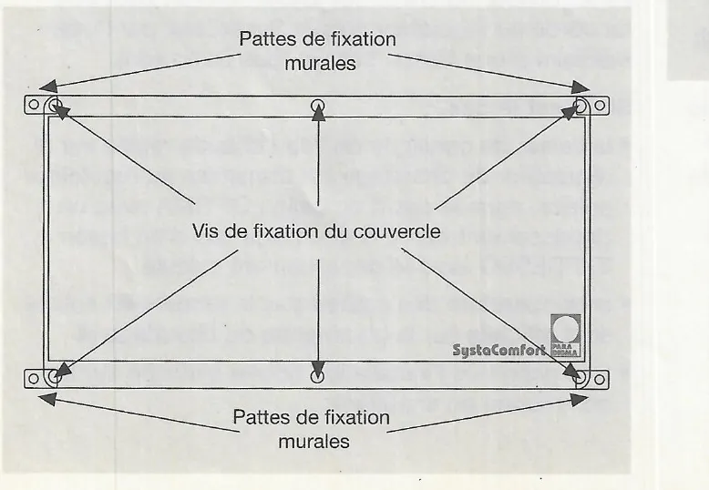
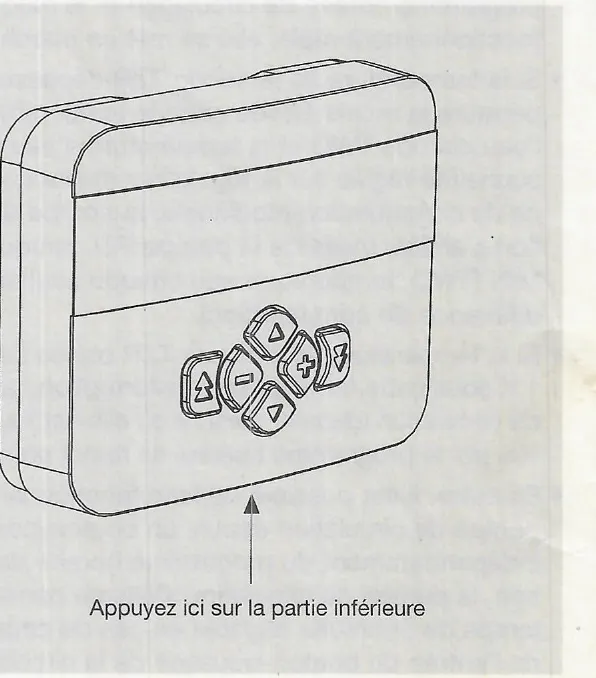
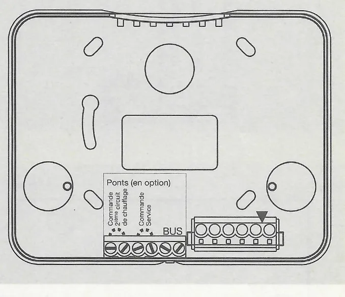
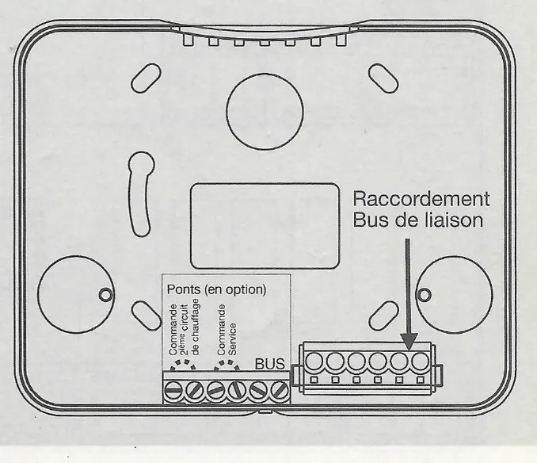
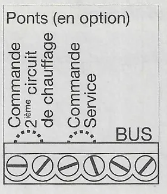
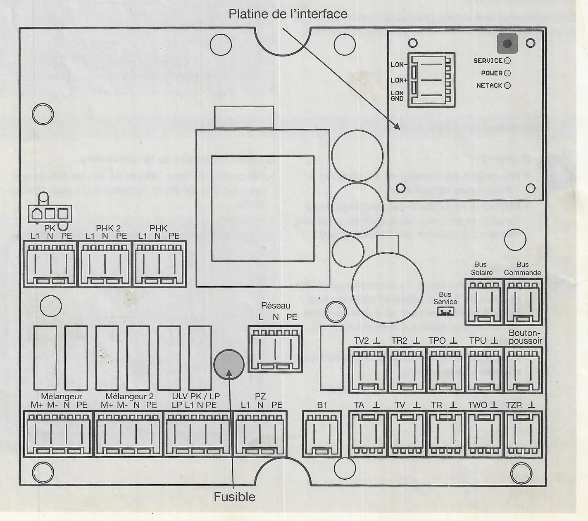
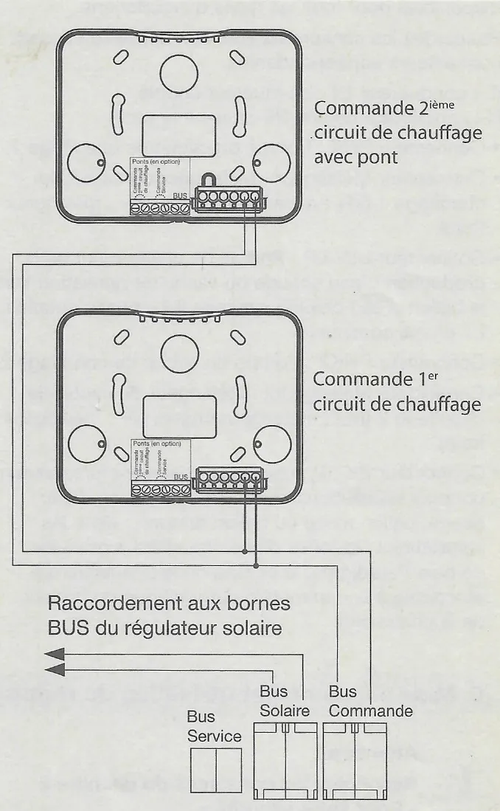

# Montage et raccordement électrique du SystaComfort

## 4. Montage

Avec les chaudières gaz à condensation ou à granulés de bois Paradigma, le régulateur de chauffage SystaComfort est livré prémonté dans la chaudière.

Vous ne devez monter le régulateur dans le coffret mural comme décrit ci-dessous qu'avec une chaudière gaz ou fioul à un niveau.

!!! warning "Attention"
    - Montez le régulateur de chauffage SystaComfort dans le coffret mural et la commande exclusivement dans des intérieurs secs.
    - Assurez-vous qu'aucun liquide n'est susceptible de goutter sur le coffret du régulateur ou sur la commande.

<small>Source : THF1777 p. 12</small>

### 4.1 Outils nécessaires

Les outils suivants seront nécessaires au montage du régulateur de chauffage SystaComfort dans le coffret mural :

- Niveau à bulle
- Perceuse
- Mèche à pierre Ø 5 mm
- Tournevis cruciforme

<small>Source : THF1777 p. 12</small>

### 4.2 Montage du régulateur de chauffage SystaComfort dans le coffret mural

Pour monter le régulateur de chauffage SystaComfort dans le coffret mural, procédez comme suit :

- Montez les pattes de fixation murales fournies au dos du coffret mural.
- Positionnez le coffret mural horizontalement contre le mur.
- Marquez les points de fixation des pattes du coffret mural sur le mur.
- Percez les quatre trous de 5 mm de diamètre et montez les chevilles fournies.
- Fixez le coffret mural au mur à l'aide des vis fournies.
- Desserrez les six vis de fixation du couvercle du coffret mural et retirez-le.

- Pattes de fixation murales (4, aux angles)
- Vis de fixation du couvercle (6)

<small>Source : THF1777 p. 12</small>

### 4.3 Montage de la commande

- Dans le cas d'un régulateur de chauffage SystaComfort intégré à la chaudière, la commande a déjà été installée au préalable dans la chaudière. Vous avez cependant également la possibilité de la monter sur demande dans la pièce d'habitation.
- Si le régulateur est situé dans le coffret mural, la commande doit être montée près du coffret mural ou dans la pièce d'habitation.

<small>Source : THF1777 p. 12</small>

#### 4.3.1 Démontage de la commande dans la chaudière

Si la commande doit être montée dans la pièce d'habitation, procédez comme suit :

- Retirez la partie supérieure de la commande. Pour ce faire, appuyez légèrement sur la partie inférieure de la commande (en bas) et soulevez la partie supérieure vers l'avant.
- Desserrez les deux vis des bornes de raccordement et débranchez le câble de raccordement.
- Retirez la commande qui est fixée à la chaudière par deux aimants.
- Ouvrez l'habillage de la chaudière et retirez le câble de raccordement de la commande branché sur la platine du régulateur.

- Flèche : « Appuyez ici sur la partie inférieure »

<small>Source : THF1777 p. 12</small>

#### 4.3.2 Montage de la commande dans la pièce d'habitation

Si la température ambiante mesurée par la commande doit servir pour des fonctions de régulation (optimisation de la courbe caractéristique de chauffage, influence de la pièce ou circuit de chauffage régulé en fonction de température ambiante), les directives suivantes pour le lieu de montage de la commande doivent impérativement être respectées :

- La température de la pièce dans laquelle la commande est montée doit être représentative de celle de tout l'appartement ou tout le bâtiment. Par conséquent, les cuisines, salles de bain et couloirs ne sont absolument pas appropriés.
- La pièce en question ne doit pas disposer d'autres sources de chauffage (poêle de faïence) ou de trop grandes baies vitrées exposées au sud.
- Les radiateurs de cette pièce ne doivent pas être régulés par vannes thermostatiques et les robinets des radiateurs doivent être complètement ouverts.
- Montez la commande à env. 1,5 m au-dessus du sol sur une cloison.
- La commande ne doit pas être exposée au rayonnement direct du soleil.

Si la commande est utilisée uniquement pour l'affichage et les réglages, ces directives ne sont pas obligatoires.

**Pour monter la commande au mur, procédez comme suit :**

- Retirez la partie supérieure de la commande.
- Positionnez verticalement la partie inférieure de la commande et marquez les deux points de fixation. Tenez compte du passage du câble de raccordement.
- Percez deux trous de 5 mm de diamètre et montez les chevilles fournies.
- Installez la partie inférieure de la commande sur le mur et fixez-la à l'aide des deux vis fournies.
- La partie inférieure peut également être montée dans une boîte d'encastrement.

<small>Source : THF1777 p. 13</small>

## 5. Raccordement électrique

!!! danger "Danger"
    - Respectez les consignes du chapitre 2 « Pour votre sécurité ».
    - Mettez le régulateur de chauffage hors tension et assurez-vous qu'il ne sera pas remis sous tension par inadvertance.

!!! warning "Attention"
    - Installez les câbles de raccordement des sondes de température et celle du bus de liaison séparément et à une certaine distance des câbles d'alimentation du réseau.
    - Respectez la puissance de commutation maximale des sorties.
    - Veuillez respecter les prescriptions en vigueur.

<small>Source : THF1777 p. 13</small>

### 5.1 Raccordement de la commande

- Raccordez le câble bifilaire du bus de liaison aux deux bornes de droite, la polarité n'a pas d'importance.

- Flèche : « Raccordement Bus de liaison »

<small>Source : THF1777 p. 13</small>

### 5.2 Adressage des commandes

- L'affectation des commandes aux circuits de chauffage est permise par les adresses des commandes.

Les adresses sont attribuées par des pontages à fil sur les bornes de raccordement des commandes (bornier à 6 bornes : 2 bornes « Commande 2ème circuit de chauffage », 2 bornes « Commande Service », 2 bornes « BUS ») :

| Commande | Pont |
|---|---|
| Commande du premier circuit de chauffage | pas de pont |
| Commande du deuxième circuit de chauffage | pont entre les deux bornes de gauche |
| Commande de service | pont entre les deux bornes du milieu |

!!! warning "Attention"
    Contrôlez l'adressage des commandes. Si deux commandes possédant la même adresse (mêmes ponts) sont raccordées au bus, cela peut entraîner des pannes de la communication entre le régulateur de chauffage et les commandes.

<small>Source : THF1777 p. 14</small>

### 5.3 Raccordement du régulateur de chauffage

Ouvrez ou retirez l'habillage de la chaudière (voir la documentation de la chaudière) pour pouvoir accéder à la platine du régulateur ou retirez le couvercle du coffret mural.

Les sondes de température, les pompes, les mélangeurs et la vanne de dérivation sont raccordées au régulateur de chauffage par des bornes à vis. Les câbles de raccordement doivent être fixés à la décharge de traction de la chaudière ou aux raccords à vis à filet pour tubes blindés du coffret mural.

L'illustration suivante représente la platine du régulateur de chauffage :

| Bornier | Bornes | Emplacement |
|---|---|---|
| PK | L1 N PE | rangée supérieure gauche |
| PHK 2 | L1 N PE | rangée supérieure gauche |
| PHK | L1 N PE | rangée supérieure gauche |
| Mélangeur | M+ M- N PE | rangée inférieure |
| Mélangeur 2 | M+ M- N PE | rangée inférieure |
| ULV PK / LP | LP L1 N PE | rangée inférieure |
| PZ | L1 N PE | rangée inférieure |
| Réseau | L N PE | centre |
| B1 | (2 bornes) | rangée inférieure |
| TA, TV, TR, TWO, TZR | ⊥ (sondes) | rangée inférieure droite |
| TV2, TR2, TPO, TPU, Bouton-poussoir | ⊥ (sondes) | rangée médiane droite |
| Bus Solaire, Bus Commande | (2 bornes chacun) | droite |
| Bus Service | prise | droite |
| Platine de l'interface | LON-, LON+, LON GND ; LED SERVICE, POWER, NETACK | en haut à droite |
| Fusible | — | près du bornier Réseau |

<small>Source : THF1777 p. 14</small>

Raccordez le régulateur de chauffage SystaComfort dans l'ordre des chapitres suivants.

### 5.4 Raccordement des sondes de température

Toutes les sondes indiquées ici ne sont pas disponibles pour tous les types d'installations.

Raccordez les sondes de températures aux bornes suivantes sans tenir compte de la polarité (toutes les sondes sont de type NTC 5 K) :

| Borne | Sonde |
|---|---|
| TA | Montez la sonde extérieure TA si possible du côté nord ou nord-ouest du bâtiment ; elle ne doit pas être exposée directement au soleil. |
| TV | Sonde TV de température de départ du circuit de chauffage, montée au niveau du départ du (premier) circuit de chauffage. Si vous l'utilisez comme sonde de contact, veillez à bien l'isoler ! |
| TR | Sonde TR de température de retour du circuit de chauffage, montée au niveau du retour du (premier) circuit de chauffage. Si vous l'utilisez comme sonde de contact, veillez à bien l'isoler ! |
| TV2 | Sonde TV2 de température de départ du 2e circuit de chauffage, montée au niveau du départ du deuxième circuit de chauffage. Si vous l'utilisez comme sonde de contact, veillez à bien l'isoler ! |
| TR2 | Sonde TR2 de température de retour du 2ème circuit de chauffage, montée au niveau du retour du deuxième circuit de chauffage. Si vous l'utilisez comme sonde de contact, veillez à bien l'isoler ! |
| TWO | Sonde TWO de la partie supérieure de l'eau chaude, montée dans le ballon d'eau chaude sanitaire ou dans la partie supérieure du ballon OPTIMA, EXPRESSO ou TITAN. |
| TPO | Sonde TPO de la partie supérieure du tampon, montée dans la partie intermédiaire du ballon OPTIMA, EXPRESSO ou TITAN ou en haut dans le ballon tampon, à hauteur du raccordement de l'aller du circuit de chauffage. |
| TPU | Sonde TPU de la partie inférieure du tampon, montée dans la partie intermédiaire du ballon OPTIMA, EXPRESSO ou TITAN ou en bas dans le ballon tampon, à hauteur du raccordement du retour de la chaudière. |
| TZR | Sonde TZR de température de retour de la circulation, montée au niveau du retour du conduit de circulation env. 1 m avant le ballon. |
| Bouton-poussoir de la circulation | Bouton-poussoir libre de potentiel pour l'activation de la pompe de circulation. |

Vous trouverez la position exacte des sondes sur le schéma hydraulique et de câblage fourni.

<small>Source : THF1777 p. 15</small>

### 5.5 Raccordement du bus de liaison à la commande ou au régulateur solaire

- Commande 2ème circuit de chauffage avec pont
- Commande 1er circuit de chauffage
- Raccordement aux bornes BUS du régulateur solaire (depuis Bus Solaire)
- Bornes du régulateur : Bus Service, Bus Solaire, Bus Commande

La commande et le régulateur solaire SystaSolar optionnel sont raccordés par un bus de liaison bifilaire.

Raccordez à l'aide d'un câble bifilaire la commande à la borne Bus Commande. La polarité n'a pas d'importance.

S'il existe une commande propre au deuxième circuit de chauffage, vous pouvez également la raccorder à ces deux bornes du régulateur de chauffage ou la brancher depuis la liaison à la première commande à l'emplacement de votre choix.

!!! warning "Attention"
    Tenez compte de l'adressage de commandes (voir chapitre 5.2).

Raccordez les bornes de bus du régulateur solaire aux bornes Bus Solaire du régulateur de chauffage. La polarité n'a pas d'importance.

!!! warning "Attention"
    La longueur totale du câble du bus de liaison ne doit pas dépasser 30 m !

<small>Source : THF1777 p. 15</small>

### 5.6 Raccordement des consommateurs

Tous les consommateurs présentés ici ne sont pas disponibles pour tous les types d'installations.

Raccordez les consommateurs aux bornes à vis des connecteurs correspondants.

(L : conducteur, L1 : conducteur couplé, N : conducteur neutre, PE : mise à la terre)

| Connecteur | Consommateur |
|---|---|
| PHK | Pompe du circuit de chauffage 1 |
| Mélangeur | Mélangeur du circuit de chauffage 1 (M+ : mélangeur chaud, M- : mélangeur froid) |
| ULV/LP | Pompe de chargement de la production d'eau chaude ou vanne de dérivation vers le ballon d'eau chaude sanitaire (L1 : phase couplée, L : phase continue) |
| PHK2 | Pompe du circuit de chauffage 2 |
| Mélangeur2 | Mélangeur du circuit de chauffage 2 (M+ : mélangeur chaud, M- : mélangeur froid) |
| PK | Pompe de la chaudière (uniquement pour les installations équipées d'un ballon d'eau douce, ballon mixte ou ballon tampon ; dans les installations équipées d'une chaudière à granulés de bois Paradigma, la pompe de la chaudière est raccordée à la commande automatique du brûleur de la chaudière) |
| PZ | Pompe de circulation |
| B1 | Contact libre de potentiel pour la commande d'une chaudière gaz ou fioul à un niveau |

!!! warning "Attention"
    La puissance maximale connectée est de 230 V / 1 A par raccordement, la puissance connectée totale ne devant pas dépasser 230 V / 3 A.

<small>Source : THF1777 p. 16</small>

### 5.7 Raccordement de la tension de réseau

Raccordez la tension de réseau (230 V, 50 Hz) aux bornes à vis du connecteur Réseau :

- Borne L : conducteur, Borne N : conducteur neutre, Borne PE : mise à la terre
- La valeur connectée maximale pour le raccordement au réseau est de 230 V / 3 A.

<small>Source : THF1777 p. 16</small>

### 5.8 Fusible

Le fusible du régulateur et les sorties se trouvent sur la platine du régulateur près des bornes de raccordement au réseau (fusible miniature T 3,15 A, 250 V).

<small>Source : THF1777 p. 16</small>
