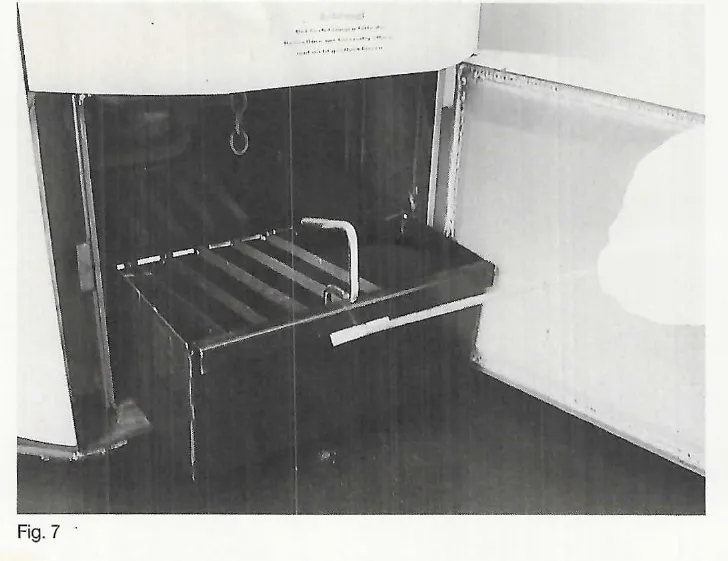
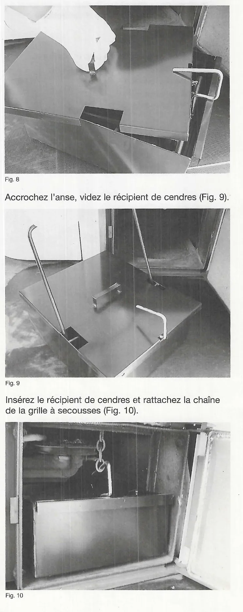

# Fonctionnement au quotidien

## 5. Fonctionnement de la chaudière à granulés de bois

### 5.1 Première mise en service par le technicien spécialisé

La première mise en service de la chaudière et l'adaptation de la commande
au système d'alimentation en granulés (réglage des paramètres de
l'installation) ne doivent être réalisées que par un technicien
spécialisé. Afin d'assurer une réalisation sans accrocs des prestations
fournies à raison de garantie pour vices, répertoriez avec l'installateur
spécialisé la mise en service et les travaux d'entretien dans les
procès-verbaux respectifs.

<small>Source : THF1848 p. 11</small>

### 5.2 Présentation par le technicien spécialisé

Assurez-vous de recevoir du technicien spécialisé les instructions pour
l'utilisation de la chaudière, ainsi que les instructions ou documents
accompagnant le produit.

!!! warning "Attention"
    Vous devez être informé en particulier des points suivants :

    - procédure de mise en marche et à l'arrêt du brûleur à la livraison
      des granulés de bois ;
    - procédure de décendrage (à effectuer régulièrement) ;
    - en cas de panne, vous devez faire venir un technicien spécialisé sans
      délai.

<small>Source : THF1848 p. 11</small>

### 5.3 Fonctionnement normal

Une fois la chaudière mise en service de façon conforme par le technicien
spécialisé, aucune manipulation de l'utilisateur n'est nécessaire hormis un
décendrage régulier. L'installation fonctionne automatiquement.

!!! note "Remarque"
    Le passage de l'heure d'été à l'heure d'hiver est automatique avec la
    chaudière Pelletti.

<small>Source : THF1848 p. 11</small>

### 5.4 Fonctionnement en cas d'absence prolongée

Pendant les vacances ou en cas d'absence prolongée, la chaudière reste en
mode automatique, aucune mesure préventive supplémentaire n'est nécessaire.

!!! note "Remarque"
    En cas d'absence prolongée, veillez à ce qu'une personne formée à cet
    effet procède au décendrage si nécessaire.

<small>Source : THF1848 p. 11</small>

### 5.5 Comportement en cas de panne de courant

Aucune mesure spéciale ne doit être prise en cas de panne de courant. Après
une panne de courant, la chaudière repasse automatiquement au mode de
fonctionnement normal. Le module de commande est équipé d'une réserve de
marche. Si la panne de courant dure plus de 24 h, il convient toutefois de
contrôler l'heure et la date.

<small>Source : THF1848 p. 11</small>

### 5.6 Comportement en cas de pannes

Les pannes sont signalées par le message « Alarme » sur l'écran du module
de commande. Dans ce cas, contactez immédiatement votre chauffagiste.

<small>Source : THF1848 p. 11</small>

### 5.7 Mise hors service de la chaudière à granulés de bois

Seul le technicien spécialisé est autorisé à mettre la chaudière à granulés
de bois hors service.

<small>Source : THF1848 p. 11</small>

### 4.8 Décendrage

!!! danger "Danger"
    Risque de brûlure ! Portez des gants de protection.

- Contrôlez et videz régulièrement le récipient de cendres.
- Stockez les cendres chaudes dans un récipient intermédiaire non
  inflammable.
- Les cendres de bois constituent un engrais de haute qualité pour votre
  jardin.

!!! note "Remarque"
    Apparition de bruits de courte durée pendant le nettoyage automatique.

Dans le réservoir de cendres se trouve une grille à secousses qui compresse
les cendres de façon mécanique par soulèvement et retombée au moment du
nettoyage automatique (réglage par défaut 12 h 00).

Procédure :

1. Tapez prudemment contre le tube-foyer avec le racloir à cendres pour que
   les cendres volantes se détachent et tombent dans le récipient de
   cendres.
2. Détachez la chaîne de la grille à secousses. Tirez le récipient de
   cendres avec le racloir à cendres (Fig. 7).
3. Placez le couvercle sur le récipient de cendres. Maintenez la porte du
   foyer fermée pendant le décendrage (Fig. 8).
4. Accrochez l'anse, videz le récipient de cendres (Fig. 9).
5. Insérez le récipient de cendres et rattachez la chaîne de la grille à
   secousses (Fig. 10).

<small>Source : THF1848 p. 10</small>
