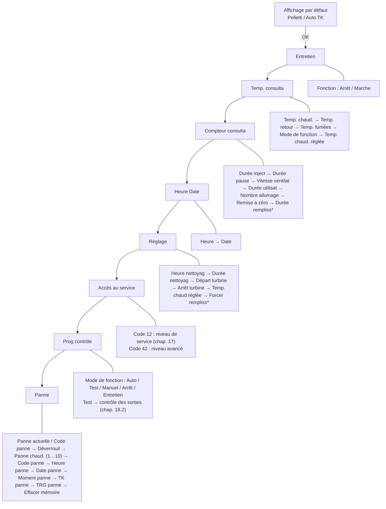

# Module de commande de la chaudière

!!! note "Notation des touches"
    Le manuel représente les touches du module de commande par des pictogrammes. Notation utilisée ici : **OK** = niveau de menu inférieur, **ESC** = niveau de menu supérieur, **▼ / ▲** = se déplacer dans un menu, **− / +** = modifier les valeurs.

## 10. Module de commande

Le module de commande de la chaudière Pelletti II permet de consulter et, si
nécessaire, modifier toutes les données de fonctionnement de la chaudière à
granulés de bois (fig. 82).

- Cela permet au ramoneur d'effectuer une mise en service simple pour la
  mesure des émissions prévue par la loi.
- Le module de commande permet au chauffagiste d'effectuer un diagnostic de
  l'installation et de régler les paramètres essentiels afin de garantir un
  fonctionnement respectueux de l'environnement avec des émissions faibles.
- Une panne identifiée sur la chaudière à granulés de bois sera affichée à
  l'écran.

L'écran affiche le mode de fonctionnement actuel, les informations de service
et permet la modification des paramètres. La commande s'effectue par des
menus via 6 touches :

| Touche | Fonction |
|---|---|
| OK | Passer au niveau de menu inférieur |
| ESC | Passer au niveau de menu supérieur |
| ▼ / ▲ | Se déplacer dans un menu |
| − / + | Modifier les valeurs |

!!! note "Remarque"
    Les valeurs modifiables sont signalées à l'écran par une flèche
    `▶ ---- ◀`.

<small>Source : THF1849 p. 41</small>

## 11. Commande

### 11.1 Structure des menus

- Passez de l'affichage par défaut au menu principal à l'aide de la touche
  **OK**.
- Les touches **▼** ou **▲** permettent de se déplacer dans le menu
  principal. Pour sélectionner un sous-menu, appuyez sur la touche **OK**.
  Pour revenir à l'affichage par défaut, appuyez (1×) sur la touche **ESC**.
- Sélectionnez les options de sous-menu (réglages) à l'aide des touches
  **▼** ou **▲**. Changez les valeurs avec les touches **−** ou **+**. Pour
  revenir à l'affichage par défaut, appuyez (2×) sur la touche **ESC**. Le
  retour à l'affichage par défaut se produit automatiquement si vous
  n'actionnez aucune touche pendant plus de 30 minutes.

<small>Source : THF1849 p. 41</small>

### 11.2 Affichage par défaut

L'affichage par défaut indique le type de module (`Pelletti`), le mode de
fonctionnement réglé (`Auto`) et la température de la chaudière (`TK`,
ex. 65 °C).

Si une panne est détectée, le texte « Alarme » apparaît dans la partie
inférieure de l'affichage. Le sous-menu Panne permet de consulter le code de
panne de la chaudière.

<small>Source : THF1849 p. 41</small>

### 11.3 Aperçu des menus principaux

| Menu principal | Fonction |
|---|---|
| Entretien | Activation de la fonction Entretien |
| Temp. consulta | Consultation des températures : affichage des températures et du mode de fonctionnement actuel |
| Compteur consulta | Consultation des compteurs : durées d'alimentation et de pause des granulés de bois, vitesse du ventilateur, heures de fonctionnement et démarrages du brûleur |
| Heure Date | Réglage de l'heure et de la date |
| Réglage | Paramètres de l'installation : réglages spécifiques à l'installation, tels que les heures d'activation de la turbine d'aspiration ou la température de consigne de la chaudière |
| Accès au service | Niveau de réglage réservé au technicien spécialisé ; accès aux paramètres de réglage relatifs à la qualité de combustion (**réservé au technicien spécialisé !**) |
| Prog contrôle | Programme de contrôle : réglage des modes de fonctionnement Auto, Test, Manuel et Arrêt |
| Panne | Dernier menu principal : en cas de panne, consultation du code correspondant |

<small>Source : THF1849 p. 41-42</small>

### 11.4 Appel d'un sous-menu

Pour accéder au sous-menu de votre choix, déplacez-vous avec la touche **▼**
ou **▲** dans le menu principal jusqu'au sous-menu souhaité. Pour passer au
sous-menu sélectionné, appuyez sur la touche **OK**.

Exemple (Consultation des températures) : le menu principal est sélectionné
lorsque les flèches noires dans la première ligne à droite et à gauche sont
affichées (`▶Temp. consulta◀`).

<small>Source : THF1849 p. 42</small>

### 11.5 Retour au menu principal

La touche **ESC** (appuyez 2×) permet de revenir d'un sous-menu dans le menu
principal, puis dans l'affichage par défaut. Cela se produit automatiquement
si vous n'actionnez aucune touche pendant plus de 30 minutes.

<small>Source : THF1849 p. 42</small>

## 12. Fonction Entretien

### 12.1 Activation de la fonction Entretien

1. Passez de l'affichage par défaut au menu principal à l'aide de la touche
   **OK**.
2. Appelez le sous-menu Entretien à l'aide de la touche **OK**.
3. Utilisez la touche **+** pour régler `Fonction` sur « Marche ».

Lorsque la fonction Entretien est activée, la chaudière est commandée à une
puissance de 100 % pendant 45 minutes jusqu'à ce que la température de 85 °C
soit atteinte. Lorsque la chaudière atteint une température de 85 °C, les
pompes de la chaudière et du circuit de chauffage sont activées pour le
transport de la chaleur.

<small>Source : THF1849 p. 42</small>

### 12.2 Désactivation de la fonction Entretien

Utilisez la touche **−** pour la régler sur « Arrêt ». Après 45 minutes, la
fonction Entretien prend fin automatiquement.

<small>Source : THF1849 p. 42</small>

## 13. Consultation des températures mesurées

### 13.1 Consultation des températures

Vous pouvez consulter les températures mesurées dans le menu principal
`Temp. consulta`.

1. Passez de l'affichage par défaut au menu principal à l'aide de la touche
   **OK**.
2. Sélectionnez ensuite le sous-menu `Temp. consulta` avec la touche **▼**.
3. Utilisez la touche **OK** pour appeler le sous-menu.

| Affichage | Contenu |
|---|---|
| Temp. chaud. (ex. 69.0 °C) | Température actuelle de la chaudière (TK) |
| Temp. retour (ex. 42.4 °C) | Température de retour (TKR, en option). Si aucune sonde TKR n'est raccordée, des traits « --- » s'affichent |
| Temp. fumées (ex. 155 °C) | Température des gaz de fumée (TRG) |

On passe d'une option à la suivante avec la touche **▼**.

<small>Source : THF1849 p. 43</small>

### 13.2 Affichage du mode de fonctionnement actuel

La touche **▼** permet d'accéder à l'option de menu suivante (`Mode de
fonction`) qui affiche le mode de fonctionnement actuel :

| Mode de fonction | Signification |
|---|---|
| Pause | Il n'y a pas de demande de chaleur. |
| Allumage | Une demande de chaleur est présente et la température actuelle de la chaudière est sensiblement inférieure à la température de consigne. La procédure d'allumage est déclenchée. |
| Départ | L'allumage a réussi. La quantité de granulés de bois amenés augmente progressivement. |
| Montée | La chaudière fonctionne à une puissance de 100 % jusqu'à atteindre sa température de consigne actuelle. Une fois la température de consigne atteinte, la puissance est régulée automatiquement pour maintenir la chaudière à cette température. |
| Eteind | La chaudière passe au mode « Eteind » lorsqu'il n'y a plus de demande de chaleur ou que la temp. maximale de la chaudière est atteinte. |
| Suffist | La température actuelle de la chaudière est supérieure à la température de consigne demandée. La chaudière délivre encore suffisamment de chaleur. |
| Bloqué | La chaudière n'accepte aucune demande de chaleur (par exemple, blocage par le boîtier de raccordement intérieur lors de la livraison de granulés de bois ou par un autre producteur de chaleur). |
| Panne | La chaudière s'est mise à l'arrêt parce qu'elle a rencontré une panne. Le sous-menu Panne permet de consulter la panne de la chaudière. |

!!! note "Remarque"
    La chaudière à granulés de bois possède une température seuil de 65 °C
    minimum en fonctionnement normal.

<small>Source : THF1849 p. 43</small>

### 13.3 Affichage de la valeur de consigne de la chaudière

La touche **▼** permet d'accéder à l'option de menu suivante, `Temp. chaud.
réglée` (ex. 44.9 °C) : affichage de la température de consigne de la
chaudière actuellement demandée.

Cette température n'est affichée que lorsqu'une demande de chaleur est
également présente. Dans le cas contraire, la valeur affichée est 0.0 °C.

!!! note "Remarque"
    La chaudière à granulés de bois possède une température seuil de 65 °C
    minimum en fonctionnement normal. La température effective de la
    chaudière peut être en réalité plus élevée que la température de
    consigne affichée ici. En mode manuel ou par une demande externe, la
    température de consigne la plus faible possible est de 65 °C.

<small>Source : THF1849 p. 43</small>

## 14. Mode de lecture

### 14.1 Consultation des compteurs

Les durées d'alimentation en granulés de bois et de pause, la vitesse du
ventilateur, les heures de fonctionnement et les démarrages du brûleur sont
affichés ici. **Uniquement pour les systèmes d'aspiration** : ce menu affiche
en plus le temps restant jusqu'au prochain remplissage.

1. Passez de l'affichage par défaut au menu principal à l'aide de la touche
   **OK**.
2. Sélectionnez ensuite le menu principal `Compteur consulta` avec la touche
   **▼**.
3. Utilisez la touche **OK** pour appeler le sous-menu, puis **▼** pour
   passer d'une option à la suivante.

| Option | Exemple | Description |
|---|---|---|
| Durée inject° | 8.0 s | Durée d'injection actuelle : pendant combien de secondes les granulés de bois sont injectés. Varie selon la puissance actuelle de la chaudière. |
| Durée pause | 9.0 s | Intervalle de temps entre les alimentations, pendant lequel aucun granulé n'est injecté. Varie selon la puissance actuelle de la chaudière. |
| Vitesse ventilat | 2050 U/m | Vitesse du ventilateur du brûleur en tours par minute. |
| Durée utilisat | 234 h | Durée d'utilisation de la chaudière (en heures) depuis le dernier effacement du compteur. |
| Nombre allumage | 69 | Nombre de démarrages de la chaudière (allumages) depuis le dernier effacement du compteur. |
| Remise à zéro | Non | Demande si les compteurs doivent être remis à zéro (durée et allumages). |

<small>Source : THF1849 p. 44</small>

### 14.2 Effacement des compteurs

Si vous souhaitez réellement effacer les compteurs, réglez l'option `Remise à
zéro` sur « Oui » avec la touche **+**. La durée d'utilisation et le nombre
d'allumages de la chaudière sont effacés.

<small>Source : THF1849 p. 44</small>

### 14.3 Moment du prochain remplissage

!!! note "Remarque"
    L'affichage suivant est actif uniquement avec un système d'aspiration.

La touche **▼** permet d'accéder à l'affichage suivant, `Durée rempliss`
(ex. 112 min) : le temps restant du moteur d'injection avant le prochain
remplissage.

<small>Source : THF1849 p. 44</small>

## 15. Réglage de l'heure et de la date

Ce sous-menu permet de régler l'heure et la date. L'heure et la date sont
mises en mémoire tampon pour env. une journée, c'est-à-dire que ces données
sont conservées en mémoire pendant cette période même en cas de coupure de la
tension d'alimentation.

1. Passez de l'affichage par défaut au menu principal à l'aide de la touche
   **OK**.
2. Sélectionnez ensuite le menu principal `Heure Date` avec la touche **▼**.
3. Utilisez la touche **OK** pour appeler le sous-menu.
4. La première option `Heure` (ex. 12:00) permet de modifier l'heure avec les
   touches **−** ou **+**.
5. La touche **▼** permet de passer à la dernière option, `Date`
   (ex. 01.01.05), réglée également avec **−** ou **+**.

<small>Source : THF1849 p. 44</small>

## 16. Paramètres de l'installation

### 16.1 Réglage des paramètres de la chaudière

Le réglage des paramètres de la chaudière s'effectue dans le menu principal
`Réglage` : depuis l'affichage par défaut, **OK**, puis **▼** jusqu'à
`Réglage`, puis **OK** pour accéder au sous-menu. Les options se suivent avec
**▼** et se modifient avec **−** / **+**.

| Option | Exemple | Description |
|---|---|---|
| Heure nettoyag | 12:00 | Heure à laquelle un nettoyage automatique de l'échangeur de chaleur et une compression des cendres ont lieu. |
| Durée nettoyag | 3 min | Durée de marche du moteur de nettoyage lors du nettoyage automatique de l'échangeur de chaleur à l'heure choisie. |
| Départ turbine | 06:00 | Début du remplissage automatique du récipient de stockage. |
| Arrêt turbine | 22:00 | Fin du remplissage automatique du récipient de stockage. |
| Temp. chaud réglée | 65.0 °C | Température prédéfinie comme valeur de consigne pour la chaudière par commande manuelle ou par une régulation d'une autre marque. Avec les demandes de chaleur via un bus LON, ce réglage n'est pas actif : la valeur de consigne est alors calculée par le régulateur de chauffage Paradigma et reprise directement en tant que température de consigne. |

!!! note "Remarque"
    La chaudière à granulés de bois doit afficher une durée de marche d'au
    moins 300 minutes avant que le prochain nettoyage automatique soit lancé
    à l'heure réglée.

!!! note "Remarque"
    Apparition de bruits de courte durée due à la tension des spirales lors
    de la compression des cendres.

!!! note "Remarque"
    La température de consigne minimale de la chaudière est de 65 °C.

<small>Source : THF1849 p. 45</small>

### 16.2 Remplissage manuel du récipient de stockage

!!! note "Remarque"
    L'affichage suivant est actif uniquement avec un système d'aspiration.

**Activation du remplissage forcé** : la touche **▼** permet d'accéder à
l'option `Forcer rempliss`. Utilisez la touche **+** pour la régler sur
« Oui ». Le récipient de stockage se remplit jusqu'à ce que la sonde de
niveau de remplissage indique qu'il est « plein » ou que les granulés
touchent la sonde.

**Désactivation du remplissage forcé** : utilisez la touche **−** pour régler
l'option sur « Non ». La procédure de remplissage est interrompue.

!!! note "Remarque"
    Cette fonction est disponible uniquement lorsqu'aucune demande de chaleur
    n'est présente au niveau de la chaudière.

<small>Source : THF1849 p. 45</small>

## 21. Aperçu des commandes

Affichage par défaut : `Pelletti` / `Auto TK 65°C` (ou `Pelletti` / `Alarme`
en cas de panne). **OK** mène au menu principal, **▼ / ▲** parcourent les
menus principaux, **OK** entre dans un sous-menu, **ESC** remonte.

\* Affichage uniquement avec un système d'aspiration.

Exemple d'affichage 1 : affichages lorsqu'il n'y a pas de panne
(`Panne actuelle` = « --- »). Exemple d'affichage 2 : affichage après
l'apparition d'une panne et son enregistrement (`Code panne` = 18).

!!! note "Remarque"
    Les valeurs modifiables sont signalées à l'écran par une flèche
    `▶ ---- ◀`. Les touches − et + permettent de modifier les valeurs.

<small>Source : THF1849 p. 56-57</small>
